# BÁO CÁO TRIỂN KHAI SLAM 3D \(SIM version\)

Quá trình xây dựng, khó khăn và hướng xử lý trên robot RB \(giai đoạn mô phỏng\)

# Tóm tắt

Mục tiêu của dự án là giúp robot RB, một robot hai bánh\-chân tự cân bằng, dựng được **bản đồ bề mặt 3D trong nhà** chỉ từ một camera màu và một cảm biến khoảng cách ToF 8×8 giá rẻ\. Khó khăn gốc rễ là ToF chỉ cho **64 vùng đo mỗi khung**, quá thưa để dựng bề mặt, còn camera cho ảnh dày nhưng không cho khoảng cách\.

Ý tưởng triển khai: dùng mạng học sâu **DELTAR** để "phóng" 64 vùng đo ToF thành ảnh độ sâu dày dựa trên ảnh màu, rồi dùng lại chính ToF để **neo và kiểm tra** kết quả\. Ảnh màu \+ độ sâu \(RGB\-D\) đi vào **cuVSLAM**, kết hợp với **odometry bánh \+ IMU** để biết robot đang ở đâu\. Cuối cùng các ảnh độ sâu được tích lũy theo vị trí vào khối **TSDF** để trích ra mesh 3D\.

- Toàn luồng đã chạy khép kín trong mô phỏng vật lý: robot tự đứng dậy, cân bằng, đi tuyến quét khoảng 96 m có 66 điểm dừng lia đầu, trong khi suy luận độ sâu, định vị và dựng mesh chạy song song trên GPU\.

- Bản đồ tốt nhất \(12/11/2026\) dựng từ **3\.198 khung**, voxel 4 cm\. Trong khung đo, khoảng **83% diện tích sàn có mesh**, sai số cao độ sàn RMSE khoảng **1,8 cm**\.

- Phát hiện quan trọng nhất: sai số mặt sàn đến chủ yếu từ **độ sâu** \(khoảng 2,6 cm\), không phải từ **định vị**         \(khoảng 0,17 cm\)\. Ưu tiên tiếp theo vì vậy là chất lượng độ sâu\.

- Nguyên tắc xuyên suốt: không "làm đẹp" bản đồ bằng cách ép phẳng hay tự vá\. Vùng chưa đo được để trống để bản đồ trung thực với dữ liệu\.

# Bối cảnh và nguyên tắc

## 2\.1\. Robot và cảm biến

Khác với robot bánh xe thông thường, RB **luôn dao động** để giữ thăng bằng, và camera cùng ToF gắn trên **đầu quay được**\. Vị trí camera vì vậy thay đổi liên tục so với thân, và bài toán định vị phải tính đến điều này\.

## 2\.2\. Môi trường mô phỏng

Toàn bộ thử nghiệm chạy trong mô phỏng vật lý MuJoCo\. Bộ điều khiển cân bằng là chính firmware sẽ chạy trên robot\. Cảnh chính là phòng khách của một căn nhà nhỏ có sofa chữ L, bàn trà, cầu thang và các vách ngăn\. Thời gian mô phỏng chạy nhanh gấp 5 lần để rút ngắn mỗi lượt quét\.

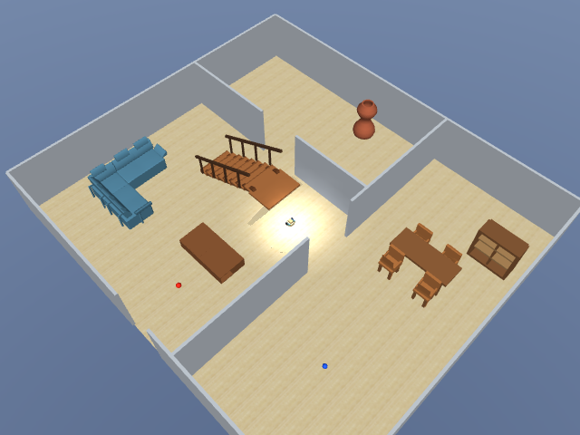

***Hình 1\. ****Cảnh nhà mô phỏng\. Phòng khách \(sofa xanh, bàn trà, cầu thang\) là khu vực quét chính\.*

## 2\.3\. Quy trình SIM

- Bản đồ chỉ được dựng từ số đo cảm biến\. Không lấy hình học tường, sàn hay đồ vật từ mô hình 3D của cảnh\.

- "Đáp án" của mô phỏng \(vị trí thật, độ sâu thật\) chỉ được dùng sau cùng để chấm điểm, không bao giờ         đưa vào bản đồ\.

- Vùng chưa đo là vùng chưa biết, không tự lấp bằng giả thiết\.

- ROS/RViz chỉ dùng để hiển thị\. Điều khiển, suy luận và dựng bản đồ chạy độc lập\.

Lý do của các nguyên tắc này: kết quả trong mô phỏng phải phản ánh đúng những gì robot thật làm được\. Một bản đồ đẹp nhờ "nhìn trộm" đáp án sẽ không có giá trị khi chuyển sang phần cứng\.

# Luồng hoạt động và ý tưởng triển khai

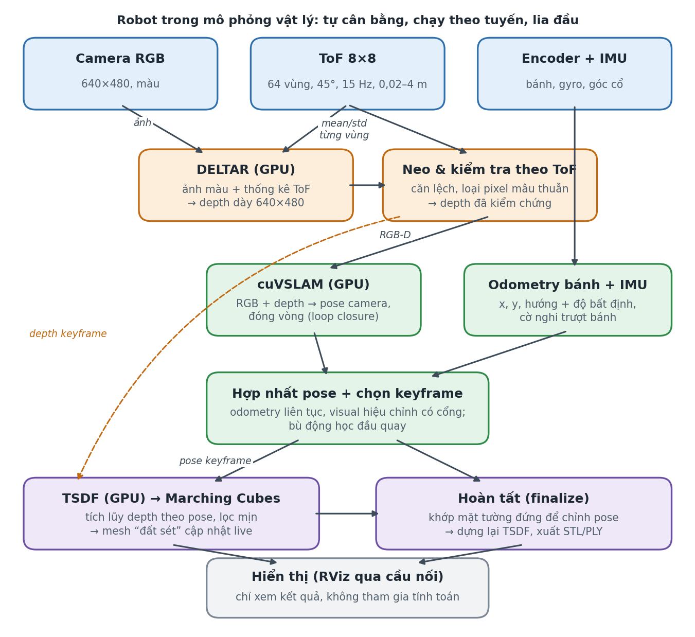

***Hình 2\. ****Luồng xử lý tổng thể: cảm biến → độ sâu → định vị → bề mặt 3D\.*

Hệ thống gồm **bốn tiến trình chạy song song**: suy luận độ sâu, định vị, dựng mesh và hiển thị\. Mỗi khối có thể khởi động lại riêng, và toàn bộ có thể **chạy lại offline** từ dữ liệu đã ghi \(replay\) để so sánh thay đổi trên cùng một đầu vào\.

## 3\.1\. Đầu vào và đầu ra của từng khối

## 3\.2\. Từ 64 vùng đo thành ảnh độ sâu: DELTAR

ToF 8×8 không trả về 64 điểm ảnh\. Mỗi vùng phủ khoảng 5,6° × 5,6° và chỉ cho **một phân bố khoảng cách** \(giá trị trung bình và độ trải\)\. **DELTAR** \(ZJU, ECCV 2022\) được thiết kế đúng cho loại cảm biến này: mạng dùng transformer ghép đặc trưng ảnh màu với phân bố ToF của từng vùng, rồi suy ra độ sâu cho từng pixel\. Hiện dự án dùng bộ trọng số huấn luyện sẵn trên NYU \(ảnh thật trong nhà\) và **chưa huấn luyện lại** cho ảnh mô phỏng\.

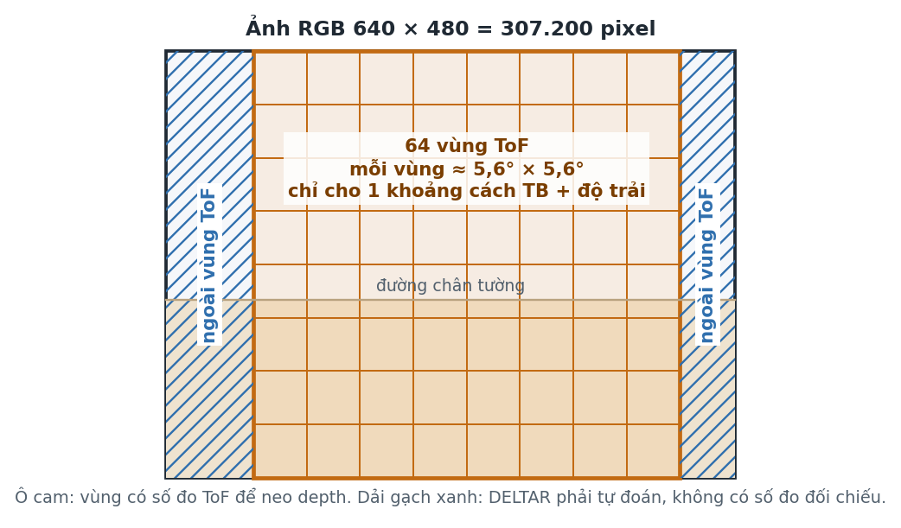

***Hình 3\. ****Minh họa vùng phủ ToF trên ảnh RGB\. Hai dải biên ảnh không có số đo ToF để đối chiếu\.*

Đầu ra của DELTAR là **dự đoán**, không phải phép đo\. Vì vậy phải có bước kiểm tra lại theo ToF trước khi dùng\.

## 3\.3\. Neo và kiểm tra độ sâu theo ToF \(bước "fusion"\)

1. **Căn lệch:** trong từng vùng ToF, so sánh độ sâu trung bình của dự đoán với số đo thật để tính độ lệch, làm mượt độ lệch giữa các vùng rồi bù vào ảnh\. Bước này sửa các sai lệch tỷ lệ hoặc offset cục bộ của mạng\.

2. **Kiểm tra nhất quán:** chiếu từng điểm 3D về **đúng** vùng ToF chứa nó\. Nếu điểm lệch quá dung sai \(8–15 cm,  tùy độ trải của vùng\) thì bỏ\. Vùng gần che vùng xa: điểm nằm sau một bề mặt gần đã đo thì không được         chấp nhận\.

3. **Vùng nhìn xiên:** khi một vùng ToF nhìn sàn ở xa, khoảng cách bên trong vùng trải rộng\. Thay vì đòi mọi         pixel gần giá trị trung bình, hệ thống kiểm tra **cả phân bố**: nếu dự đoán là một mặt nghiêng liên tục và có trung bình cùng độ trải khớp với ToF thì giữ lại\.

Bước này chỉ **chỉnh hoặc loại** pixel, không bao giờ tự sinh độ sâu mới\.

## 3\.4\. Định vị: ba nguồn bổ trợ nhau

- **Odometry bánh \+ gyro:** cân hai nguồn theo độ tin cậy\. Khi bánh và gyro báo quay khác nhau, hệ thống gắn cờ nghi trượt\. Nguồn này liên tục nhưng trôi dần theo thời gian\.

- **cuVSLAM \(NVIDIA, chạy GPU\):** theo dõi đặc trưng ảnh kết hợp độ sâu, có khả năng nhận ra chỗ đã đi qua để sửa trôi\. Thời gian xử lý khoảng 2–4 ms/khung\.

- **Hợp nhất:** odometry là "xương sống" liên tục' cuVSLAM chỉ hiệu chỉnh khi bước nhảy hợp lý \(dưới 0,5 m và 20°\)\. Với giả thiết sàn ngang, chiều cao và độ nghiêng lấy từ động học chân \+ IMU, còn visual chỉ sửa  x, y và hướng\. Vị trí camera so với thân được tính lại theo góc cổ tại từng thời điểm\.

- **Chọn keyframe:** chỉ lưu khung khi camera đi được ít nhất 5cm hoặc quay ít nhất khoảng 4,6°, để robot đứng yên không làm phình dữ liệu\. Tối đa 4\.096 keyframe mỗi phiên\.

## 3\.5\. Dựng bề mặt bằng TSDF

Không gian được chia thành các khối voxel 4 cm\. Mỗi ảnh độ sâu "bỏ phiếu" khoảng cách có dấu từ voxel tới bề mặt \(dương ở phía trước, âm ở phía sau\)\. Lấy trung bình nhiều phiếu, bề mặt nằm ở chỗ đổi dấu, và thuật toán Marching Cubes trích ra lưới tam giác\. Một ô chỉ được dựng khi **cả 8 đỉnh** đều được ít nhất 3 khung quan sát\. Sau đó mesh được làm mịn \(Gaussian, Taubin\) và loại các mảnh nhỏ hơn 0,01 m²\.

## 3\.6\. Hoàn tất: khớp bề mặt tường

Tường đứng là mốc ổn định nhất trong phòng\. Khi kết thúc quét, với mỗi khung, hệ thống lấy các điểm trên mặt gần thẳng đứng và khớp chúng \(point\-to\-plane\) vào phần tường đã có trong bản đồ, rồi chỉnh x, y, hướng\. Mức chỉnh có giới hạn và luôn bị "kéo" về phía odometry\. Nếu khung chỉ thấy một bức tường \(không đủ ràng buộc\) thì không chỉnh\. Sau đó TSDF được dựng lại từ đầu với pose mới\.

## 3\.7\. Tuyến quét

Tuyến gồm 184 điểm, khoảng **96 m**: robot đi theo chu vi phòng rồi theo các dải song song\. Ở **66 điểm dừng**, robot lia đầu một vòng với bước 8° và chỉ lia tiếp khi khung ở góc hiện tại **đã được xử lý xong**, vì GPU không theo kịp mọi khung khi mô phỏng chạy ×5\. Tuyến này được lập sẵn từ cảnh nên **chưa phải tự khám phá**\.

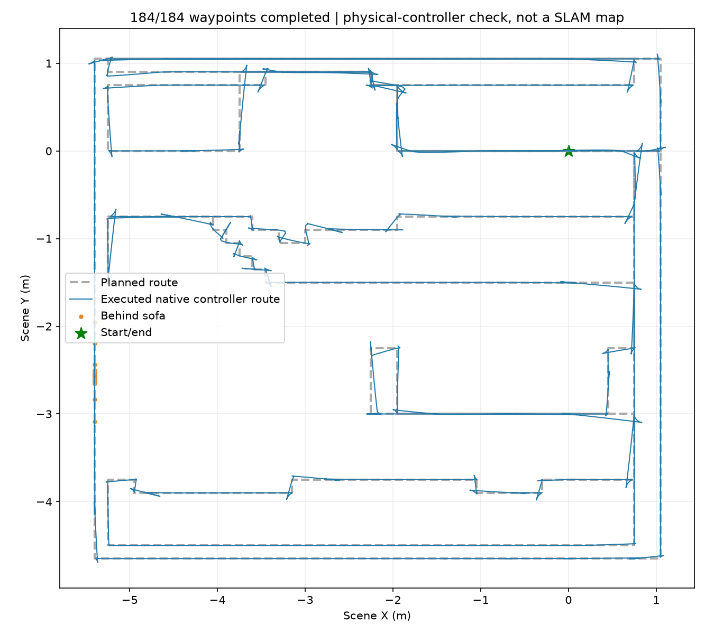

***Hình 4\. ****Tuyến quét phòng khách: nét đứt là tuyến lập sẵn, nét liền là quỹ đạo thật của robot khi tự cân bằng \(184/184 điểm\)\.*

# Kết quả: bản đồ tốt nhất

***Hình 5\. ****Bản đồ 3D tốt nhất \(phiên 12/11/2026, mesh cuối\): 3\.198 khung, voxel 4 cm, không ép phẳng, không tự vá\.*

Bản đồ này dùng 912 khung từ lượt quét chính và **2\.286 khung bổ sung** lấy từ các lượt lia đầu đã ghi\. Pose của các khung bổ sung được truyền từ pose ước lượng cộng chuyển động đo bằng odometry và góc cổ, không dùng vị trí thật của mô phỏng\.

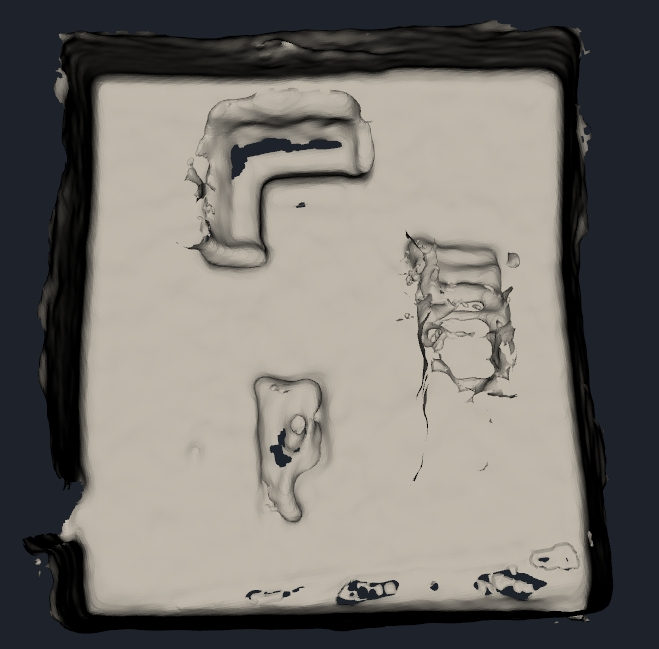

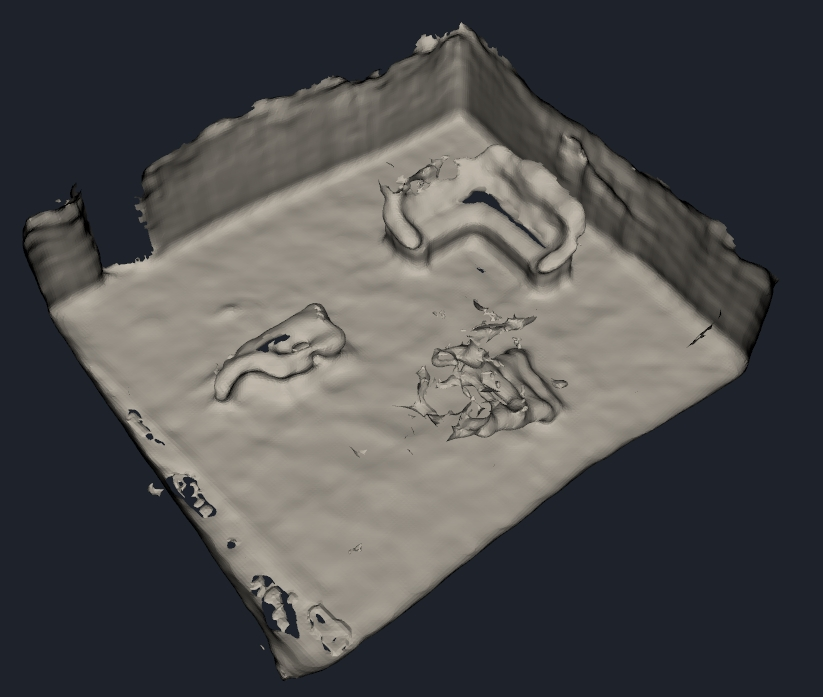

*Tỷ lệ "có mesh" được đo trong một khung chữ nhật quanh phòng\. Đây không phải phần trăm sàn thật đã quét, vì khung vẫn tính cả chỗ đồ vật che\. Các số liệu là kết quả chạy lại offline trên dữ liệu đã ghi, chưa phải một lượt quét trực tiếp mới\.*

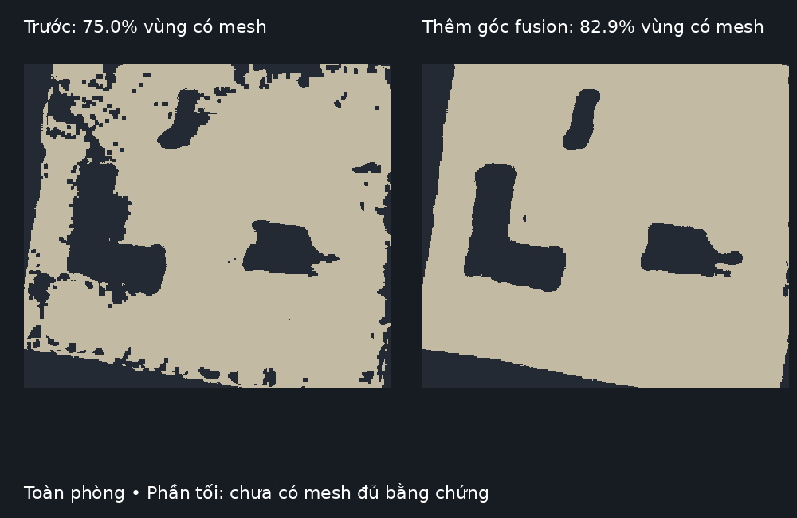

***Hình 6\. ****Mặt sàn nhìn từ trên xuống: trước và sau khi bổ sung góc nhìn\. Màu tối là chỗ chưa có mesh đủ bằng chứng \(gồm cả vị trí sofa, bàn\)\.*

# Khó khăn và nguyên nhân

## 5\.1\. Sàn rỗ và lồi lõm

Để biết lỗi đến từ đâu, nhóm tách riêng hai nguồn ở vùng sàn sát tường phải \(khoảng 199\.000 pixel sàn trên 32 khung\): lần lượt thay độ sâu bằng giá trị thật và thay pose bằng giá trị thật \(chỉ dùng trong bước chấm điểm\)\. Kết quả rất rõ: **lỗi độ sâu lớn hơn lỗi định vị khoảng 15 lần**\.

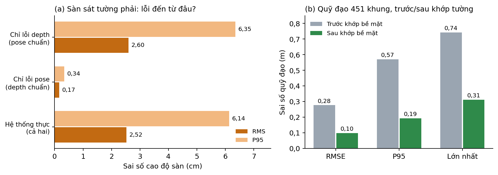

***Hình 7\. ****\(a\) Phân rã sai số cao độ sàn: lỗi chủ yếu đến từ độ sâu\. \(b\) Khớp bề mặt tường giảm mạnh sai số quỹ đạo\.*

1. **Độ sâu DELTAR là suy đoán và bị lệch miền dữ liệu\.** Mạng học trên ảnh thật \(NYU\), còn ảnh mô         phỏng có texture và ánh sáng khác\. Sàn gỗ lặp lại, ít đặc trưng, nên độ sâu dự đoán dao động\. Trong phép         thử ngắn, sai số độ sâu thô trước khi lọc khoảng 0,58 m và chỉ khoảng 30% pixel qua được bước kiểm tra\.

2. **ToF quá thô\.** Mỗi vùng khoảng 5,6° chỉ cho một giá trị trung bình\. Vùng nhìn trộn sàn với chân tường hay         chân sofa có giá trị trung bình bị kéo lệch\. Bước căn lệch theo từng vùng vì vậy để lại "gợn sóng" theo lưới 8×8 dù đã làm mượt\.

3. **Sàn nhìn xiên\.** Một vùng ToF nhìn sàn ở xa chứa dải khoảng cách rộng\. Bộ lọc ban đầu đòi mọi pixel gần giá trị trung bình nên loại nhầm nhiều pixel sàn, gây rỗ lấm tấm\.

4. **Tư thế camera khi lia đầu\.** Trước khi sửa, góc nghiêng chưa được lấy mốc đúng và pose còn bị "nắn"         theo mặt phẳng ước lượng từ từng ảnh\. Kết quả là sàn bị cong dạng phễu quanh điểm lia đầu, sai số P95         tới 8 cm \(Hình 8\)\.

5. **Bước làm mượt TSDF ăn mất bề mặt\.** Khi nhìn xiên, phía trước bề mặt có rất nhiều quan sát còn         phía sau chỉ có một lớp mỏng\. Phép làm mượt xóa mất lớp mỏng này nên chỗ đổi dấu biến mất, và Marching Cubes không dựng được bề mặt\. Có điểm lỗ thực tế đã được 7–25 khung đo\.

6. **Cộng dồn sai số nhiều góc nhìn\.** Cùng một chỗ sàn được nhìn từ nhiều vị trí, mỗi lần sai một kiểu\. TSDF lấy trung bình nên bề mặt cuối là "trung bình các sai số", gây lượn sóng vài cm\.

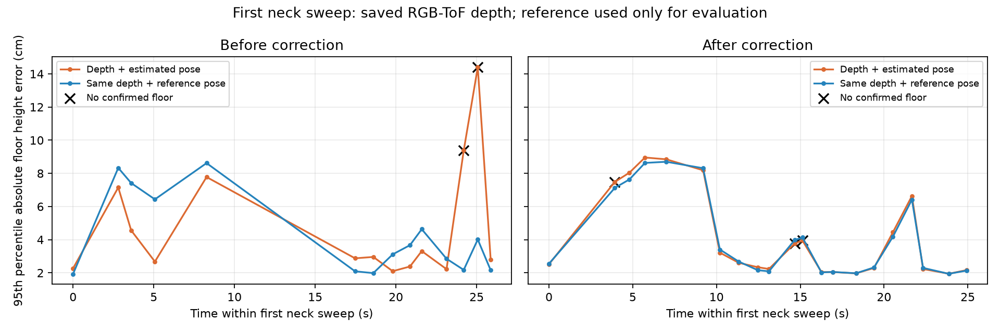

***Hình 8\. ****Sai số cao độ sàn trong lượt lia đầu đầu tiên, trước và sau khi sửa cách lấy tư thế camera\.*

## 5\.2\. Tường méo, lệch và điểm xuyên tường

1. **Trôi vị trí \(drift\)\.** Odometry bánh tích lũy sai hướng\. Ở một phiên trước khi có bước khớp tường, phần      lớn hiệu chỉnh visual bị cổng an toàn từ chối, nên bản đồ gần như chỉ dựa vào odometry: sai số quỹ đạo  RMSE 0,28 m, lớn nhất 0,74 m\. Cùng một bức tường quét ở hai thời điểm không còn trùng nhau, khiến tường bị dày, cong hoặc tách thành hai lớp\.

2. **Độ sâu sai ở tường và mép vật\.** DELTAR có xu         hướng đoán sâu hơn tường thật: khoảng 36\.500 trên 1,9 triệu pixel tường lệch quá 8 cm, có pixel lệch tới 1,42m\. Bộ lọc cũ gộp các vùng ToF chồng lấn và có dung sai không chặn trên, nên điểm "sau tường" vẫn được giữ\.

3. **Thị sai giữa camera và ToF\.** Hai cảm biến đặt lệch nhau khoảng 2 cm và quay lệch 4°\. Ở mép vật thể, cái         camera thấy và cái ToF đo không phải cùng một bề mặt\.

4. **Làm mượt bo tròn góc** tường và mép bàn\. Ngoài ra, giả thiết sàn ngang khiến visual không sửa được chiều cao và độ nghiêng, nên hệ thống chưa dùng được cho dốc hoặc bậc\.

## 5\.3\. Vì sao chưa phủ kín bản đồ

1. **Ngoài vùng ToF:** ToF hẹp hơn camera nên hai dải biên ảnh không có số đo đối chiếu và bị loại \(Hình 3\)\.         Trong phép thử, khoảng **22,6% pixel sàn** nằm ngoài vùng ToF\.

2. **Che khuất vật lý:** gầm và sau sofa, gầm bàn, sau chân bàn\. Camera của RB đặt thấp nên không thấy mặt         trên hoặc phía sau nhiều đồ vật\.

3. **Thiếu góc nhìn:** tuyến cố định chưa đi hết sát tường, nên vùng biên chỉ được nhìn rất xiên và ít lần\.

4. **Ngưỡng bằng chứng:** một ô chỉ được dựng khi cả 8 đỉnh có ít nhất 3 quan sát\. Bộ lọc độ sâu cũng nghiêm, chỉ giữ khoảng 30–65% pixel tùy phép thử\.

5. **Thông lượng xử lý:** mô phỏng ×5 chạy nhanh hơn khả năng GPU \(riêng kiểm tra độ sâu khoảng 100–125 ms/khung, chưa kể DELTAR và TSDF\) nên phải bỏ bớt khung\. Mỗi phiên cũng bị giới hạn 4\.096 keyframe\.

6. **Chủ trương không tự vá:** các lỗ còn lại phản ánh đúng vùng chưa biết, không bị che bằng mặt phẳng giả\.

## 5\.4\. Khó khăn hệ thống

- Đồng bộ ảnh, ToF và odometry trong 20 ms, trong khi robot luôn dao động để cân bằng và đầu quay liên tục\.

- DELTAR và cuVSLAM cần các môi trường Python/CUDA khác nhau, nên phải tách thành tiến trình riêng trao đổi qua file\.

- Các khối cùng tranh chấp một GPU\. Mỗi lượt quét dài \(khoảng 8–11 phút thực tế\) nên vòng lặp thử–sửa chậm, và phải dựa nhiều vào replay offline\.

# Phương pháp xử lý

## 6\.1\. Các thay đổi đã giữ lại

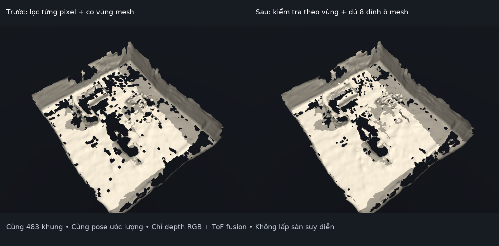

***Hình 9\. ****Cùng 483 khung và cùng pose: trước \(trái\) và sau \(phải\) khi đổi cách kiểm tra theo vùng ToF và cách dựng ô mesh\.*

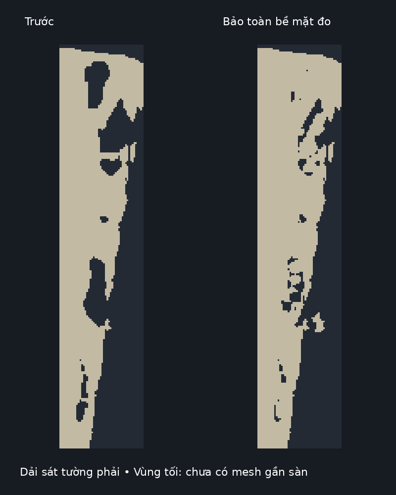

***Hình 10\. ****Dải sàn sát tường phải trước và sau khi bảo toàn bề mặt bị bước làm mượt xóa\. Màu tối là chưa có mesh\.*

## 6\.2\. Các hướng đã thử và loại bỏ

Bài học rút ra: một thay đổi chỉ được giữ khi **cải thiện số đo khách quan**\. Nhóm không đánh đổi độ chính xác lấy vẻ ngoài đầy đủ của bản đồ\.

# Hướng phát triển tiếp theo

- **Nâng chất lượng độ sâu \(nguyên nhân chính\):** huấn luyện thêm DELTAR trên dữ liệu mô phỏng và dữ liệu robot thật, tận dụng tốt hơn độ trải của ToF, và ước lượng độ tin cậy cho từng pixel\.

- **Hợp nhất độ sâu theo thời gian và nhiều góc nhìn** có trọng số \(theo góc nhìn, khoảng cách, độ tin cậy\) và     có bảo vệ che khuất trước khi đưa vào TSDF\.

- **Tối ưu toàn cục:** đưa encoder/IMU vào cùng đồ thị pose với cuVSLAM, tận dụng loop closure, và dùng ràng buộc mặt phẳng tường/sàn có bằng chứng làm ràng buộc tối ưu thay vì ép hình học\.

- **Khám phá chủ động:** chọn góc nhìn tiếp theo hướng vào vùng còn trống \(next\-best\-view\) thay cho tuyến cố định\.

- **TáI tạo nâng cao:** tham khảo neural SDF và các hệ ToF\-SLAM  tối ưu cảnh chung\.

- **Tiến tới phần cứng:** mô phỏng ToF sát thực hơn \(histogram, vật liệu, phản xạ nhiều đường, nhiễu\); hiệu chuẩn camera–ToF, IMU và encoder trên robot thật; đo  riêng ba nhóm chỉ số là lỗi định vị, độ phủ và lỗi tái tạo\.

# Kết luận

Dự án đã chứng minh được một luồng SLAM 3D hoàn chỉnh chỉ với camera màu và ToF 8×8 trên robot tự cân bằng trong mô phỏng: từ cảm biến, qua DELTAR, kiểm tra theo ToF, cuVSLAM kết hợp odometry, tới mesh TSDF\. Bản đồ tốt nhất phủ khoảng 83% sàn trong khung đo với sai số cao độ khoảng 1,8 cm, và đạt được mà không ép phẳng hay tự vá\. Phân tích định lượng cho thấy giới hạn hiện tại nằm ở **độ sâu suy đoán** và **góc nhìn**, không phải ở định vị\. Đây là cơ sở để chọn hướng đầu tư tiếp theo trước khi chuyển sang robot thật\.

