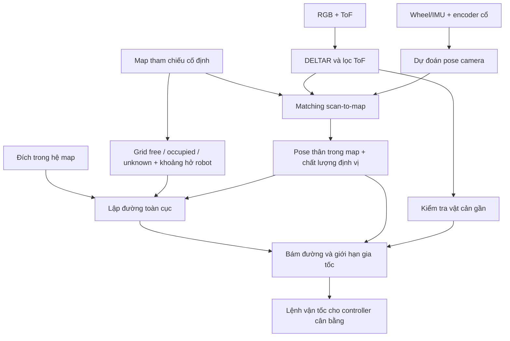

# Localization và navigation trên bản đồ đã quét

Trạng thái 13/11/2026: đây là thiết kế triển khai cho giai đoạn tiếp theo,
**chưa có navigation end-to-end**. Giữ core không ROS; RViz chỉ hiển thị/nhận
tương tác, nếu bổ sung chọn pose ban đầu hoặc đích trên RViz.

## Bản đồ tham chiếu cố định

Dùng `datasets/processed/scan3d_fusion/room-floor-preserved-20261112/`:

- `final_mesh.stl`: bề mặt để hiển thị và đối chiếu.
- `live_sequence.json`: 3.198 pose camera ước lượng, đã có chỉnh surface matching.
- `keyframes/`: depth fusion và thống kê ToF; có symlink về dữ liệu nguồn.
- `inputs/`, `prediction/`, `source.json`: nguồn cảm biến/prediction và provenance.

Thư mục này **không có `cuvslam_map/` tương ứng**. Không lấy database bất kỳ từ
phiên khác rồi giả định pose nằm đúng hệ tọa độ mesh cuối. Các pose từng được
chỉnh sau quét; nếu dùng database cuVSLAM phải kiểm chứng phép nối hai hệ và
sai số còn lại, không chỉ đổi tên frame thành `map`.

Không sửa bản đồ tham chiếu trong khi localization; lưu kết quả thử nghiệm ở
phiên riêng. Tuyến quét cũ dùng `backend.view` (pose mô phỏng) và planner cũ dùng
va chạm scene. Chúng là công cụ thu thập dữ liệu, **không phải navigation bằng
pose ước lượng trên map đã quét**.

## Pipeline đích

## Mốc 1 — Localization trên map cố định

Phiên bản đầu có pose ban đầu gần đúng do người vận hành cung cấp trong hệ map;
**chưa đặt mục tiêu tự nhận vị trí từ mọi điểm bất kỳ**. Không dùng pose thật
simulator để tự cấp initial pose.

1. Dựng reference point cloud/pháp tuyến từ keyframe fusion và pose đã lưu.
2. Wheel/IMU dự đoán chuyển động; động học cổ/thân đổi camera pose sang body pose.
3. Matching scan hiện tại với reference cố định để hiệu chỉnh X/Y/yaw.
   Tái sử dụng các phép chiếu/pháp tuyến trong
   `reconstruction/surface_matching.py`, nhưng không gọi nguyên `refine_sequence`
   để biến bài toán thành dựng thêm map tuần tự.
4. Chấp nhận correction khi đủ overlap, residual tốt, đủ ràng buộc hình học và
   không nhảy quá lớn; lưu số liệu từng lần, không chỉ cờ thành công.
5. Báo `initializing`, `tracking`, `degraded`, `lost`; pose stale/lost không được
   dùng tiếp để phát lệnh navigation. Khôi phục có thể cần dừng và lia đầu.

Point-to-plane trên mặt gần đứng hiện có bỏ điểm thấp dưới 15 cm để matching.
**Không tái sử dụng mask đó cho vật cản navigation**: bóng/vật thấp vẫn phải
được xét va chạm. Giả thiết nền ngang của odometry vẫn phải được công khai.

Kiểm tra trước khi nối điều khiển: replay một phiên chuyển động mới với pose
khởi đầu cung cấp rõ; đo sai số thân theo thời gian, drift, thời gian mất định vị,
tỷ lệ correction bị loại và ảnh hưởng khi chỉ quay đầu. Dùng ground truth chỉ
ở evaluator, không ở estimator. Replay các frame đã tạo map chỉ là smoke test,
không đủ xác nhận khả năng localization trong phiên mới.

## Mốc 2 — Chuẩn bị map cho robot chạy trên sàn

Giữ mesh 3D để xem, tạo thêm grid 2D/2.5D để lập đường:

- Phân biệt `free`, `occupied`, `unknown` bằng bằng chứng quan sát/ray từ depth
  và pose đã lưu; không coi chỗ mesh thủng là đường trống.
- Xét vật cản theo thể tích robot quét qua, gồm vật thấp và vật nhô ở cao độ thân.
- Phân biệt nền có thể đi được với vật cản; không coi mọi điểm mesh là occupied.
- Nới vùng cấm theo footprint RB và khoảng dự phòng cho cân bằng/sai số pose.
- Chưa đủ bằng chứng ở đâu thì chặn lập đường ở đó trong phiên bản đầu.

Planner không đọc CAD/scene collision để biết đường trống. Mô phỏng va chạm chỉ
dùng để chấm kết quả sau đó. Cần kiểm tra các hành lang có đủ bằng chứng cho
đường đi trước khi kết luận bản scan hiện tại đủ dùng cho navigation.

## Mốc 3 — Đi tới đích

1. Nhận đích X/Y/yaw trong đúng hệ map.
2. A* trên grid đã nới vật cản; kiểm tra cả đoạn nối/làm gọn đường, không cắt góc.
3. Controller bám đường dùng pose localization, xuất vận tốc tiến và quay;
   giữ controller cân bằng hiện tại, giới hạn thay đổi vận tốc để tránh dừng giật.
4. Cảm biến hiện tại kiểm tra vật cản gần, dừng/replan khi cần. Camera/ToF nhìn
   hẹp nên không mặc định vùng ngoài FoV là an toàn để lùi hoặc quay.
5. Đến đích hoặc mất định vị phải có trạng thái rõ; lệnh dừng vận hành có ramp,
   dừng khẩn cấp vẫn theo cơ chế controller.

## Tiêu chí hoàn thành giai đoạn đầu

- Khởi động phiên mới, cung cấp initial pose và giữ định vị trong hệ map cũ.
- Đầu quay không làm pose thân quay sai theo camera.
- Chọn đích trong vùng đã biết, lập đường tránh vật cản từ dữ liệu scan.
- RB bám đường bằng pose ước lượng, không lấy `backend.view.x/y/quaternion`.
- Pose stale/lost, đích bị chặn hoặc không có đường phải dừng có lý do.
- Đo riêng độ chính xác localization, tỷ lệ đến đích, khoảng hở/va chạm và độ trễ;
  không dùng chất lượng hiển thị mesh để thay các phép đo này.

Chưa đặt con số sai số/tỷ lệ đạt trước khi có baseline của phiên mới. Chưa dùng
cuVSLAM relocalization database hoặc ROS navigation trong thiết kế đầu này.
