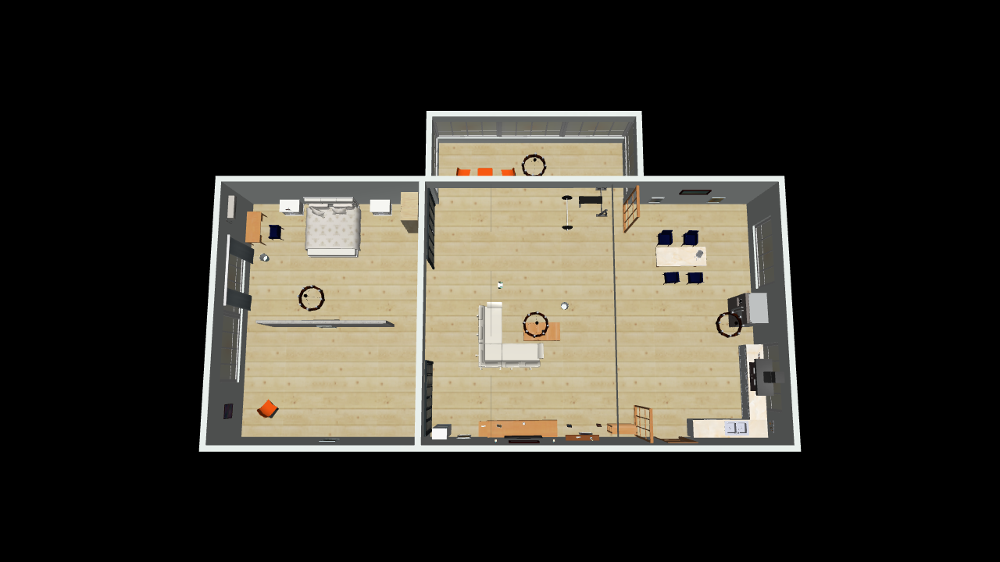

# temSlam — mô phỏng RB phục vụ SLAM

Workspace này dùng mô phỏng robot RB để phát triển và đánh giá SLAM trong điều kiện **không có ground truth ở đầu vào thuật toán**. Mặc định giữ MuJoCo và mô hình RB v1.3 đã có. Mã nguồn firmware và thuật toán điều khiển được giữ nguyên làm mã tham chiếu; chỉ đường dẫn CMake để đặt runner mô phỏng ngoài `firmware/` được cập nhật. Công việc SLAM mới đặt ngoài `firmware/`.

## Cấu trúc workspace

```text
.
├── model/                    Mô hình RB dùng chung: CAD, mesh, YAML, XML MuJoCo
├── simulation/
│   ├── mujoco/               Runner MuJoCo trên host
│   ├── scenarios/            Cảnh indoor_small_house và cấu hình thí nghiệm
│   ├── sensors/              Mô hình cảm biến và cấu hình nhiễu
│   └── assets/               Small House meshes, textures, license và nguồn
│   └── README.md             Ranh giới dữ liệu, luồng mô phỏng
├── slam/                     Mã thuật toán SLAM, tách khỏi mô phỏng và firmware
│   └── README.md
├── datasets/
│   ├── raw/                  Bag/log mô phỏng gốc
│   └── processed/            Dữ liệu đã xử lý, cache bản đồ
├── evaluation/               Công cụ đánh giá; ground truth chỉ được phép dùng ở đây
├── firmware/                 Mã firmware/bộ điều khiển hiện có, giữ riêng
├── gui/                      GUI mô phỏng hiện có
├── tools/                    Công cụ sinh mô hình và tiện ích
└── docs/                     Tài liệu kiến trúc và quy trình
```

`model/` vẫn ở gốc để tránh đổi đường dẫn các mesh/XML và công cụ sinh dữ liệu hiện tại. Runner MuJoCo đã được chuyển ra `simulation/mujoco/`; nó vẫn liên kết các thư viện controller hiện có để giữ hành vi mô phỏng. GUI và tool tìm tham số vẫn dùng đường dẫn build tương thích.

## Ranh giới ground truth

- Node SLAM chỉ nhận dữ liệu cảm biến mô phỏng, odometry đầu vào (nếu cấu hình), TF/đồng hồ và thông tin hiệu chuẩn cảm biến.
- Pose thật, quỹ đạo thật và bản đồ thật không được publish vào graph runtime mà SLAM subscribe.
- Ground truth của MuJoCo chỉ được ghi riêng để chấm sai số trong `evaluation/`; không dùng để khởi tạo, hiệu chỉnh online hoặc sửa kết quả SLAM.
- Mỗi thí nghiệm lưu seed, cấu hình cảnh/cảm biến, lệnh chạy và phiên bản mã để có thể tái lập.

## Hiện trạng và chạy mô phỏng RB

Runner nằm trong `simulation/mujoco/` và dùng `RobotController` hiện tại để điều khiển mô hình MuJoCo. GUI dùng cảnh indoor Small House mặc định; chọn model khác bằng `RB1_SIM_MODEL`. Scene hiện có mesh/texture và collision proxy, nhưng pipeline SLAM/cảm biến camera/LiDAR chưa được nối vào runner.



```bash
cmake -S firmware -B firmware/build -DCMAKE_BUILD_TYPE=Release
cmake --build firmware/build -j8 --target rb1_sim
python3 gui/sim_gui.py
```

Chạy không GUI:

```bash
firmware/build/bin/rb1_sim --model model/dynamic.xml --start-key home --run-for 26 --at 0.3:STANDUP
```

Yêu cầu chính: CMake ≥ 3.20, C++17, Python 3, MuJoCo (gồm header/thư viện), `python3-tk` cho GUI. Quy trình sinh mô hình xem [docs/simulation.md](docs/simulation.md); ranh giới module và lộ trình tích hợp SLAM xem [docs/slam_simulation_architecture.md](docs/slam_simulation_architecture.md).
