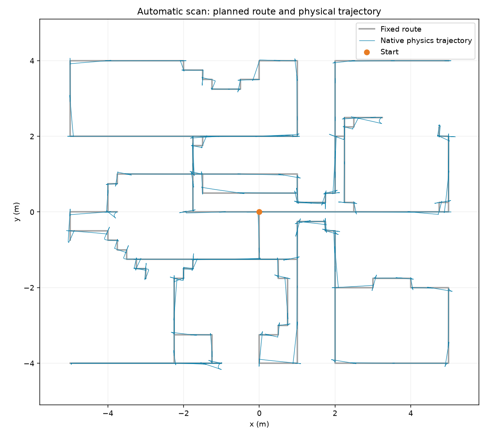

# Kiểm tra tuyến quét tự động — 2026-11-11

Nguyên nhân kẹt được tái hiện bằng native simulator riêng, không có GUI: tuyến cũ
đi vào mesh bàn cạnh sofa đã dịch vị trí. Replay ghi nhận tiếp xúc
`left_wheel_collision`/`body_1` với `env_mesh_coffee_table`. Bản cũ vẫn ở điểm 6
khi kết thúc phép thử 260 giây mô phỏng. Lỗi ghi đè lệnh tay trước đó không phải
lời giải thích đầy đủ cho lần kẹt này.

Đã nối lại tuyến theo va chạm hiện tại, chừa bán kính 0,40 m quanh đường tâm;
giữ các góc rẽ, phân bố lại điểm quét mỗi mét. Tốc độ thẳng tối đa 0,20 m/s,
giảm theo khoảng cách/góc lệch; hai ngưỡng xoay tránh đổi qua lại giữa xoay và
đi thẳng. Không phát STOP ở điểm nối không quét. Lia đầu vẫn 20°/s, hồi đầu
45°/s. Dừng có lý do sau 12 giây không tiến triển hoặc worker SLAM/inference lỗi.

## Kết quả

- Tuyến mới: **213 điểm, 125.5 m, 127 điểm quét**;
  khoảng cách theo tuyến giữa hai điểm quét tối đa 1 m.
- Native physics: **213/213 điểm**, từ home → đứng lên → cao giữa 0,14305 m →
  chạy/dừng/lắc đầu toàn tuyến; controller luôn Balancing ở các mẫu đã ghi.
- Thời gian mô phỏng: **4628.24 s**, thời gian chạy kiểm tra
  không realtime: **359.23 s**.
- Replay **21724 mẫu** (cách khoảng 0,2 s) không có tiếp xúc robot–vật
  cản ngoài mặt sàn sâu hơn 10 µm. Đây là kiểm tra theo mẫu, không chứng minh
  mọi bước vật lý giữa các mẫu đều không tiếp xúc.
- Kiểm tra tĩnh toàn tuyến bằng cylinder r=0,40 m, z=0,01–0,45 m, bước 0,05 m:
  không có đoạn bị chặn.
- Đoạn đầu tới điểm quét cách khoảng 1 m, gồm căn hướng và di chuyển:
  trước **10,50 s**, sau **7,56 s** (~28% ngắn hơn). Đây là một đoạn so sánh;
  không phải mức tăng tốc toàn tuyến vì tuyến mới phải vòng đồ đạc.
- 9 kiểm thử route/dashboard và 3 kiểm thử live IPC/keyframe/lỗi worker đạt.

[Dữ liệu physics](../datasets/processed/route_validation/20261111/physics.json)
· [Kết quả replay tiếp xúc](../datasets/processed/route_validation/20261111/contacts.json)

## Phạm vi kiểm chứng

Physics 3000 Hz, state 50 Hz, IMU unit 648; không teleport robot trong lượt chạy.
SHA256 scene: `8ee21fb486b9851cffe5f455cba50e57cf637488579fea1a036fff39091c7d4b`.
Phép thử toàn tuyến không chạy inference/tracking/mesh; phiên GPU trực tiếp
`datasets/raw/tof-20261111-151817-243111` được mở riêng, đã tự đứng lên và quét,
có keyframe và mesh cập nhật. Chưa xác nhận chất lượng SLAM toàn nhà.

Giới hạn 1000 keyframe/phiên vẫn còn. Đã bỏ việc thêm keyframe chỉ vì thời gian
trôi qua khi camera đứng yên: giữ 3 frame khởi tạo, sau đó chọn theo dịch chuyển
5 cm hoặc góc 0,08 rad. Khi worker báo lỗi hoặc hết giới hạn, robot dừng tuyến
với lý do; chưa có cơ chế bản đồ lớn vượt giới hạn này. Các kiểm tra trên không
thay thế navigation, tránh vật cản động hoặc chứng minh độ phủ cảm biến toàn nhà.
