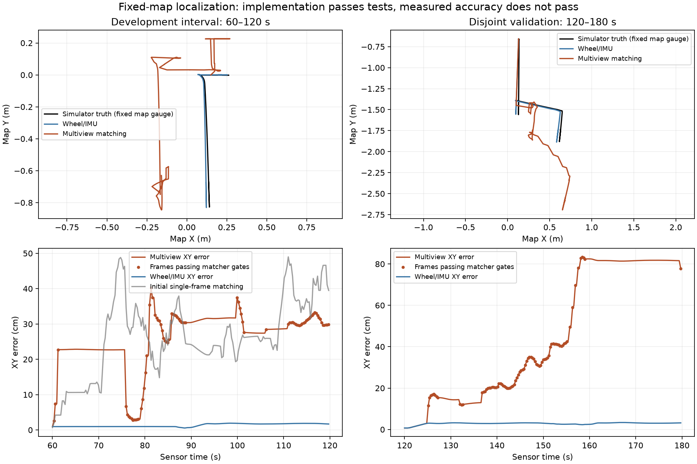

# Định vị trên map cố định — kiểm chứng 14/11/2026

**Đã có implementation và runner, nhưng chưa đạt độ tin cậy để điều khiển robot.**
Các kiểm tra mã nguồn đạt; phép đo trên phiên khác phát hiện scan matching có
thể kéo pose sai dù residual nhỏ. Không nối localizer này vào điều khiển tự hành.
`usable` trong output chỉ có nghĩa vượt gate của thuật toán prototype, không phải
chứng nhận pose chính xác. Kết quả dưới đây giữ cả thất bại và baseline odometry.

## Đã triển khai

- Reference point cloud/pháp tuyến cố định, voxel 4 cm, từ keyframe fusion và pose
  map đã lưu; không thêm dữ liệu vào map khi định vị.
- Wheel/IMU dự đoán pose thân, bù camera mount theo đầu; chỉ sửa XY/yaw, giữ Z/tilt
  theo giả thiết sàn ngang của odometry.
- Cửa sổ tối đa 16 quan sát trong 3 giây, lưu trong hệ **odom chưa hiệu chỉnh**.
  Một correction chung phải vượt overlap/residual ở từng quan sát, cùng gate hình
  học XY/yaw và giới hạn bước nhảy. Không dùng điểm cũ thay cho depth mới bị mất.
- Hai giả thuyết correction liên tiếp nhất quán mới được áp dụng; đang xác nhận
  vẫn giữ transform đã chấp nhận trước đó.
- `initializing/tracking/degraded/lost`, rejection reason và diagnostics mỗi frame.
  Runner live bổ sung thời hạn wall-clock và `stopped`, ghi log/status riêng.
- CLI replay và observer đọc buffer `rgbd.npz` hiện có; không gửi lệnh vận tốc.
- Bộ chuẩn bị RGB–ToF và bộ chấm độc lập; truth không truyền vào estimator.

## Dữ liệu và cách đối chiếu

Map: `datasets/processed/scan3d_fusion/room-floor-preserved-20261112`, 3.198 frame,
nguồn raw `tof-20261112-094256-483079`. Reference có 199.963 voxel bề mặt.

Dữ liệu thử: raw **khác phiên** `tof-20261112-090937-766548`, cùng scene phòng
khách. Render lại RGB + thống kê ToF, chạy checkpoint DELTAR và ToF support thật,
không dùng depth RGB-D ground truth hoặc pose SLAM của phiên thử làm measurement.

- Đoạn 60–120 s: 200 frame, dùng để phát hiện lỗi và phát triển kiểm tra nhiều góc nhìn.
- Đoạn 120–180 s: 200 frame không trùng đoạn trước, kiểm tra sau khi sửa thuật toán.
- Chu kỳ chọn 0,3 s; khoảng thực tế 0,265–0,335 s, lệch đồng bộ odometry tối đa 0,333 ms.
- Đoạn thứ hai có một frame depth không còn điểm hỗ trợ; giữ nguyên để chấm mất dữ liệu.
- Pose đầu được cung cấp rõ: `(0.15, 0, 0°)` và `(0.13, -0.66, -90°)`, chọn gần
  điểm đầu theo hệ map/odom của thí nghiệm. Không lấy truth để tự cấp initial pose.

Hệ map được nối với simulator **một lần từ frame đầu của phiên tạo map**:
pose camera đã lưu, mount đúng timestamp và pose thật của phiên tạo map. Xem
[ma trận và provenance](fixed_map_alignment.json). Không fit/align quỹ đạo thử
với ground truth sau khi chạy. Truth của phiên thử chỉ đọc trong evaluator.
Độ biến dạng của map sau frame đầu vẫn tính vào sai số, không bị căn lại để che đi.

## Kết quả

Sai số XY là RMSE trên **tất cả frame có pose**, kể cả degraded/lost. Baseline
wheel/IMU dùng cùng initial pose, không correction matching.

| Đoạn / phương pháp | XY RMSE | XY P95 | Yaw RMSE | Frame vượt gate |
|---|---:|---:|---:|---:|
| 60–120 s: wheel/IMU | 1,40 cm | 1,87 cm | 0,64° | Không áp dụng |
| 60–120 s: bản khớp từng frame ban đầu | 28,49 cm | 46,28 cm | 3,13° | 129/200 (64,5%) |
| 60–120 s: bản nhiều góc nhìn hiện tại | 27,20 cm | 32,89 cm | 1,31° | 80/200 (40%) |
| 120–180 s: wheel/IMU | 2,93 cm | 3,30 cm | 1,46° | Không áp dụng |
| 120–180 s: bản nhiều góc nhìn hiện tại | 54,23 cm | 81,97 cm | 6,73° | 82/200 (41%) |

Chỉ tính các frame vượt gate vẫn **không đạt**: XY RMSE của bản nhiều góc nhìn
lần lượt 27,77 cm và 36,61 cm. Không thể giải thích sai số chỉ bằng những lúc
localizer đã báo lost.



[Toàn bộ số liệu tóm tắt JSON](fixed_map_localization_results.json).
Log từng frame và dữ liệu đầu vào nằm trong các thư mục sau dưới
`datasets/processed/scan3d_fusion/` (generated data, git-ignored):

- `localization-heldout-20261114`: 200 RGB–ToF đầu, mất 126,78 s chuẩn bị.
- `localization-validation-20261114`: 200 RGB–ToF tiếp, mất 101,40 s chuẩn bị.
- `localization-baseline-20261114`: cách khớp từng frame ban đầu, giữ để đối chiếu.
- `localization-multiview-20261114`: kết quả code hiện tại trên đoạn đầu.
- `localization-validation-result-20261114`: kết quả code hiện tại trên đoạn thứ hai.

## Phát hiện và cải thiện đã kiểm tra

Ở 70,54–75 s, wheel/IMU chỉ dịch khoảng 6 mm, nhưng matcher ban đầu kéo pose thân
khoảng 42 cm khi đầu lia. Residual vẫn 11–13 mm. Đối chiếu reference cho thấy
pose lệch có thể giảm objective thật sự: ở 73,54 s, pose odometry có residual
18,1 mm/overlap 97%; pose lệch có residual 11,2 mm/overlap 90,2%.

Vì vậy đã bổ sung cửa sổ nhiều góc nhìn, veto từng view và xác nhận trước khi
commit correction. Các test hình học bắt được depth bias thay đổi theo góc đầu,
view lịch sử mâu thuẫn, mất depth, hết hạn cửa sổ và chuyển động thân thật.
Cải thiện này giảm sai số hướng/P95 ở đoạn phát triển, nhưng **không giải quyết
được sai số vị trí và không tổng quát sang đoạn kiểm tra tiếp theo**.

Thử riêng reference từ vertex/normal của `final_mesh.ply` (cùng giới hạn mặt đứng,
4 cm voxel) cho 29.445 điểm và **0/200 frame được xác nhận**. Đây là probe ngoại
tuyến, không đưa thành tùy chọn hay default trong code; không phải bằng chứng mesh
không thể dùng với thuật toán khác. Kết quả lưu ở `localization-mesh-probe-20261114`.

Bước dedup reference được gom 64 frame/lần, giữ chính xác điểm/pháp tuyến đầu tiên
trong mỗi voxel. Nạp map giảm từ 79,85 xuống 18,47 s trên máy hiện tại.
Matching nhiều góc nhìn: p50 khoảng 137 ms, p95 270/516 ms trên hai lượt. Có chạy
benchmark đồng thời; số này không phải cam kết realtime, và chưa tính inference.

Review độc lập phát hiện tuổi buffer bị đặt lại khi đọc; đã sửa giữ mtime age +
processing latency. Test live dùng subprocess và buffer cũ 1,5 s đã tái hiện lỗi
trước sửa, rồi xác nhận hết hạn đúng và `STOP` không còn pose usable.

## Chạy lại

Chuẩn bị một output mới (môi trường DELTAR hiện có):

```bash
env -u PYTHONPATH MUJOCO_GL=egl /home/dvt/.venvs/deltar/bin/python \
  evaluation/prepare_localization_replay.py \
  datasets/raw/tof-20261112-090937-766548 \
  datasets/processed/scan3d_fusion/localization-new-input \
  --start 60 --duration 60 --period .3
```

Định vị:

```bash
env -u PYTHONPATH /home/dvt/.venvs/cuvslam/bin/python \
  technology/scan3d_fusion/navigation/run_localization.py \
  --map datasets/processed/scan3d_fusion/room-floor-preserved-20261112 \
  --replay datasets/processed/scan3d_fusion/localization-new-input \
  --initial-pose .15 0 0 \
  --output datasets/processed/scan3d_fusion/localization-new-result
```

Chấm độc lập; alignment này chỉ dùng cho reference map nêu trên:

```bash
env -u PYTHONPATH /home/dvt/.venvs/cuvslam/bin/python \
  evaluation/evaluate_localization.py \
  datasets/processed/scan3d_fusion/localization-new-input \
  datasets/processed/scan3d_fusion/localization-new-result \
  --alignment evaluation/fixed_map_alignment.json \
  --output datasets/processed/scan3d_fusion/localization-new-result/evaluation.json
```

## Kiểm tra và phần còn thiếu

38 test đạt: navigation 20, odometry/attitude 4, surface matching 2, live IPC 7,
chuẩn bị replay 3, tính sai số 2. Review độc lập sau sửa không còn lỗi implementation
quan trọng được phát hiện. Không đồng nghĩa benchmark localization đã đạt.

**Mốc 1 chưa hoàn tất về chất lượng định vị.** Cần tách sai số depth theo góc nhìn
khỏi độ biến dạng của reference; kiểm tra bề mặt tham chiếu được nhiều quan sát
độc lập hỗ trợ và độ bất định trước khi tiếp tục tin correction. Việc tăng gate
hoặc chỉ giữ odometry để làm đẹp điểm số không chứng minh localization thành công.

Chưa thử phần cứng, chưa định vị toàn cục, chưa điều khiển tới đích. Hai đoạn thử
ngắn cùng môi trường mô phỏng, ToF không thêm nhiễu ngẫu nhiên, odometry tốt;
không suy rộng baseline này thành độ chính xác của robot thật.
