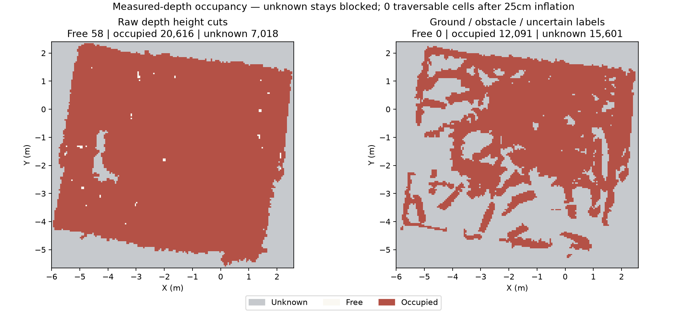
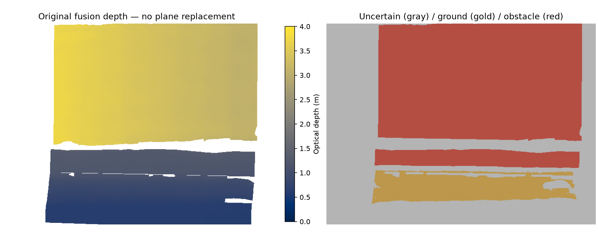
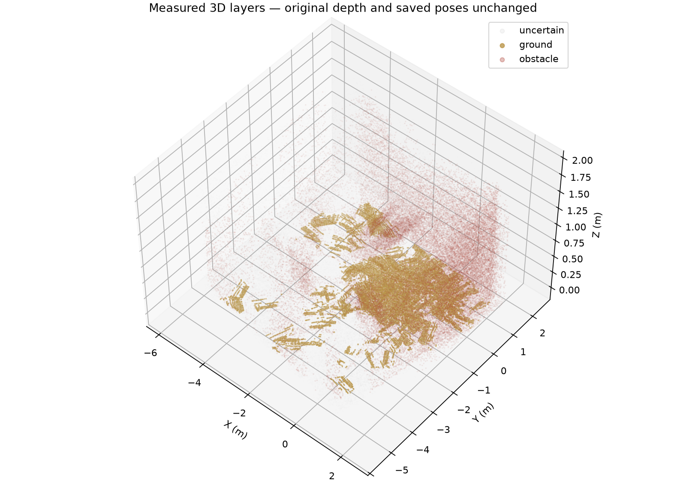

# Tách sàn sau fusion — 14/11/2026

Đã nối bộ phân loại ground/obstacle/uncertain vào inference live, lưu keyframe
và point cloud; grid navigation nhận nhãn cùng depth gốc. Depth và full mesh
tiếp tục giữ cả sàn. Vùng chưa chắc chắn chặn việc gán free.

**Chưa đạt navigation trên bản quét cũ.** Bộ phân loại hoạt động nhưng xác nhận
sàn còn ít và grid chưa có vùng đủ bằng chứng khoảng trống.

Nguồn replay là `room-floor-preserved-20261112`: 3.198 keyframe, pose wheel/IMU
với hiệu chỉnh visual có gate và planar surface matching. Không dùng pose hay mesh ground truth.
Đầu ra riêng tại `datasets/processed/scan3d_fusion/room-ground-segmented-20261114/`.

- 334/3.198 frame xác nhận mặt phẳng, khoảng 10,44%; thời gian replay 166,49 s.
- 5.831.707 pixel ground; 35.078.299 obstacle; 941.515.594 uncertain. Uncertain
  bao gồm cả pixel không có depth hợp lệ, không phải chỉ các điểm đo bị mơ hồ.
- Các lớp 3D giảm mẫu 3 cm: 18.012 điểm ground, 215.122 obstacle, 715.715 uncertain.
- Intrinsics và mọi pose/thời gian giữ nguyên. SHA-256 toàn bộ depth đầu vào và
  đầu ra cùng là `dbb3b6c338601efd6506024d22fac0c7f216be442c654bf0d75c4051a61fd551`.

| Grid 5 cm | Trước phân loại | Sau phân loại |
|---|---:|---:|
| Free | 58 | 0 |
| Occupied | 20.616 | 12.091 |
| Unknown | 7.018 | 15.601 |
| Đi được sau khoảng hở 25 cm | 0 | 0 |

Số ô occupied giảm chủ yếu chuyển sang unknown, chưa chứng minh độ chính xác
vật cản tốt hơn. Grid mới còn bảo thủ hơn: điểm mơ hồ và điểm thấp dưới sàn veto
hỗ trợ sàn cũ, còn các tia depth phải chứng minh khoảng trống ở mọi dải độ cao.
Việc thêm phân loại chưa giải quyết bias/độ phủ depth của bản quét.







Đã kiểm tra 106 test: 67 navigation, 31 reconstruction, 8 IPC. Review độc lập
đã dẫn tới regression test cho mặt kê 2 cm, vật 3 cm chiếm phần lớn ảnh kéo
nghiêng RANSAC, điểm thấp 20 cm dưới sàn, cùng bảo toàn nhãn trong voxel. Có
kiểm tra thay đổi roll/pitch, góc camera và chiều cao thân; mất depth/gap thời
gian không tạo sàn.

Smoke live trên MuJoCo thu 8 frame mới trong 34,46 s tính cả khởi động; một frame
có 11.884 pixel ground và ba lần xác nhận. Những frame còn lại giữ uncertain
khi chưa đủ điều kiện. Đây là thử startup/inference, chưa kiểm chứng độ ổn định
của cả tuyến tracking/meshing hoặc một chuyến navigation. Không gửi goal DRIVE.

Lệnh tái hiện phân loại và quy tắc grid xem
[hướng dẫn navigation](../technology/scan3d_fusion/navigation/README.md#tách-sàn-sau-fusion).
Sau khi có đầu ra cùng tên trên máy này, chạy đối chiếu bằng:

```bash
env -u PYTHONPATH OPENBLAS_NUM_THREADS=1 /home/dvt/micromamba/envs/wheel-leg-ros/bin/python \
  evaluation/evaluate_ground_segmentation.py
```

Script dựng lại grid, đối chiếu với artifact đã lưu nếu có, kiểm tra depth/pose
giữ nguyên và xuất lại ảnh/JSON. Số liệu chi tiết ở
[ground_segmentation_results.json](ground_segmentation_results.json), thử live ở
[ground_live_smoke.json](ground_live_smoke.json).

Giới hạn: giả thiết sàn phẳng đã hiệu chuẩn ở odom Z=0; nhãn ground cần độ cao
trong ±1,2 cm, plane fit dịch gốc tối đa 1 cm. Vật rất thấp còn có thể lẫn với
nhiễu depth. Xác nhận qua nhiều frame chưa bảo đảm các góc nhìn độc lập. Guard
live tiếp tục dùng depth gốc bảo thủ; chưa kiểm chứng trên RB thật. Cần cải
thiện depth và quan sát nhiều góc trước khi xác nhận đường đi trên scan này.
