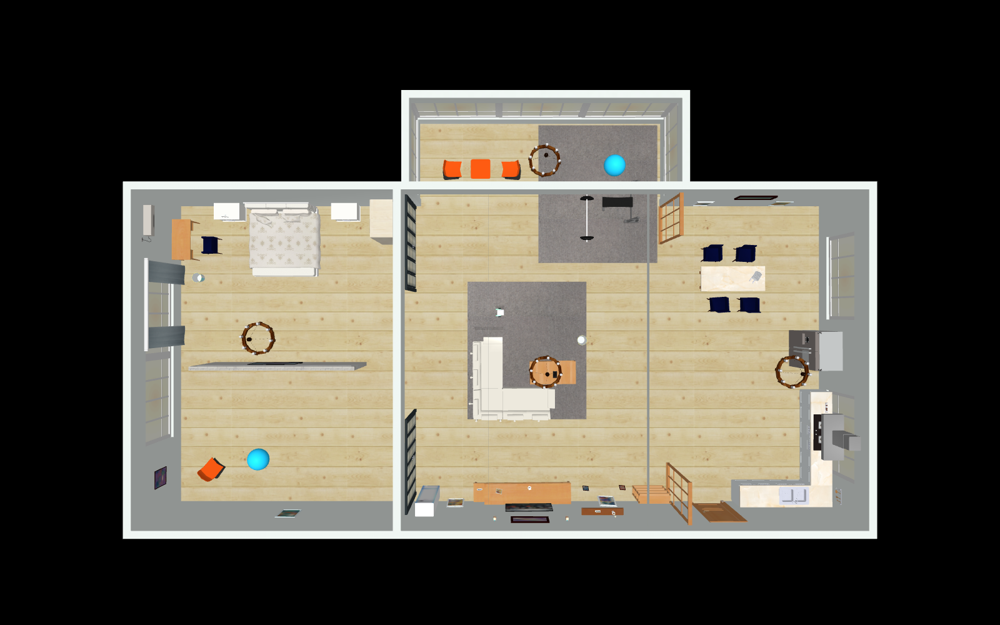

# House visibility and collision audit — 2026-11-10

The user's second collision report was reproduced by replaying the recorded drive
commands with IMU unit 648. At about 86.88 s, the robot's body contacted
`house_collision_3_0` near (−6.70, −4.36, 0.19) m. This was a source ball of
radius 0.31 m whose collision sphere was imported but whose visual sphere was
silently skipped. Both source balls now have visible cyan spheres with matching
positions and radii. The importer rejects unsupported visual geometry instead
of silently omitting it.

The broader audit also found that furniture collision meshes were submitted to
MuJoCo as whole convex hulls, filling spaces between components and concave
surfaces. The importer now welds coincident vertices, splits connected parts,
keeps closed convex parts, and represents remaining surfaces by 2 mm convex
triangular prisms. It does not fill source holes during splitting. This extends
the earlier doorway fix to furniture. Visual meshes/textures and robot
calibration were preserved.

## Verification

- Regenerated the complete source scene in a temporary directory and applied its
  house assets/geoms; visual OBJ files were byte-identical to the existing ones.
- All **87 source instances** have visual counterparts: **110 visual geoms**.
  Alpha and default geom-group visibility passed for every part in both the
  simulator/camera model and the CAD viewer model.
- All **1,602 collision mesh assets** passed a closed-convex check; they are used
  by **1,913 static collision geoms** including sphere primitives and repeated
  instances. No non-convex furniture mesh remains a single implicit convex hull.
- Both balls are hit by the same MuJoCo ray API used by ToF, at the expected
  distance. Camera rendering shows both cyan balls in the overview below.
- Three wall openings stay open; three solid wall/parapet samples still collide.
  Full robot footprints pass two doorway corridors.
- Probes at the centre below the dining table, reading desk and two chair models
  no longer collide with a filled hull. Probes touching their real surfaces
  still collide. A shelf in the coffee table remains collidable.
- A 28 s native drive through the room doorway finishes Balancing without fault;
  the original scene stopped at the false wall and fell. This run took roughly
  11 s wall time on this PC while another test ran concurrently. This is not a
  GUI frame-rate benchmark.

Run the regression with the indoor-map dependencies and MuJoCo installed:

```sh
/tmp/temslam-map-env/bin/python tools/model/test_house_collision.py
```



## Limits

The scene still uses the upstream simplified collision surfaces, not a measured
physical house. Surface prisms extend 1 mm either side of the original surface;
this audit checks visibility and geometry construction globally, plus selected
contact paths, not every possible robot pose/contact. Collision processing costs
more than the old filled hulls. These fixes do not eliminate drift/noise artifacts
in the separate ToF occupancy map, and a robot commanded into a now-visible ball
can still collide with it.
