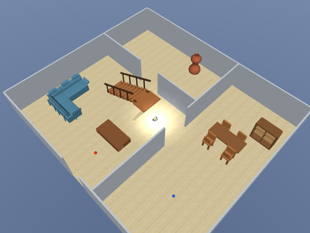

# MuJoCo + RViz trực tiếp

Khởi chạy từ root: `./run_vision.sh`. Hướng dẫn sử dụng ở
[README live](../technology/scan3d_fusion/live/README.md).

Đã thử simulator thời gian thực, MPU6500 unit 648, đứng dậy từ home, hạ 0,14 m,
di chuyển 0,08 m/s trong 4 giây sau khi tracking sẵn sàng, rồi dừng. Controller
vẫn Balancing. Dữ liệu tại `datasets/raw/tof-20261111-141356-725032`:

- Point cloud và quỹ đạo được ghi/cập nhật khi robot đang chạy.
- Cuối lượt có 73 keyframe, 5.350 điểm sau voxel filtering, sensor timestamp 65,2703 s.
- Inference sau khởi tạo thường khoảng 180–325 ms/frame trong lượt này; không đạt
  đủ 15 FPS. Các frame cũ được bỏ qua để không tích lũy độ trễ.
- Stop SIM đóng worker, viewer và lưu database: log ghi `map_saved True`.
- Mesh worker được kiểm tra thêm trên chính keyframe live, xuất 934 mặt;
  kết quả tại `datasets/processed/odometry/live-mesh-check`. Lượt live ngắn bị đóng
  trước khi worker hoàn tất mesh đầu tiên; chưa có số đo độ trễ mesh ổn định dài hạn.
- Kiểm tra IPC atomic, field `path` trong NPZ và serialization đã qua.

Lần khởi tạo CUDA đầu tiên có độ trễ vài giây. Worker làm nóng DELTAR trước khi
xuất ảnh; kiểm tra gap dùng chuyển động/covariance odometry để chấp nhận khoảng
trễ khi đứng yên. Dashboard chặn lệnh bắt đầu di chuyển đến khi có 3 keyframe.
Nếu tracker mất bám, map được giữ và hiện thông báo tạo phiên mới.

Viewer CAD đã sửa để giữ các geom môi trường, material sàn gỗ và hiển thị group 3
của môi trường (các bức tường). Các proxy của robot vẫn thuộc nhóm ẩn trong viewer.
Đã xác nhận cả năm đoạn tường ngoài nằm trong nhóm hiển thị. Ảnh render kiểm tra:

Chưa kiểm chứng chất lượng navigation, loop closure dài hạn hoặc tải 1000 keyframe.
Point cloud còn phụ thuộc depth DELTAR và ToF; việc cập nhật trực tiếp không tự cải
thiện sai số hình học. ROS chỉ phục vụ hiển thị.

## Cập nhật: mesh trực tiếp đã xác nhận

Phiên `datasets/raw/tof-20261111-142246-706018` tiếp tục tracking và xuất mesh
trong lúc simulator/controller đang chạy. Đã nhận các URI mesh khác nhau qua
subscriber ROS domain 44 với QoS transient-local; log RViz không báo lỗi load mesh.
Ví dụ mesh-0013 có 964 mặt và mesh-0027 có 997 mặt. Mesh mặc định bật, point cloud
mặc định tắt. Chu kỳ yêu cầu dựng lại là 5 giây, min_views=3 cho preview trực tiếp;
bề mặt ở ít góc nhìn chưa có độ tin cậy của mesh được quét đầy đủ.

Đã bỏ điều kiện dừng chỉ dựa trên timestamp gap/ước lượng chuyển động; cuVSLAM
quyết định tracking loss, và pose visual vẫn qua gate odometry trước khi ghép.
GPU mesh được làm nóng lúc khởi động. Phiên đầu bị dừng thiếu keyframe được giữ
nguyên để chẩn đoán; không trộn dữ liệu giữa các gốc map.
