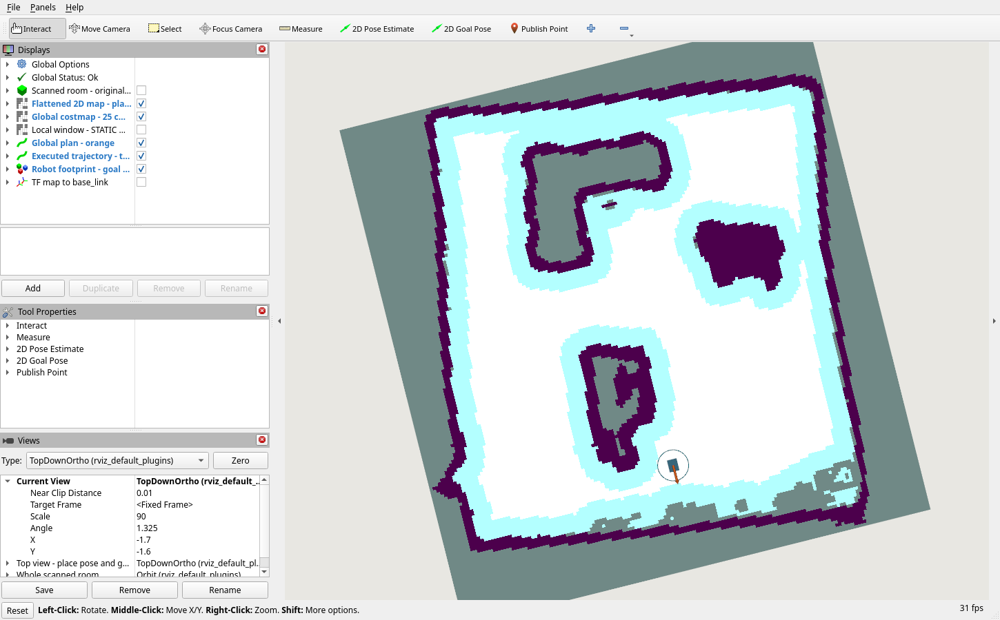

# Bản thử ép phẳng sàn → map 2D — 14/11/2026



Đã mở trong RViz với các công cụ 2D Pose Estimate, 2D Goal Pose và Publish Point
để dừng. Grid nhận qua ROS đã được đối chiếu từng ô với `grid.npz`, Global Status
trong RViz là OK. Sáu test adapter ROS đạt; launcher kiểm tra cú pháp đạt.

Tái sử dụng `room-estimated-plane-preview-20261112`: bản thử cùng nguồn
`room-floor-preserved-20261112`, fit mặt phẳng RANSAC trên thành phần gần ngang
lớn nhất. 25.524 vertex sàn được điều chỉnh, tối đa 5,98 cm; không thêm tam giác,
không đổi depth/pose và không dùng hình học ground truth. Sau đó dùng bộ chiếu
mesh đã có để tạo bản 2D, giữ nguyên vùng unknown và khoảng đệm 25 cm.

| Chỉ số | Mesh gốc → 2D | Sàn phẳng → 2D |
|---|---:|---:|
| Free trước inflation | 10.761 | 13.890 |
| Occupied | 5.715 | 3.130 |
| Unknown | 9.099 | 8.555 |
| Đi được sau inflation | 2.655 | 8.128 |
| Diện tích đi được theo grid | 6,64 m² | 20,32 m² |

Bản mới có một vùng đi được liên thông. Đây là phép đo trên các grid demo,
không phải chứng minh diện tích sàn thật hay robot có thể đi an toàn ở mọi ô.

Mở lại:

```bash
technology/scan3d_fusion/navigation/run_flat_rviz.sh
```

Các file ở `datasets/processed/scan3d_fusion/navigation-flat-2d-20261114/`:
`grid.npz` mang cờ demo-only; `map.pgm`/`map.yaml` là map 2D tiêu chuẩn;
`report.json` lưu nguồn, SHA256 mesh gốc và giả thiết của bản thử. Đã kiểm tra
PGM giữ đúng thứ tự trục Y và giá trị từng ô sau khi xuất/đọc.

**Giới hạn:** giả thiết mặt phẳng có thể làm mất vật cản thấp hòa vào component
sàn. Bản gốc vẫn giữ nguyên. Chưa kiểm chứng navigation bằng cảm biến hoặc vật
lý; không tự lấp vùng thiếu dữ liệu để tạo hành lang giả.
