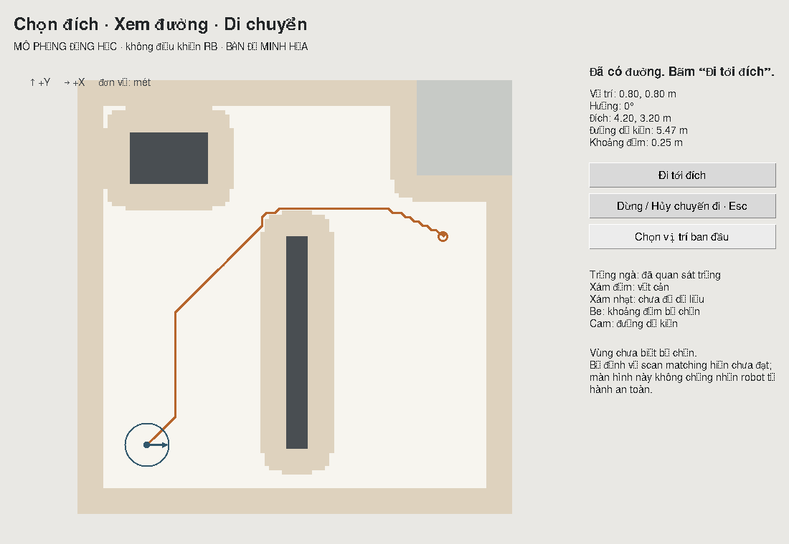
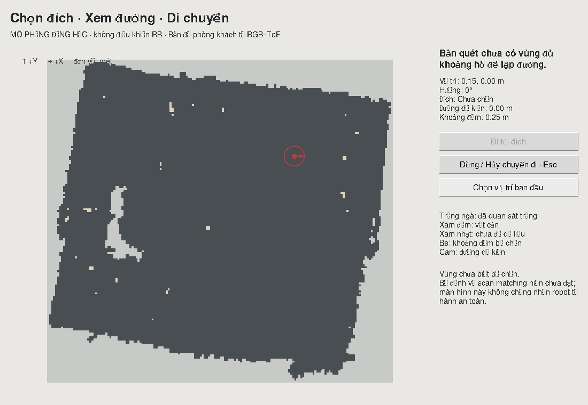

# Navigation — kiểm chứng ngày 14/11/2026

Đã triển khai grid từ depth fusion, A*, bám đường và cửa sổ chọn đích 2D.
**Demo động học đạt; chưa đạt navigation end-to-end trên map quét trong MuJoCo.**
Không có kết quả chạy trên robot thật. [Hướng dẫn mở giao diện](../technology/scan3d_fusion/navigation/README.md#chạy-navigation).

## Kết quả có thể đối chiếu

| Kiểm tra | Kết quả | Phạm vi |
|---|---|---|
| Bộ test navigation/localization trong thư mục navigation | 51/51 đạt, 5,304 s | Logic, dữ liệu lỗi, gate, Tk, regression runtime; không chứng nhận SLAM |
| Vòng qua tường trên map minh họa | Tới đích sau 59,3 s mô phỏng; sai số 2,46 cm | Pose động học chính xác; không có vật lý cân bằng/SLAM |
| Vật cản xuất hiện khi đang tiến | `blocked`, lệnh dừng giữ nguyên | Tiêm lỗi ở giây 10 của demo |
| Pose hết hạn khi đang tiến | `lost`, lệnh dừng giữ nguyên | Tiêm lỗi ở giây 10 của demo |
| Hủy chuyến khi đang tiến | `cancelled`, lệnh dừng giữ nguyên | Tiêm thao tác ở giây 10 của demo |
| Đích nằm trong tường | Từ chối, không phát vận tốc | Map minh họa |
| Grid bản scan phòng khách | Từ chối, không phát vận tốc | 0 ô đủ khoảng hở sau inflation |
| Native MuJoCo | Đứng dậy/cân bằng, nhận wheel/IMU và depth; guard báo `unknown forward corridor` | Kiểm tra khởi động/quan sát, **không gửi goal DRIVE** |

Tuyến demo từ `(0,8; 0,8)` tới `(4,2; 3,2)` m không cắt vào ô bị chặn đã nới;
vận tốc tối đa đo được 0,1 m/s và 0,4 rad/s. Đây là kiểm tra va chạm theo grid,
không phải đo va chạm robot MuJoCo. Kết quả chi tiết và chuỗi pose nằm trong
[navigation_results.json](navigation_results.json).



## Bản đồ quét không có tuyến hợp lệ

Nguồn: `datasets/processed/scan3d_fusion/room-floor-preserved-20261112`, toàn bộ
3.198 keyframe trong `live_sequence.json`, depth fusion và pose ước lượng đã lưu.
Không dùng mesh CAD hay va chạm scene để lập đường.

Artifact: `datasets/processed/scan3d_fusion/navigation-grid-20261114.npz`.
Grid 161 × 172 ô, 5 cm/ô, origin `(-6; -5,65)` m; thời gian dựng đo được 267,5 s.

| Loại ô | Số lượng |
|---|---:|
| Free trước inflation | 58 |
| Occupied | 20.616 |
| Unknown | 7.018 |
| Đi được sau khoảng đệm 25 cm | **0** |

Các ô free chỉ nằm trong 26 cụm nhỏ; lớn nhất 7 ô. Không đủ để đặt footprint
robot và nối đường. Điểm thử `(0,15; 0)` → `(0,5; 0)` m bị từ chối ngay.
Kết quả này phản ánh bằng chứng free-space theo tiêu chí hiện tại; không có
nghĩa căn phòng thật không có chỗ đi. Depth/pose sai lệch hoặc thiếu góc quan sát
có thể làm map không đạt. Chưa tách định lượng từng nguyên nhân trong lượt này.



## Native runtime và các lỗi đã sửa qua review

Runtime giữ controller cân bằng hiện có, dùng wheel/IMU neo theo pose thân ban
đầu do người vận hành cung cấp. Không dùng scan matcher có kết quả chưa đạt;
không dùng pose thật MuJoCo để điều khiển. Khoảng sai số 5 cm là **giả thiết**,
chưa hiệu chuẩn. Giới hạn thử 2 m quãng đường hoặc 60 s sensor-time.

Review và regression kiểm tra tuổi depth từ capture thay vì mtime inference,
tuổi pose sau thời gian xử lý, rearm watchdog bằng thao tác chọn đích, giữ nguyên
lý do dừng và yêu cầu ổn định liên tục trước khi neo initial pose. Mất readiness
hoặc odometry quá 0,3 s sẽ bắt đầu lại khoảng chờ ổn định.

Lượt native cuối ghi trong [navigation_native_smoke.json](navigation_native_smoke.json),
session `datasets/raw/tof-20261114-162307-041442`. Script chỉ khởi động, đứng dậy,
hạ chiều cao, quan sát và dừng phiên;
không gửi mục tiêu di chuyển. Guard không xác nhận hành lang trống nên không có
kết quả tới đích native. Camera FoV hẹp, vùng mù sát thân/phía sau phụ thuộc map
phòng tĩnh; chưa thử vật cản động hoặc chứng minh an toàn vật lý.

## Tái hiện

Chạy từ thư mục gốc repo, môi trường có sẵn trên máy:

```bash
env -u PYTHONPATH /home/dvt/micromamba/envs/wheel-leg-ros/bin/python \
  -m unittest discover -s technology/scan3d_fusion/navigation -p 'test_*.py'

env -u PYTHONPATH /home/dvt/micromamba/envs/wheel-leg-ros/bin/python \
  evaluation/evaluate_navigation.py

env -u PYTHONPATH /home/dvt/micromamba/envs/wheel-leg-ros/bin/python \
  evaluation/check_navigation_native.py
```

Test Tk cần display đồ họa. Native smoke sở hữu một phiên MuJoCo/inference và
tự dừng khi kết thúc; không chạy cùng một phiên live khác. Hai evaluator ghi
lại file JSON tương ứng trong `evaluation/`. Native smoke đạt nghĩa là đã nhận
đủ đầu ra để kiểm tra guard, **không yêu cầu guard clear và không chứng minh
robot tới đích**.

CLI `--help`, cú pháp shell launcher và `git diff --check` cũng đã đạt.
Bước tiếp theo để thử tuyến native là có vùng free-space liên thông đủ footprint,
định vị đủ chính xác và depth đủ mới/đủ coverage; chưa nới gate để ép robot chạy.
