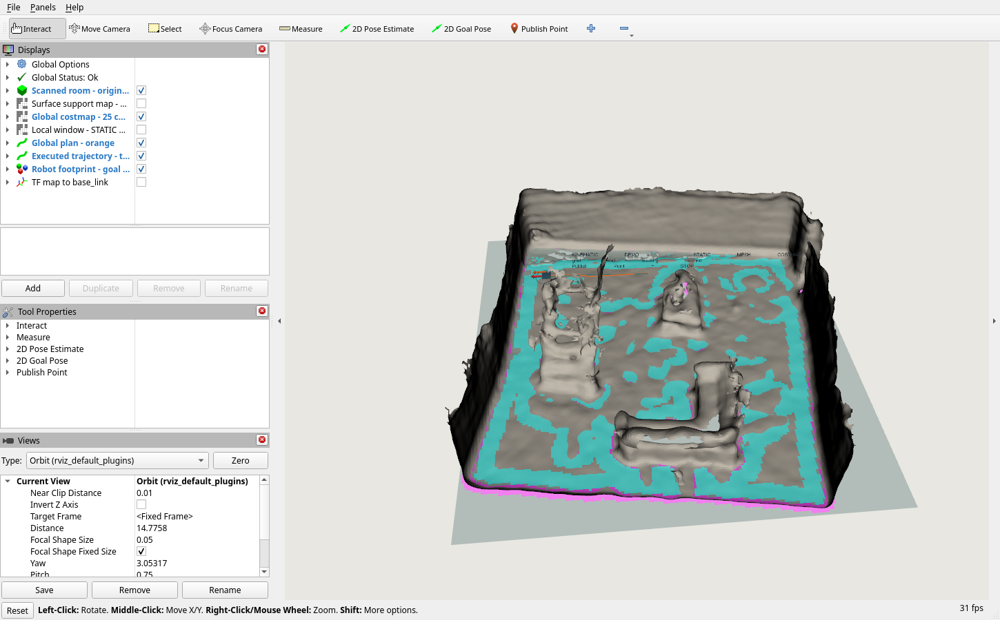

# Navigation tương tác trong RViz — 14/11/2026

Đã mở đúng bản quét 3D trong RViz2 và nối các công cụ chuẩn tới planner/controller
demo. Node nhận thao tác mới và mô phỏng bám đường theo thời gian thực; không
chỉ phát lại GIF/quỹ đạo tính sẵn.



## Kiểm tra

- 64/64 test phần navigation/localization đạt, gồm 6 test mới cho chuyển đổi
  ROS message, frame/quaternion sai, đặt lại pose, tới đích và hướng cuối,
  dừng/hủy, thứ tự ô/cost và origin của costmap crop.
- RViz thực sự phát `initialpose`, `goal_pose`, `stop` theo cấu hình; adapter
  nhận cùng các topic đó. Đã thấy goal từ thao tác RViz trong log của RViz và node.
- Lượt đối chiếu qua ROS đặt pose `(0,7; −1,6)`, gửi goal, hủy chuyến, đặt lại
  pose và gửi goal `(0,8; 0,8; 90°)`. Robot demo tới đích với sai số 2,45 cm,
  khoảng 29,4 giây wall-clock; có 50 điểm global plan và 222 điểm trajectory.
- Global costmap phát đủ `−1/0/99/100`; local window có kích thước nhỏ hơn
  global map và origin dịch đúng theo vị trí robot. TF phát `map → base_link`.
- Review phát hiện topic mesh dùng chung với viewer cũ có thể chồng scan khác;
  đã tách `/rb_navigation/mesh` và khởi động lại phiên RViz.
- Ảnh chụp lấy trực tiếp từ cửa sổ RViz; Global Status hiển thị OK.

[Kết quả ROS roundtrip](rviz_navigation_results.json) ·
[Script đối chiếu](check_rviz_navigation.py) ·
[Hướng dẫn sử dụng](../technology/scan3d_fusion/navigation/README.md#rviz-thả-posegoal-xem-quỹ-đạo-và-costmap).

Khi phiên RViz demo đang mở, chạy kiểm tra (script sẽ đặt lại pose và gửi goal):

```bash
env -u PYTHONPATH /home/dvt/micromamba/envs/wheel-leg-ros/bin/python \
  evaluation/check_rviz_navigation.py
```

## Giới hạn

Pose là trạng thái động học mô phỏng; robot hiển thị bằng marker thân/hướng và
footprint. Costmap lấy từ mesh tĩnh; lớp local chỉ là cửa sổ cắt, không phải
obstacle layer từ depth live. Không có Nav2, AMCL, scan matcher, `/cmd_vel` hay
controller cân bằng trong adapter này. Thành công của lượt demo không xác nhận
navigation vật lý hoặc độ chính xác định vị. Grid native nghiêm ngặt trước đó
vẫn không có tuyến được chấp nhận.
