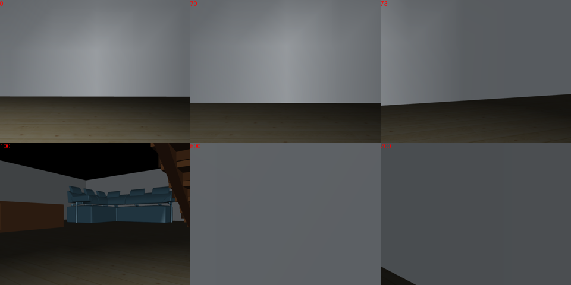

# Kiểm tra loop closure và nguồn pose mapping — 14/11/2026

**Chưa đạt:** đã sửa luồng dùng pose tối ưu, nhưng chưa tạo được bản đồ mới đủ
tin cậy để navigation. Không thay thế scan đang mở bằng một kết quả sai.

## Bằng chứng

Scan 3.198 frame cũ chỉ nhận visual correction ở 4/483 frame tracking ban đầu;
2.715 góc nhìn bổ sung được truyền pose bằng odometry và mount. Khoảng cách
timestamp lớn nhất 21,66 s. Đây không phải 3.198 frame SLAM liên tục độc lập.

| Lượt kiểm tra | Kết quả |
|---|---|
| CuVSLAM chạy riêng trên 3.198 RGB/depth cũ | ATE SE3 142,31 m; không có metrics báo LC thành công |
| 750 RGB-D liên tục, 30–180 s, 5 Hz, lần thử đầu | 14 timestamp metrics LC/PGO; ATE SE3 76,27 m; đường ước lượng 231,15 m |
| Chạy lại cùng đầu vào bằng script trong repo | 18 timestamp metrics LC/PGO; ATE SE3 9,24 m; đường ước lượng 78,77 m |
| Quãng đường camera thật trong hai lượt liên tục | 6,57 m; chỉ dùng để chấm sau tracking |
| Replay bật kiểm tra delta visual–wheel/IMU | Dừng ở index 73, t=44,6003 s, bất đồng 1,2 cm / 9,5°; `complete=false`, `map_saved=false` |

Kết quả GPU khác nhau giữa các lần chạy; cả hai đều không đạt. Không chọn lượt
đẹp hơn để kết luận thành công. Metrics có thể giữ nguyên qua nhiều frame;
bảng đếm timestamp metrics riêng biệt, không đếm mọi frame có `lc_status=true`.
Metrics LC/PGO là bằng chứng SDK báo xử lý thành công, không xác nhận hình học đúng.



Nhiều ảnh nhìn gần tường trơn/gầm đồ vật. Có frame còn 0–3 observation nhưng SDK
vẫn trả pose. Tại frame 73, evaluator xác nhận camera thật xoay khoảng 9,4° giữa
hai ảnh, còn delta visual gần như không xoay. Đây là mất bám chuyển động dù API
chưa trả `None`. Depth fusion cũng còn sai số; chưa tách riêng toàn bộ ảnh hưởng
của depth, texture, tần số và chuyển động cổ bằng các thí nghiệm kiểm soát.

## Đã sửa

- Mapping dùng toàn bộ lịch sử pose cuVSLAM tối ưu, chỉ căn hệ ban đầu một lần
  bằng wheel/IMU + mount. Không gate loop closure hay thay từng pose bằng encoder.
- Kiểm tra chuyển động dùng odometry visual cục bộ, tách khỏi pose SLAM toàn cục.
  Bất đồng vượt ngưỡng mô phỏng thì dừng, không chèn pose khác để tiếp tục ghép.
- Cập nhật lại lịch sử khi LC/PGO xảy ra trên frame không giữ, và khi dừng sạch.
  Mesh live dựng lại khi pose đổi dù số keyframe không tăng, dùng URI mới cho RViz.
- Finalize không chạy surface matching tuần tự để ghi đè nghiệm pose graph.
- Replay giữ snapshot graph trước frame lỗi. Live giữ sản phẩm đã xuất trước lỗi;
  cả hai không lưu database SDK đã nhận frame bị loại.
- Shutdown chờ SLAM tối đa 60 s thay vì 3 s, ghi `slam_shutdown.json`. Headless
  từ chối finalize nếu SLAM lỗi/hết thời gian. Callback lưu database phải thành công.

119 test đạt: adapter 8, live/lifecycle 13, reconstruction 31, navigation 67.
Các regression đã được chạy đỏ trước sửa: mất hiệu chỉnh ở frame cuối không giữ,
mesh bỏ qua thay đổi pose, frame lỗi sửa lịch sử đã nhận, thời gian shutdown quá ngắn.
Test phần mềm không chứng minh chất lượng bản đồ.

## Tái hiện

Tạo RGB + ToF fusion liên tục từ raw snapshot (không dùng depth thật của simulator):

```bash
env -u PYTHONPATH OPENBLAS_NUM_THREADS=1 OMP_NUM_THREADS=2 MUJOCO_GL=egl \
 /home/dvt/.venvs/deltar/bin/python evaluation/prepare_localization_replay.py \
 datasets/raw/tof-20261112-094256-483079 /tmp/rb-slam-prepared \
 --start 30 --duration 150 --period .2

OPENBLAS_NUM_THREADS=1 technology/scan3d_fusion/mapping/cuvslam/run_python.sh \
 evaluation/replay_slam_probe.py /tmp/rb-slam-prepared /tmp/rb-slam-diagnostic

env -u PYTHONPATH OPENBLAS_NUM_THREADS=1 MUJOCO_GL=egl \
 /home/dvt/.venvs/deltar/bin/python evaluation/evaluate_slam_map.py /tmp/rb-slam-diagnostic
```

Script diagnostic cố ý bỏ sanity gate để đo tracking, không phải lệnh quét map
được chấp nhận. Thư mục đầu ra phải chưa tồn tại. Estimator chỉ đọc RGB/depth và
timestamp. Evaluator riêng mới đọc pose MuJoCo và chấm SE3, không fit scale.
Số liệu đầy đủ và nguồn kết quả trong [JSON](slam_loop_results.json).

Việc tiếp theo để có map dùng được là thu chuỗi có chồng lấn tốt, tránh camera
nhìn sát mảng trơn/gầm đồ, giảm tốc quay và giữ đủ tần số ảnh thực đưa vào tracker.
Sau đó kiểm tra tracking và sai số khép vòng trước khi dựng lại mesh/costmap.
Chưa chạy lại toàn phiên ở 15 Hz, chưa đổi vị trí camera hay xác nhận robot thật.
