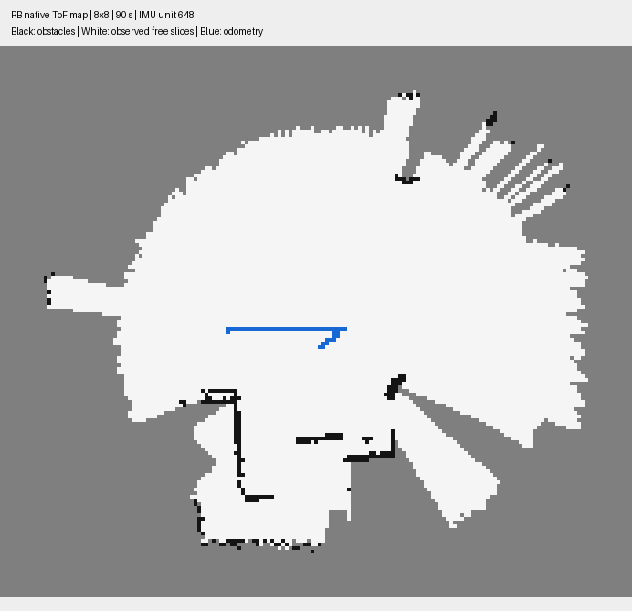

# Native ToF mapping — initial verification

Implemented occupancy mapping with ToF 8×8, wheel encoders and IMU, without ROS/RViz. Native core builds independently and its dynamic dependencies contain standard C/C++ libraries only. The Tk viewer is separate. No physical robot was used in these checks.

## Checks performed

- Four-wall synthetic geometry: walls observed in all directions, correct signed rotation and radial projection.
- Floor returns and an injected pitch/roll offset: floor does not become rings of obstacles in the checked central area.
- Invalid ranges/malformed records: preserve the previous map and count rejected records.
- Reset clears the map; replay produces identical PGM output.
- Python syntax checks for the backend, map viewer and camera viewer.
- Standalone CMake build plus integrated `rb1_sim` build.
- Actual GUI: ToF and map frames update together, a map is visible, sensor log/path/PGM are saved, mapper stderr is empty.

## Simulation evidence

Small House, 3000 Hz physics, MPU6500 model enabled, unit 648, noise seed 1. Start extended, enable at 0.3 s, forward 0.04 m/s at 10 s, stop at 20 s, turn 0.2 rad/s at 25 s, stop at 55 s, reverse 0.03 m/s at 60 s, stop at 70 s. Duration 90 s. These are requested commands; actual motion comes from the balance controller.

- 1,350 ToF frames, 1,327 supported mapping frames; no controller fault.
- 229 occupied XY cells and 10,514 observed-free XY cells at the end of the recorded run.
- Offline axle-position error: RMS 1.63 cm, final/max 3.32 cm.
- Offline heading error: RMS 4.88°, final 6.90°.
- Evaluation aligns only the initial axle position/yaw, with no fitted scale or later correction. Ground truth is read solely by `evaluation/tof_mapping.py`.
- Replay of all 1,350 frames: 2.56 s wall time, 1.77 s user CPU, 5,680 KiB max RSS in this environment. This includes PGM snapshots and is an aggregate measurement, not a per-frame p95 guarantee.
- Separate 40 s lying-start run with STANDUP at 0.3 s: completed stand-up, 483 supported mapping frames, ended Balancing without a fault.

Reproducible local sensor-only example: `datasets/raw/tof-example-90s/` (ignored by Git). Command/calibration metadata, sensor log, map and trajectory are saved there. Build and replay commands are in `technology/scan3d_fusion/mapping/native/README.md`.

## Limits

This is odometry-based mapping, matching the reference project's retained mapping mode; there is no scan matching or loop closure. Heading drift can shift distant walls. The sparse center-ray ToF model does not emulate full sensor zone response. Floor-plane rejection can suppress very low obstacles. A white projected cell is observed free at sampled heights, not a guarantee of robot clearance. The map has fixed 16 m bounds and a 5–80 cm obstacle-height band; broader scenes and physical calibration remain unverified. Visual similarity to an ArduBot screenshot does not establish equal accuracy or coverage.
