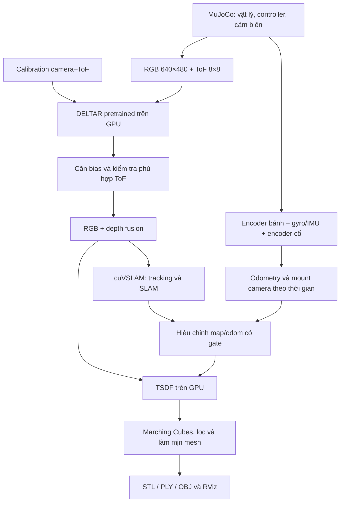

# Trạng thái công nghệ Scan3D Fusion — 12/11/2026

Tài liệu này chốt kiến trúc và giới hạn hiện tại của hệ thống, sau các lượt thử
cải thiện sàn. Đây là prototype trên MuJoCo, chưa phải hệ SLAM đã được xác nhận
trên robot thật hoặc đủ tin cậy cho navigation.

## 1. Mục tiêu và ranh giới dữ liệu

Robot dùng RGB + ToF 8×8 để suy ra depth dày, ước lượng chuyển động và dựng bản đồ
bề mặt 3D dạng “đất sét”. Điều khiển, suy luận, định vị và dựng map không dùng ROS;
ROS/RViz chỉ nhận dữ liệu để hiển thị.

- **Hình học map:** chỉ từ RGB → DELTAR, kết hợp số đo vùng ToF và calibration.
- **Pose map:** encoder bánh + gyro/IMU, động học camera trên đầu quay và hiệu
  chỉnh visual từ cuVSLAM; finalize có bước surface matching riêng.
- **Scene MuJoCo:** tạo ảnh/số đo cảm biến và phục vụ kiểm tra va chạm/tuyến cố định.
  Không chép tường, sàn hay mesh đồ vật của scene vào map đang đánh giá.
- **Ground truth:** chỉ để đánh giá ngoại tuyến trong các lượt gần đây. Các ví dụ
  capture/handheld cũ có thể dùng pose thật; phải xem provenance từng phiên.
- **Vùng chưa được đo:** để chưa biết, không tự phủ mặt phẳng hoặc lấy CAD để vá.

## 2. Luồng chính hiện có



Finalize bổ sung surface matching vào pose trước khi dựng lại TSDF; nó không
tham gia mọi lần cập nhật mesh live.

## 3. Từng khối đang cung cấp gì?

| Khối | Đã có | Giới hạn quan trọng |
|---|---|---|
| Mô phỏng và điều khiển | RB đứng dậy, cân bằng, di chuyển, đầu quay; scene nhà/phòng khách | Không phải xác nhận phần cứng thật |
| Cảm biến | RGB 640×480; ToF 8×8, FoV cấu hình 45°, 15 Hz, 0,02–4 m | ToF vùng mean/std gần đúng, không mô phỏng đầy đủ SPAD/histogram, vật liệu, multipath |
| Calibration | Fit extrinsic camera–ToF bằng mặt phẳng trong mô phỏng; cấu hình mount | Chưa calib camera/ToF/encoder/IMU phần cứng thật |
| DELTAR | Mã nguồn, checkpoint NYU, runner CUDA, xuất depth dày | Dự đoán depth, không tự định vị hoặc dựng map; sai số miền dữ liệu còn đáng kể |
| Kiểm tra ToF | Căn bias, chiếu về đúng vùng ToF, loại depth mâu thuẫn, kiểm tra vùng nhìn xiên | Depth dày vẫn là suy luận, không phải từng pixel đều được ToF đo trực tiếp |
| Wheel–IMU odometry | Encoder + gyro theo phương sai, covariance x/y/yaw, cờ nghi trượt | Không phải EKF IMU 15 trạng thái; trượt đều hai bánh có thể không phát hiện |
| cuVSLAM | RGB-D tracking/SLAM GPU, API loop closure, pose và map database | Có tích hợp không đồng nghĩa loop closure/độ chính xác đã đạt trên phòng hiện tại |
| Fusion pose | Local odometry liên tục và correction visual có gate; bù mount theo cổ/thân | Fusion bên ngoài cuVSLAM, không phải tối ưu chặt tất cả cảm biến trong BA |
| Surface matching | Point-to-plane dùng mặt gần đứng, chỉnh X/Y/yaw khi finalize | Tuần tự, có gate; không phải pose graph toàn cục hoặc ICP 6 bậc tự do realtime |
| Reconstruction | TSDF GPU, Marching Cubes, Gaussian/Taubin và lọc thành phần nhỏ | Không phải neural SDF/ToF-SLAM đầy đủ; smoothing vẫn có thể mất chi tiết |
| Hiển thị | MuJoCo cho vật lý, RViz cho cloud/trajectory/live mesh hoặc mesh đã lưu | RViz không tạo hình học và không sửa sai SLAM |

**Giả thiết định vị cần công khai:** live dùng `BodyLocalization(level_floor=True)`.
Cao độ dựa vào bán kính bánh/động học và giả thiết nền ngang; roll/pitch dùng IMU.
Correction visual chỉ giữ X/Y/yaw sau căn hệ ban đầu, không sửa Z/roll/pitch.
Đây là ràng buộc pose, khác với ép vertex sàn về mặt phẳng, nhưng cũng giới hạn
khả năng chạy trên dốc/bậc và chưa phải định vị 6-DoF tổng quát.

## 4. Ba nhánh cần phân biệt

1. **RGB + ToF → DELTAR → RGB-D → pose → mesh:** nhánh đang tập trung cải thiện.
2. **ToF-only:** mapper occupancy voxel C++ + odometry, giữ để tham khảo/thử nghiệm;
   không phải nhánh mesh DELTAR và chưa có scan matching/loop closure riêng.
3. **Capture handheld/sofa:** di chuyển cụm cảm biến ảo để đánh giá reconstruction.
   Các ví dụ có pose biết sẵn không chứng minh RB tự chạy và SLAM tốt tương ứng.

DELTAR giải bài toán depth; cuVSLAM giải phần pose/SLAM từ RGB-D; TSDF tích lũy
depth theo pose thành bề mặt. Không khối nào tự bảo đảm toàn bộ pipeline đúng.

## 5. Profile và tuyến thử hiện tại

- Phòng khách độc lập: `simulation/scenarios/indoor_tiny_house_living_room.xml`.
  Nhà đầy đủ vẫn ở `simulation/scenarios/indoor_tiny_house.xml`.
- Profile phòng khách chạy thời gian mô phỏng **×5**. GPU chạy theo năng lực thật;
  buffer lấy frame mới nhất có thể bỏ frame, không cam kết fusion đủ 15 FPS.
- ToF hiện **không thêm nhiễu ngẫu nhiên**:
  `config/tof.yaml → noise.sigma_fraction_of_bound: 0.0`.
  Độ phân tán khoảng cách trong một vùng xiên/mixed vẫn tồn tại; DELTAR vẫn sai.
- Tuyến cố định: 184 waypoint, 66 điểm dừng lia đầu, dài khoảng 96,3 m.
  Đi chu vi và các dải trong phòng; đầu quét đủ vòng rồi về trước khi đi tiếp.
- Các điểm lia dùng `scan_step_deg: 8`: chờ góc của frame fusion đã xử lý,
  không chỉ dựa vào tần số ToF danh nghĩa. Giới hạn 4096 keyframe/phiên.
- Bộ lập tuyến dùng scene đã biết để đặt đường/kiểm tra vật cản. Đây là **tuyến
  thử cố định**, chưa phải exploration/navigation từ bản đồ SLAM chưa biết.
- Live/finalize dùng voxel TSDF tối thiểu 4 cm, tự tăng theo thể tích; min_views=3.
  Ví dụ offline mặc định 1 cm/min_views=6 là cấu hình khác, không đại diện live.

Chạy phòng khách:

```bash
technology/scan3d_fusion/live/run_living_room.sh
```

Chạy nhà đầy đủ: `./run_vision.sh`. Chạy phòng khách headless:

```bash
/home/dvt/micromamba/envs/wheel-leg-ros/bin/python technology/scan3d_fusion/live/headless.py
```

Chi tiết thao tác/log: [live/README.md](live/README.md).

## 6. Kết quả đang dùng và các thí nghiệm đã loại

**Bản đối chiếu chính hiện tại:**
`datasets/processed/scan3d_fusion/room-floor-preserved-20261112/`.

- 3.198 frame fusion, voxel 4 cm, không ép phẳng hoặc floor completion.
- Bổ sung góc từ snapshot đã ghi; pose frame bổ sung truyền từ anchor map ước
  lượng bằng delta wheel/IMU và động học cổ. **Không phải 3.198 frame vừa chạy
  lại tracking cuVSLAM độc lập từ đầu.**
- Sửa bộ lọc vùng xiên và bước trích mesh: khôi phục zero crossing TSDF thô
  bị Gaussian xóa, chỉ khi đủ quan sát và gần ngang. Không tạo depth mới,
  không đặt sàn Z=0; vẫn có thể giữ lại độ cong sai vốn có trong depth.
- Có Gaussian/Taubin nên đây là reconstruction đã lọc, không phải raw point cloud.

Các lượt so sánh trước cho thấy diện tích hỗ trợ mesh gần sàn trong khung đo
tăng 74,96% → 82,91%. Đây là proxy trong ROI, **không phải phần trăm sàn thật
được quét**, và khung đó chưa chứa hết dải lỗ bên phải.

Kiểm tra 32 frame đã tham gia map cho vùng phải: RMS cao độ do depth khoảng
2,60 cm; thành phần do pose khoảng 0,17 cm. Đây là phép tách lỗi có oracle
chỉ ở evaluator, không phải tập test độc lập hoặc cam kết ngoài đời.

**Không dùng để chứng minh chất lượng fusion:**

- `room-estimated-plane-preview-20261112`: fit mặt phẳng từ mesh và chiếu 25.524
  vertex về đó, dịch tối đa 5,98 cm. Sàn phẳng là do regularization hình học;
  bản này đã rút khỏi hiển thị chính. Không tích hợp vào live/finalize.
- Thử lọc vertex nhiều góc bằng median residual: sai số tổng thể tăng, đã bỏ
  prototype khỏi core.
- `floor_support.py`, `complete_floor.py` và các output sàn suy diễn cũ:
  chỉ giữ để đối chiếu, không gọi trong inference/finalize chính.

Mở bản không ép phẳng:

```bash
technology/scan3d_fusion/viewer/run_clay_rviz.sh \
  datasets/processed/scan3d_fusion/room-floor-preserved-20261112/final_mesh.stl
```

Báo cáo: [toàn phòng](../../evaluation/room_dense_results.md),
[các lỗ bên phải](../../evaluation/remaining_holes_results.md),
[lồi lõm và thí nghiệm mặt phẳng](../../evaluation/uneven_floor_diagnosis.md).

## 7. Vị trí mã và dữ liệu

| Đường dẫn trong toolkit | Trách nhiệm |
|---|---|
| `config/`, `calibration/` | Cấu hình cảm biến và extrinsic |
| `capture/`, `sensor/` | Capture/preview và mô hình số đo |
| `model/deltar/`, `inference/` | Model/checkpoint và runner depth |
| `mapping/odometry/`, `mapping/cuvslam/` | Local odometry, visual tracking và correction |
| `mapping/fixed_scan_route.py`, `mapping/native/` | Tuyến cố định, tích hợp controller/mapper |
| `reconstruction/depth_support.py` | Hiệu chỉnh và kiểm tra depth với ToF |
| `reconstruction/reconstruct.py` | TSDF và xuất mesh dùng chung |
| `reconstruction/surface_matching.py` | Chỉnh pose bằng mặt đo được khi finalize |
| `live/` | Điều phối inference/tracking/mesh, session, headless, bridge |
| `viewer/` | Xem mesh đã xuất trong RViz |

`datasets/raw/` ở gốc repo giữ log phiên; `datasets/processed/` giữ replay/mesh;
`evaluation/` giữ script và báo cáo kiểm chứng. Một số output dùng symlink, cần
giữ nguồn. Checkpoint/môi trường hiện có trên máy không đồng nghĩa clone Git
mới tự có đủ file lớn; xem hướng dẫn môi trường trong README.

## 8. Phần chưa giải quyết

1. Depth dày còn bias, mixed zone sát tường, mép vật thể và lỗi domain DELTAR.
2. Thiếu góc nhìn gây lỗ thật; lọc/meshing cũng có thể bỏ mất số đo hợp lệ.
3. Matching/correction còn gần đúng; gate có thể loại correction lớn do loop closure.
4. Chưa có neural scene optimization/local-global BA như hệ ToF-SLAM tham khảo.
5. Chưa chứng minh toàn tuyến live ×5 với cấu hình dày mới; replay không thay
   cho kiểm thử tracking/latency/loop closure toàn luồng.
6. Chưa có xác nhận calibration, noise, drift, slip và navigation trên RB thật.

Ưu tiên tiếp theo là giảm lỗi depth và xung đột giữa các góc đo, đo riêng lỗi
pose/coverage/reconstruction; không dùng việc ép phẳng hay tự vá sàn để thay thế
các chỉ số này. Snapshot tài liệu này không phải một lượt benchmark mới.
