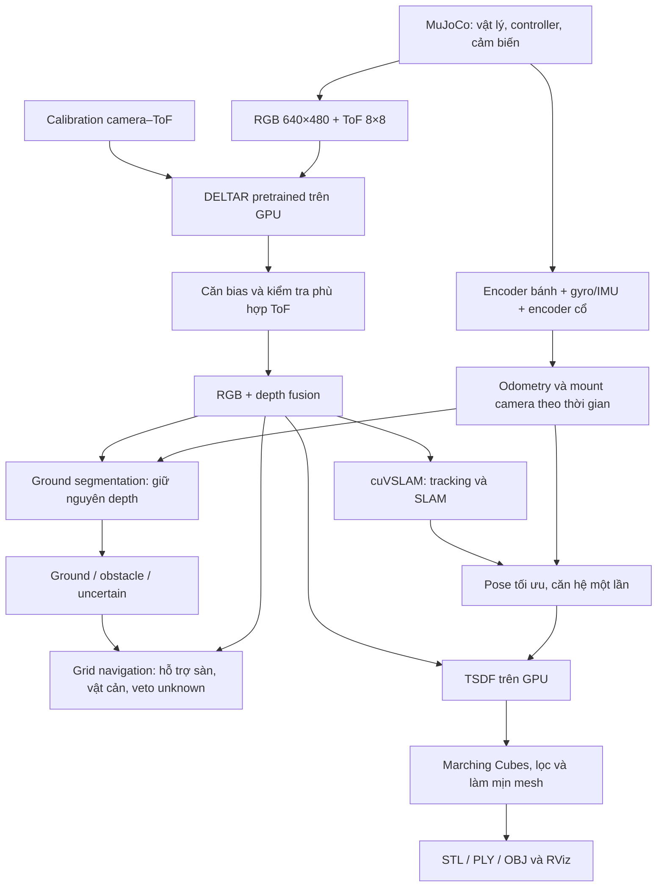

# Trạng thái công nghệ Scan3D Fusion — 16/11/2026

Tài liệu này chốt kiến trúc và giới hạn hiện tại của hệ thống, sau các lượt thử
cải thiện sàn. Đây là prototype trên MuJoCo, chưa phải hệ SLAM đã được xác nhận
trên robot thật hoặc đủ tin cậy cho navigation.

## Bổ sung ngày 15/11/2026 — nhóm product và bản đồ không sàn

Đã tổ chức ba vai trò cố định: plan (GPT-6 Astra high), coding (GPT-6.1 Sol medium),
review/test (GPT-6.1 Sol high). [Kế hoạch và tiêu chí nghiệm thu](../../docs/superpowers/plans/2026-11-15-clean-slam-product.md)
được đối chiếu với [review độc lập](../../evaluation/clean_slam_review_20261115.md).

Đã bổ sung replay có kiểm tra tracking cục bộ, báo lỗi khi depth toàn zero, dùng
đầy đủ lịch sử pose cuối đã tối ưu và bộ đo sai số pose/rotation/RPE. Ba lượt
cuVSLAM trên cùng 150 khung native, cổ cố định, đều chạy đủ nhưng sai số vị trí
RMSE 4,62–6,71 cm và góc cuối 2,54–3,65°; **chưa đạt tiêu chí bản đồ**.
Bản sửa ghép đặc trưng RGB–ToF theo từng vùng đang được thử riêng: sai số RMSE
ba lượt còn 4,01–4,68 cm, nhưng một lượt lệch góc tối đa 3,32° nên vẫn chưa đạt.
Bản này chưa thay cấu hình chính; lỗi đuôi depth và nhận dạng sàn vẫn còn.
Giảm còn 5 Hz làm sai số tăng. Thử dùng depth dự đoán chưa lọc cũng tệ hơn;
không đưa các thử nghiệm thất bại vào cấu hình mặc định.

Đã xuất ba lớp PLY thực tế: obstacle, uncertain, ground. Viewer mặc định chỉ
hiện obstacle; có thể bật hai lớp còn lại để đối chiếu. Depth gốc và pose không
bị sửa, checksum được ghi trong ground_report.json. Đây là sản phẩm **diagnostic**,
chưa đủ chất lượng navigation. Kiểm tra ray độc lập trên 10 khung giữ lại cho
đánh giá cho thấy ít nhất 3.301/26.622 điểm PLY vật cản thực chất là sàn (12,4%
tổng điểm). Trong các pixel sàn có depth hợp lệ được chấm, chỉ 12,6% được nhận là
sàn; 100% điểm bề mặt vật cản cao từ 2,5 cm vẫn được giữ chặn khi tính cả uncertain.
[Kết quả định lượng](../../evaluation/clean_slam_floor_quality_review_20261115.json)
chưa đạt, vì depth fusion có thể biến sàn thật thành các điểm cao giả.

```bash
technology/scan3d_fusion/viewer/run_classified_rviz.sh \
  datasets/processed/scan3d_fusion/fixed-neck-obstacle-diagnostic-r1-20261115
```

Chín ảnh xem trước từ ba đoạn cũ đều không đạt theo nhóm. Hai phiên thu native
mới với cổ cố định và di chuyển chậm có lần lượt 1/59 và 0/60 khung đạt kiểm tra
đặc trưng RGB có depth hỗ trợ. Đã dừng trước hành trình dài, không thay pose bằng
truth hoặc nới tiêu chuẩn để gọi là thành công. Chưa có map thay thế được nghiệm thu.

## Bổ sung ngày 16/11/2026 — giữ RGB + ToF 8×8

Ba biến thể xử lý độ sâu đã bị loại sau đối chiếu độc lập: tại 10 khung cố định,
không biến thể nào nhận đúng sàn (0/10.747 pixel sàn theo mẫu số baseline), đồng
thời mất 17,7% phần depth vật cản vốn quan sát được. Vùng uncertain tiếp tục chặn;
không dùng việc mất dữ liệu để gọi bản đồ sạch hơn.
[Kết quả](../../evaluation/clean_slam_return_variants_floor_review_20261115.json).

Đã dừng chỉnh tiếp các ngưỡng hỗ trợ ToF và thử hiệu chỉnh 2,2% tham số cuối mô
hình trên dữ liệu mô phỏng của phòng hiện tại, với 161 mẫu huấn luyện và 48 mẫu
development validation tách riêng.
RGB/ToF huấn luyện được render lại từ snapshot native đã cố định; validation giữ
nguyên byte H5 đã lưu. Nhãn độ sâu chuẩn chỉ dùng làm
supervision, không đưa vào đầu vào cảm biến hoặc pose dựng bản đồ. Lượt huấn luyện
100 bước đã hoàn tất sau 85,72 giây. Sai số RMSE độ sâu trên cùng 48 mẫu
validation tăng từ 1,180 lên 1,258 m (phạm vi nhãn hợp lệ 0,001–10 m), nên bản
thử bị loại theo quy tắc chốt trước. Checkpoint mặc định giữ nguyên; không thu
test mới hoặc tăng số bước huấn luyện cho bản thử này. Trên cùng mẫu số 40.807 pixel
sàn của baseline, recall giảm 6,38% xuống 2,58%; p95 sai số độ cao tuyệt đối tăng
30,20 lên 35,15 mm, đồng thời mất 629/33.379 mẫu depth vật cản baseline. Review
độc lập tái hiện đúng support/classifier ở cả 60 khung và 14 test tập trung đạt.
[Quyết định và số đo](../../evaluation/clean_slam_pilot_decision_20261116.json).
Chưa có map được nghiệm thu.

## Đính chính phạm vi hiển thị toàn phòng — 16/11/2026

Đoạn 150 khung/10 giây chỉ kiểm tra tracking cục bộ; không đại diện cho bản đồ
căn phòng hoàn chỉnh. Đã mở lại mesh toàn bộ 3.198 khung từ
`room-unsmoothed-20261112`, với cửa sổ 3D và góc nhìn từ trên. Có thể thấy đường
bao bốn phía, nhưng đây là bản cũ: còn sàn, bề mặt méo và quỹ đạo legacy có
SE3 RMSE 22,94 cm trên toàn hành trình. Không coi đây là map mới đã nghiệm thu.
[Ảnh RViz toàn phòng](../../evaluation/full_room_rviz_top_20261116.png).

## Bổ sung 16/11/2026 — Greater floor tuner

`reconstruction/process_floor_surface.py` có thuật toán offline **Greater**:
height grid tối ưu theo trọng số giữ số đo, làm mịn, ép phẳng và nội suy; tuner
Tk có preview measured/inferred/obstacle, giới hạn fill, footprint và bảo toàn
vật thấp. Trọng số fill điều khiển tỷ lệ của bán kính fill tối đa. Export ghi
mesh riêng, hash nguồn, tham số và số ô observed/inferred.
Chỉ preview/export cho map floor-preserved; chưa benchmark đa bản đồ. Phần
inferred vẫn không phải free-space và Greater không nằm trong live/finalize SLAM.

Điều kiện thành công phải áp dụng trên toàn phòng và lượt quay lại vị trí đã
quét; điểm số tốt ở đoạn ngắn không thay thế điều kiện này.

## Bổ sung ngày 14/11/2026 — localization trên map cố định

Đã triển khai estimator XY/yaw nhiều góc nhìn, replay/live observer và evaluator.
38 test phần mềm đạt; review đã sửa lỗi tuổi buffer live. Tuy nhiên kiểm chứng
hai đoạn 200 frame của phiên khác cho XY RMSE 27,2/54,2 cm, cao hơn baseline
wheel/IMU 1,4/2,9 cm. **Mốc định vị chưa đạt chất lượng; chưa nối vào tự hành.**
Xem [kết quả, biểu đồ và cách tái hiện](../../evaluation/fixed_map_localization_results.md).

## Bổ sung ngày 14/11/2026 — navigation chọn đích 2D

Đã có cửa sổ chọn đích 2D, A*, bám đường có giới hạn vận tốc và dừng khi mất
pose/depth. Demo động học vòng qua tường tới đích sai số 2,46 cm. Bản grid từ
3.198 frame scan có 0 ô đủ khoảng hở 25 cm; planner từ chối lập đường. Native
MuJoCo đã kiểm tra khởi động/nhận cảm biến, chưa chạy một chuyến tới đích.
Wheel/IMU chỉ là baseline ngắn 2 m / 60 s; không dùng scan matcher chưa đạt.
Xem [cách chạy](navigation/README.md) và [báo cáo navigation](../../evaluation/navigation_results.md).

Đã bổ sung [demo RB trên chính mesh 3D đã quét](../../evaluation/navigation_mesh_3d_results.md):
chiếu sàn mesh để lập đường, dùng CAD RB phát lại bám đường động học, tới đích
trong 29,35 s với sai số 2,45 cm. Grid mesh mang cờ chỉ dùng demo, không thay
grid depth/native; chưa xác nhận cân bằng, va chạm vật lý hoặc định vị cảm biến.

Đã có [giao diện RViz tương tác](../../evaluation/rviz_navigation_results.md):
2D Pose Estimate, 2D Goal Pose, plan/trajectory, global costmap và local window
từ map tĩnh. Các thao tác nối tới demo kinematic; 64 test đạt và lượt ROS
roundtrip tới đích. Không đồng nghĩa đã tích hợp Nav2 hoặc điều khiển native.

## Bổ sung ngày 14/11/2026 — phân loại sàn sau fusion

Live inference và keyframe đã có ground/obstacle/uncertain; point cloud giữ
nhãn khi giảm mẫu. Bộ phân loại dùng wheel/IMU + mount động, RANSAC, xác nhận
thời gian, pháp tuyến/độ liên tục và giới hạn độ cao của sàn phẳng đã hiệu chuẩn.
Depth gốc và full mesh giữ nguyên. Grid sử dụng ground làm hỗ trợ, giữ obstacle
và uncertain/dropoff để chặn; bằng chứng tia vẫn lấy từ depth đầy đủ.

Replay riêng 3.198 frame xác nhận mặt phẳng ở 334 frame; checksum toàn bộ depth
trùng nguồn, pose giữ nguyên. Kiểm tra live có 8 frame mới và một frame xác nhận
sàn; chưa ổn định xuyên suốt. 106 test navigation/reconstruction/IPC đạt; review
đã chặn lỗi mặt kê 2 cm, vật 3 cm kéo nghiêng plane và điểm thấp dưới sàn.
Grid sau phân loại có 0 free, 12.091 occupied, 15.601 unknown; vẫn 0 ô đủ khoảng
hở 25 cm. Occupied giảm do chuyển sang unknown, chưa đạt cải thiện navigation.
Xem [cách chạy](navigation/README.md#tách-sàn-sau-fusion) và
[đối chiếu/giới hạn](../../evaluation/ground_segmentation_results.md).

## 1. Mục tiêu và ranh giới dữ liệu

Robot dùng RGB + ToF 8×8 để suy ra depth dày, ước lượng chuyển động và dựng bản đồ
bề mặt 3D dạng “đất sét”. Điều khiển, suy luận, định vị và dựng map không dùng ROS;
ROS/RViz chỉ nhận dữ liệu để hiển thị.

- **Hình học map:** chỉ từ RGB → DELTAR, kết hợp số đo vùng ToF và calibration.
- **Pose map mới:** toàn bộ pose cuối đã tối ưu của cuVSLAM, căn hệ một lần bằng
  wheel/IMU + mount camera đầu tiên; không ghi đè bằng surface matching tuần tự.
  Các scan cũ vẫn giữ nguyên chính sách pose cũ và cần xem provenance từng phiên.
- **Scene MuJoCo:** tạo ảnh/số đo cảm biến và phục vụ kiểm tra va chạm/tuyến cố định.
  Không chép tường, sàn hay mesh đồ vật của scene vào map đang đánh giá.
- **Ground truth:** dùng để đánh giá ngoại tuyến và làm nhãn riêng trong pilot
  huấn luyện có giám sát; không đưa vào đầu vào mô hình/tracker hoặc pose dựng map.
  Các ví dụ capture/handheld cũ có thể dùng pose thật; phải xem provenance từng phiên.
- **Vùng chưa được đo:** để chưa biết, không tự phủ mặt phẳng hoặc lấy CAD để vá.

## 2. Luồng chính hiện có



Finalize dựng lại TSDF theo pose cuối đã tối ưu. Mesh live cũng dựng lại khi
loop closure sửa lịch sử pose mà số keyframe không tăng.

## 3. Từng khối đang cung cấp gì?

| Khối | Đã có | Giới hạn quan trọng |
|---|---|---|
| Mô phỏng và điều khiển | RB đứng dậy, cân bằng, di chuyển, đầu quay; scene nhà/phòng khách | Không phải xác nhận phần cứng thật |
| Cảm biến | RGB 640×480; ToF 8×8, FoV cấu hình 45°, 15 Hz, 0,02–4 m | ToF vùng mean/std gần đúng, không mô phỏng đầy đủ SPAD/histogram, vật liệu, multipath |
| Calibration | Fit extrinsic camera–ToF bằng mặt phẳng trong mô phỏng; cấu hình mount | Chưa calib camera/ToF/encoder/IMU phần cứng thật |
| DELTAR | Mã nguồn, checkpoint NYU, runner CUDA, xuất depth dày | Dự đoán depth, không tự định vị hoặc dựng map; sai số miền dữ liệu còn đáng kể |
| Kiểm tra ToF | Căn bias, chiếu về đúng vùng ToF, loại depth mâu thuẫn, kiểm tra vùng nhìn xiên | Depth dày vẫn là suy luận, không phải từng pixel đều được ToF đo trực tiếp |
| Wheel–IMU odometry | Encoder + gyro theo phương sai, covariance x/y/yaw, cờ nghi trượt | Không phải EKF IMU 15 trạng thái; trượt đều hai bánh có thể không phát hiện |
| cuVSLAM | RGB-D tracking/SLAM GPU, API loop closure, pose và map database | Có tích hợp không đồng nghĩa loop closure/độ chính xác đã đạt trên phòng hiện tại |
| Pose mapping | Pose graph cuVSLAM và một alignment ban đầu; wheel/IMU kiểm tra delta visual cục bộ | Chưa đưa wheel/IMU factors vào BA; ngừng khi tracking sai thay vì thay pose |
| Surface matching | Giữ công cụ thử nghiệm riêng | Đã bỏ khỏi finalize chính để không ghi đè tối ưu toàn cục |
| Reconstruction | TSDF GPU, Marching Cubes, Gaussian/Taubin và lọc thành phần nhỏ | Không phải neural SDF/ToF-SLAM đầy đủ; smoothing vẫn có thể mất chi tiết |
| Hiển thị | MuJoCo cho vật lý, RViz cho cloud/trajectory/live mesh hoặc mesh đã lưu | RViz không tạo hình học và không sửa sai SLAM |

**Mapping chưa đạt chất lượng:** replay 750 RGB-D liên tục 5 Hz, hai lượt có
14/18 timestamp metrics báo loop closure, nhưng ATE SE3 vẫn 76,27/9,24 m trên
quãng đường thật 6,57 m; kết quả GPU khác nhau giữa các lần chạy.
Nhiều ảnh nhìn tường trơn/gầm đồ vật; đếm pose trả về không xác nhận tracking tốt.
Luồng có kiểm tra delta đã dừng ở frame 73 thay vì tiếp tục ghép sai. Giữ nguyên
scan cũ, chưa có map mới đạt chuẩn để navigation. Xem
[số liệu và giới hạn](../../evaluation/slam_loop_results.md).

## 4. Ba nhánh cần phân biệt

1. **RGB + ToF → DELTAR → RGB-D → pose → mesh:** nhánh đang tập trung cải thiện.
2. **ToF-only:** mapper occupancy voxel C++ + odometry, giữ để tham khảo/thử nghiệm;
   không phải nhánh mesh DELTAR và chưa có scan matching/loop closure riêng.
3. **Capture handheld/sofa:** di chuyển cụm cảm biến ảo để đánh giá reconstruction.
   Các ví dụ có pose biết sẵn không chứng minh RB tự chạy và SLAM tốt tương ứng.

DELTAR giải bài toán depth; cuVSLAM giải phần pose/SLAM từ RGB-D; TSDF tích lũy
depth theo pose thành bề mặt. Không khối nào tự bảo đảm toàn bộ pipeline đúng.

## 5. Profile và tuyến thử hiện tại

- Phòng khách độc lập: `simulation/scenarios/indoor_tiny_house_living_room.xml`.
  Nhà đầy đủ vẫn ở `simulation/scenarios/indoor_tiny_house.xml`.
- Profile phòng khách chạy thời gian mô phỏng **×5**. GPU chạy theo năng lực thật;
  buffer lấy frame mới nhất có thể bỏ frame, không cam kết fusion đủ 15 FPS.
- ToF hiện **không thêm nhiễu ngẫu nhiên**:
  `config/tof.yaml → noise.sigma_fraction_of_bound: 0.0`.
  Độ phân tán khoảng cách trong một vùng xiên/mixed vẫn tồn tại; DELTAR vẫn sai.
- Tuyến cố định: 184 waypoint, 66 điểm dừng lia đầu, dài khoảng 96,3 m.
  Đi chu vi và các dải trong phòng; đầu quét đủ vòng rồi về trước khi đi tiếp.
- Các điểm lia dùng `scan_step_deg: 8`: chờ góc của frame fusion đã xử lý,
  không chỉ dựa vào tần số ToF danh nghĩa. Giới hạn 4096 keyframe/phiên.
- Bộ lập tuyến dùng scene đã biết để đặt đường/kiểm tra vật cản. Đây là **tuyến
  thử cố định**, chưa phải exploration/navigation từ bản đồ SLAM chưa biết.
- Live/finalize dùng voxel TSDF tối thiểu 4 cm, tự tăng theo thể tích; min_views=3.
  Ví dụ offline mặc định 1 cm/min_views=6 là cấu hình khác, không đại diện live.

Chạy phòng khách:

```bash
technology/scan3d_fusion/live/run_living_room.sh
```

Chạy nhà đầy đủ: `./run_vision.sh`. Chạy phòng khách headless:

```bash
/home/dvt/micromamba/envs/wheel-leg-ros/bin/python technology/scan3d_fusion/live/headless.py
```

Chi tiết thao tác/log: [live/README.md](live/README.md).

## 6. Kết quả đang dùng và các thí nghiệm đã loại

**Bản scan mặc định được người dùng chọn ngày 13/11/2026:**
`datasets/processed/scan3d_fusion/room-floor-preserved-20261112/`.
Launcher `viewer/run_clay_rviz.sh` không có đối số mở đúng bản này. Đây là lựa
chọn bản đối chiếu, không phải chứng nhận đạt chất lượng navigation hoặc thay
scene nhà gốc. Kết quả vẫn là dataset cục bộ, không kèm trong Git.

- 3.198 frame fusion, voxel 4 cm, không ép phẳng hoặc floor completion.
- Bổ sung góc từ snapshot đã ghi; pose frame bổ sung truyền từ anchor map ước
  lượng bằng delta wheel/IMU và động học cổ. **Không phải 3.198 frame vừa chạy
  lại tracking cuVSLAM độc lập từ đầu.**
- Sửa bộ lọc vùng xiên và bước trích mesh: khôi phục zero crossing TSDF thô
  bị Gaussian xóa, chỉ khi đủ quan sát và gần ngang. Không tạo depth mới,
  không đặt sàn Z=0; vẫn có thể giữ lại độ cong sai vốn có trong depth.
- Có Gaussian/Taubin nên đây là reconstruction đã lọc, không phải raw point cloud.

Các lượt so sánh trước cho thấy diện tích hỗ trợ mesh gần sàn trong khung đo
tăng 74,96% → 82,91%. Đây là proxy trong ROI, **không phải phần trăm sàn thật
được quét**, và khung đó chưa chứa hết dải lỗ bên phải.

Kiểm tra 32 frame đã tham gia map cho vùng phải: RMS cao độ do depth khoảng
2,60 cm; thành phần do pose khoảng 0,17 cm. Đây là phép tách lỗi có oracle
chỉ ở evaluator, không phải tập test độc lập hoặc cam kết ngoài đời.

**Không dùng để chứng minh chất lượng fusion:**

- `room-estimated-plane-preview-20261112`: fit mặt phẳng từ mesh và chiếu 25.524
  vertex về đó, dịch tối đa 5,98 cm. Sàn phẳng là do regularization hình học;
  bản này đã rút khỏi hiển thị chính. Không tích hợp vào live/finalize.
- Thử lọc vertex nhiều góc bằng median residual: sai số tổng thể tăng, đã bỏ
  prototype khỏi core.
- Các output sàn suy diễn cũ chỉ giữ làm bằng chứng thí nghiệm; thuật toán sửa
  depth theo mặt phẳng và vá sàn hậu kỳ đã bị loại khỏi mã nguồn chính.

Mở bản không ép phẳng:

```bash
technology/scan3d_fusion/viewer/run_clay_rviz.sh \
  datasets/processed/scan3d_fusion/room-floor-preserved-20261112/final_mesh.stl
```

Báo cáo: [toàn phòng](../../evaluation/room_dense_results.md),
[các lỗ bên phải](../../evaluation/remaining_holes_results.md),
[lồi lõm và thí nghiệm mặt phẳng](../../evaluation/uneven_floor_diagnosis.md).

## 7. Vị trí mã và dữ liệu

| Đường dẫn trong toolkit | Trách nhiệm |
|---|---|
| `config/`, `calibration/` | Cấu hình cảm biến và extrinsic |
| `capture/`, `sensor/` | Capture/preview và mô hình số đo |
| `model/deltar/`, `inference/` | Model/checkpoint và runner depth |
| `mapping/odometry/`, `mapping/cuvslam/` | Local odometry, visual tracking và correction |
| `mapping/fixed_scan_route.py`, `mapping/native/` | Tuyến cố định, tích hợp controller/mapper |
| `reconstruction/depth_support.py` | Hiệu chỉnh và kiểm tra depth với ToF |
| `reconstruction/ground_segmentation.py`, `segment_scan.py` | Phân loại sàn sau fusion, replay giữ depth |
| `reconstruction/reconstruct.py` | TSDF và xuất mesh dùng chung |
| `reconstruction/surface_matching.py` | Chỉnh pose bằng mặt đo được khi finalize |
| `live/` | Điều phối inference/tracking/mesh, session, headless, bridge |
| `viewer/` | Xem mesh đã xuất trong RViz |

`datasets/raw/` ở gốc repo giữ log phiên; `datasets/processed/` giữ replay/mesh;
`evaluation/` giữ script và báo cáo kiểm chứng. Một số output dùng symlink, cần
giữ nguồn. Checkpoint/môi trường hiện có trên máy không đồng nghĩa clone Git
mới tự có đủ file lớn; xem hướng dẫn môi trường trong README.

## 8. Phần chưa giải quyết

1. Depth dày còn bias, mixed zone sát tường, mép vật thể và lỗi domain DELTAR.
2. Thiếu góc nhìn gây lỗ thật; lọc/meshing cũng có thể bỏ mất số đo hợp lệ.
3. Matching/correction còn gần đúng; gate có thể loại correction lớn do loop closure.
4. Chưa có neural scene optimization/local-global BA như hệ ToF-SLAM tham khảo.
5. Chưa chứng minh toàn tuyến live ×5 với cấu hình dày mới; replay không thay
   cho kiểm thử tracking/latency/loop closure toàn luồng.
6. Chưa có xác nhận calibration, noise, drift, slip và navigation trên RB thật.

Ưu tiên tiếp theo là giảm lỗi depth và xung đột giữa các góc đo, đo riêng lỗi
pose/coverage/reconstruction; không dùng việc ép phẳng hay tự vá sàn để thay thế
các chỉ số này. Snapshot tài liệu này không phải một lượt benchmark mới.
