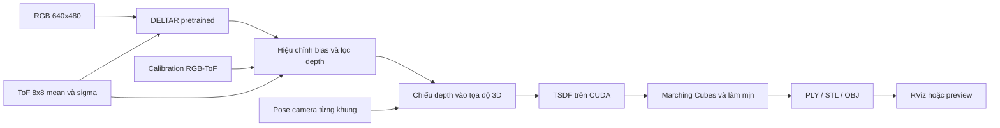

# Vision + ToF SLAM Toolkit (Scan3D Fusion)

Thư mục này gom bộ công cụ vision và SLAM đang có trong workspace: cấu hình RGB/ToF, preview cảm biến, hiệu chuẩn mô phỏng, DELTAR và checkpoint pretrained, dựng mesh RGB+ToF, mapper ToF-only, tuyến quét và công cụ xem RViz. Scene MuJoCo, CAD robot và dashboard vẫn dùng từ workspace chung.

Pipeline mesh RGB+ToF mặc định dùng pose mô phỏng đã biết. Nhánh [cuVSLAM RGB-D](mapping/cuvslam/README.md) bổ sung tracking, SLAM/loop closure và lưu map native trên GPU; TSDF nhận pose cuối qua `--trajectory`. Có cả replay dữ liệu đã ghi và [profile trực tiếp MuJoCo + RViz](live/README.md), khởi chạy bằng `./run_vision.sh`. Controller vẫn chạy độc lập với xử lý ảnh. Mapper ToF-only riêng vẫn dùng odometry encoder/gyro và occupancy voxel, chưa có scan matching hoặc loop closure.

## Sơ đồ xử lý



1. **Capture:** MuJoCo tạo RGB, đo phân bố khoảng cách giả lập trên 8×8 vùng ToF, và lưu pose cùng intrinsics cho mỗi khung. Trong chế độ handheld, cả cụm camera–ToF được di chuyển và nghiêng như một thiết bị cầm tay.
2. **DELTAR:** checkpoint pretrained nhận RGB, mean/sigma ToF, mask và rectangle của từng vùng; xuất depth dày theo pixel. Depth chuẩn MuJoCo chỉ được giữ lại để chấm điểm ngoại tuyến, không đưa vào mạng.
3. **Ràng buộc ToF:** depth được căn bias cục bộ theo vùng đo ToF rồi loại các pixel mâu thuẫn với ToF. Đây là bước hiệu chỉnh gần đúng, không phải tối ưu loss RGB/ToF/depth qua nhiều khung như bài báo.
4. **Fusion hình học:** mỗi depth đã lọc được chiếu theo pose vào một thể tích TSDF. Sau khi tích lũy nhiều khung, Marching Cubes trích bề mặt, lọc thành phần nhỏ và làm mịn nhẹ.
5. **Hiển thị:** xuất mesh và có thể mở mesh trong RViz. ROS không tham gia suy luận hay fusion.

Mapper ToF-only có nhánh riêng: adapter MuJoCo ghi frame 8×8 và odometry cảm biến; C++ mapper cập nhật occupancy voxel/map xám; GUI dashboard ghi log và mở map; ROS bridge tùy chọn hiển thị map và point cloud trong RViz.

## Mối liên hệ với DELTAR và ToF-SLAM

- [DELTAR](https://zju3dv.github.io/deltar/) là mạng hợp nhất ảnh màu và tín hiệu ToF thưa để dự đoán depth dày.
- [ToF-SLAM của ZJU](https://zju3dv.github.io/tof_slam/) dùng DELTAR làm depth supervision trung gian. Phương pháp bài báo còn tối ưu biểu diễn cảnh SDF đa mức và pose camera từ RGB, depth dự đoán, tín hiệu vùng ToF; lọc ToF theo thời gian; dùng tối ưu coarse-to-fine và local/global BA.
- Vì vậy, **DELTAR không tự tạo pose hay bản đồ SLAM**. Baseline trong repo dùng pose ground truth mô phỏng để cô lập và kiểm tra bước dựng mesh.
- Trang ToF-SLAM ghi mã nguồn “Coming”; implementation hiện tại của workspace là bản tái dựng một phần, không phải mã chính thức của tác giả.

## Phần cứng và cấu hình cảm biến

- GPU máy phát triển: RTX 3060, VRAM 12 GB. Lần chạy handheld dùng khoảng 288 MiB VRAM cực đại khi fusion; inference DELTAR chạy CUDA.
- RGB: 640×480. Focal length và tâm ảnh trong sequence được tính từ camera MuJoCo của model, không hard-code intrinsics của camera thương mại.
- ToF giả lập: 8×8 vùng, FoV 45°, tầm 2 cm–4 m, 15 Hz; camera hướng lệch yaw −4° so với trục trước của robot.
- Extrinsic camera–ToF dùng `technology/scan3d_fusion/config/sim_calibration.json`, là kết quả calibration mặt phẳng trong mô phỏng. Báo cáo fit: median point-to-plane giảm từ khoảng 23 mm xuống 3,6 mm; RMSE sau fit khoảng 7,4 mm. Đây chưa phải calibration phần cứng.
- Mỗi vùng ToF được lấy từ 16×16 = 256 tia diện tích. Adapter chọn cụm gần có đủ tín hiệu rồi tính mean/std theo optical Z, thêm nhiễu theo cấu hình. Đây không phải mô hình photon, SPAD, histogram, xtalk hay phản xạ vật liệu của cảm biến thật.

## Bố cục mã nguồn

```text
technology/scan3d_fusion/
├── config/             camera, ToF, extrinsic mô phỏng, DELTAR eval config
├── environment/        package pin cho GPU / DELTAR
├── sensor/             RGB/RGB-D/ToF preview
├── calibration/        fit camera–ToF và web chọn vị trí ToF
├── capture/            capture RGB + ToF từ MuJoCo
├── model/deltar/       upstream model source, NYU checkpoint, demo H5, license
├── inference/          DELTAR runner
├── reconstruction/     lọc depth, TSDF, mesh, geometry checks
├── mapping/
│   ├── odometry/       fusion encoder bánh + gyro, covariance, correction từ visual
│   ├── cuvslam/        RGB-D SLAM GPU, replay, đánh giá trajectory và xuất pose cho TSDF
│   ├── tof_only/       native mapper, ToF adapter, calibration generator
│   ├── native/         CMake integration, route, RViz bridge/config, launch script
│   └── fixed_scan_route.py
└── viewer/             RViz/preview viewers cho mesh và native ToF map
```

| Đường dẫn | Chức năng |
|---|---|
| `config/camera.yaml`, `config/tof.yaml` | Nguồn cấu hình cảm biến dùng cho mô hình robot, capture, calibration và mapper. |
| `sensor/camera_viewer.py` | Preview RGB và RGB-D/ToF từ runner MuJoCo. |
| `calibration/sim_plane_calibration.py` | Ước lượng extrinsic camera–ToF bằng mặt phẳng mô phỏng. |
| `calibration/tof_placement/index.html` | Công cụ browser để xem mesh đầu RB và chọn pose ToF. |
| `model/deltar/` | Mã DELTAR upstream, LICENSE, checkpoint NYU và demo data cần cho inference. |
| `environment/requirements-gpu.txt` | Pin Python/PyTorch/CUDA và thư viện xử lý mesh. |
| `capture/capture_mujoco.py` | Sinh capture RGB/ToF, zone rectangle, intrinsics và camera-to-world pose; có quỹ đạo sofa thấp, handheld nhiều độ cao, bóng và các góc cardinal. |
| `inference/run_demo.py` | Nạp checkpoint DELTAR, tự chọn CUDA, chạy H5 và ghi PNG depth 16-bit theo mm. |
| `config/sim_calibration.json` | Extrinsic camera-to-ToF ước lượng trong mô phỏng và sai số fit. |
| `reconstruction/reconstruct.py` | Hiệu chỉnh/lọc depth, tích phân TSDF CUDA và xuất mesh. Có chế độ `--reference` riêng để tạo mesh depth chuẩn đánh giá. |
| `reconstruction/render_mesh.py` | Render file mesh độc lập thành ảnh xem nhanh; không tái dựng scene. |
| `reconstruction/test_geometry.py` | Kiểm tra projection vùng ToF, pose rigid của camera–ToF, hiệu chỉnh depth và hình học TSDF. |
| `viewer/rviz_bridge.py` | Publish mesh qua Marker cho RViz. Tùy chọn `--compare-sofa` hiển thị sofa gốc cạnh mesh để so sánh. |
| `viewer/clay.rviz` | Cấu hình RViz cho mesh đất sét. |
| `viewer/run_clay_rviz.sh` | Mở RViz với mesh; có tùy chọn sofa tham chiếu. |
| `mapping/tof_only/` | Mapper occupancy ToF-only C++17 và adapter sensor MuJoCo. |
| `mapping/cuvslam/` | cuVSLAM RGB-D native GPU, loop closure, map database, replay và đánh giá pose; [hướng dẫn](mapping/cuvslam/README.md). |
| `mapping/native/` | CMake integration, RViz map/point cloud, fixed scan route và lệnh mở RViz. |
| `mapping/fixed_scan_route.py` | Logic tuyến quét cố định mà dashboard gọi. |
| `viewer/tof_map_viewer.py`, `viewer/tof_map_3d_viewer.py` | Viewer map native được dashboard khởi chạy. |

## Cài môi trường

Các lệnh bên dưới chạy từ thư mục gốc repo. Môi trường DELTAR đã được chuẩn bị tại `/home/dvt/.venvs/deltar` bằng Python 3.8, PyTorch 1.12.1 + CUDA 11.3 và TorchVision 0.13.1. NYU checkpoint và demo H5 nằm trong `model/deltar/`; do dung lượng lớn, các file này được giữ tại chỗ nhưng loại khỏi Git bằng `.gitignore`.

Nếu cần tạo lại môi trường:

```bash
micromamba create -y -p /home/dvt/.venvs/deltar python=3.8 pip
env -u PYTHONPATH micromamba run -p /home/dvt/.venvs/deltar python -m pip install \
  --extra-index-url https://download.pytorch.org/whl/cu113 \
  -r technology/scan3d_fusion/environment/requirements-gpu.txt
```

Phụ thuộc xuất/làm mịn mesh được pin trong `environment/requirements-gpu.txt` (`scikit-image`, `trimesh`). Mapper native cần C++17, Python và PyYAML lúc configure. Preview dùng Tk/Pillow. RViz là tùy chọn, dùng môi trường ROS cục bộ `wheel-leg-ros`.

## Quick start: ToF-only mapping

The native mapper builds independently and replays sensor logs without ROS or MuJoCo:

```bash
cmake -S technology/scan3d_fusion/mapping/tof_only -B build/tof_only -DCMAKE_BUILD_TYPE=Release
cmake --build build/tof_only -j2
python technology/scan3d_fusion/mapping/tof_only/test_mapper.py build/tof_only/rb_tof_mapper
build/tof_only/rb_tof_mapper /tmp/tof-map < datasets/raw/tof-SESSION/sensors.log
```

To collect a new map, build `rb1_sim` from the root instructions and start the GUI; it launches the mapper and records a new session under `datasets/raw/`. To show the latest map in RViz, run `technology/scan3d_fusion/mapping/native/run_tof_rviz.sh`. For a second point-cloud view, open `rviz2 -d technology/scan3d_fusion/mapping/native/rviz_pointcloud.rviz`.

## Sensor preview and calibration

The simulator dashboard can open `sensor/camera_viewer.py`; to start it directly, run `python technology/scan3d_fusion/sensor/camera_viewer.py` while `rb1_sim` is running. Re-estimate simulated RGB–ToF extrinsics with `MUJOCO_GL=egl python technology/scan3d_fusion/calibration/sim_plane_calibration.py`. To choose the ToF location on the RB head, serve the workspace root over HTTP and open `technology/scan3d_fusion/calibration/tof_placement/` in a browser; the page loads the robot CAD mesh from `model/assets/`.

## Quick start: RGB + ToF mesh

Tạo một thư mục run mới để không ghi đè kết quả trước. Ví dụ:

```bash
RUN="datasets/processed/sofa_clay/handheld-$(date +%Y%m%d-%H%M%S)"
mkdir -p "$RUN"
```

Sinh 216 góc nhìn handheld. Quỹ đạo lấy tâm sofa từ scene hiện tại, chạy ba vòng ở bán kính 1,5 m và cao độ tâm camera khoảng 0,5 m, 1,1 m và 1,8 m, có chuyển cao độ giữa vòng và ngắm về sofa:

```bash
MUJOCO_GL=egl env -u PYTHONPATH /home/dvt/.venvs/deltar/bin/python \
  technology/scan3d_fusion/capture/capture_mujoco.py \
  --scan sofa-handheld --frames 216 --samples-per-pose 1 \
  --output "$RUN/input"
```

Chạy DELTAR trên GPU:

```bash
env -u PYTHONPATH /home/dvt/.venvs/deltar/bin/python \
  technology/scan3d_fusion/inference/run_demo.py \
  --data-root "$RUN/input" \
  --output "$RUN/prediction" \
  --max-frames 0
```

Ghép depth thành bề mặt:

```bash
env -u PYTHONPATH /home/dvt/.venvs/deltar/bin/python \
  technology/scan3d_fusion/reconstruction/reconstruct.py \
  "$RUN/input" "$RUN/prediction" "$RUN/mesh"
```

Kết quả chính là `$RUN/mesh/clay.ply`, `clay.stl`, `clay.obj` và metadata `clay.json`. Tạo preview:

```bash
MUJOCO_GL=egl env -u PYTHONPATH /home/dvt/.venvs/deltar/bin/python \
  technology/scan3d_fusion/reconstruction/render_mesh.py "$RUN/mesh/clay.obj" \
  --output "$RUN/clay_preview.png"
```

Mở mesh trong RViz. Có thể thêm sofa gốc bên cạnh để đối chiếu kích thước/hình dạng:

```bash
technology/scan3d_fusion/viewer/run_clay_rviz.sh "$RUN/mesh/clay.stl"
technology/scan3d_fusion/viewer/run_clay_rviz.sh "$RUN/mesh/clay.stl" --compare-sofa
```

Sofa gốc được lấy từ mesh `env_mesh_sofa` trong `simulation/scenarios/indoor_tiny_house.xml`; bridge chỉ dịch sofa tham chiếu 2,6 m sang bên trong khung hiển thị. Geometry tham chiếu không đi vào model, lọc ToF hay TSDF.

### Các chế độ capture khác

Quét sofa thấp, ngang tầm robot:

```bash
MUJOCO_GL=egl env -u PYTHONPATH /home/dvt/.venvs/deltar/bin/python \
  technology/scan3d_fusion/capture/capture_mujoco.py --scan sofa --frames 72 \
  --samples-per-pose 1 --output "$RUN/input-low"
```

Quét bóng đỏ nhỏ:

```bash
MUJOCO_GL=egl env -u PYTHONPATH /home/dvt/.venvs/deltar/bin/python \
  technology/scan3d_fusion/capture/capture_mujoco.py --scan ball --frames 72 \
  --samples-per-pose 1 --output "$RUN/ball-input"
```

Mọi capture này vẫn là pose tĩnh được đặt trong MuJoCo. Chế độ handheld giả lập chuyển động của cụm cảm biến; nó không chạy điều khiển RB, không nâng đầu robot tới 1,8 m và không chứng minh quỹ đạo đó va chạm-free.

## Định dạng dữ liệu

`input/` chứa:

- `data.json`: danh sách capture cho loader DELTAR.
- `sequence.json`: loại quỹ đạo, bounds thể tích, intrinsics `[fx, fy, cx, cy]`, kích thước ảnh, pose 4×4 `camera_to_world` và timestamp mỗi khung.
- Mỗi H5 có RGB uint8, depth chuẩn MuJoCo để chấm điểm ngoại tuyến, `hist_data` 64×2 (mean, sigma), `fr` 64×4 (rectangle từng vùng trên ảnh) và `mask` 64 phần tử.

`prediction/` chứa PNG depth 16-bit, đơn vị mm. Khi dựng mesh DELTAR, depth chuẩn trong H5 không được đọc; `--reference` là cờ riêng, chủ ý dùng depth chuẩn để tạo bản đối chứng.

Quỹ đạo pose hiện lấy trực tiếp từ state của simulator để kiểm tra fusion. Do đó mesh đẹp trong ví dụ không có nghĩa hệ thống đã giải được pose từ cảm biến. Khi thay bằng dữ liệu cầm tay hoặc robot thật, phải cung cấp pose ước lượng đồng bộ từng khung và calibration được đo thật.

## Cách hiệu chỉnh và hợp nhất bề mặt

- ToF mean/std được chiếu qua extrinsic camera–ToF để lấy rectangle vùng RGB; rectangle không lấy từ depth chuẩn.
- Với mỗi vùng hợp lệ, hệ thống so depth DELTAR đã chuyển sang optical-Z ToF, căn một bias cục bộ tối đa ±15 cm khi có tối thiểu 32 pixel hỗ trợ, rồi làm mềm correction theo ảnh.
- Giữ pixel nếu ToF đo hỗ trợ nó trong ngưỡng `max(8 cm, 3 sigma)`. Pixel depth zero/NaN không được biến thành bề mặt.
- TSDF GPU dùng voxel mặc định 1 cm, truncation 6 voxel, chỉ xét bề mặt có ít nhất 6 quan sát. Trường SDF được lọc Gaussian sigma 1 voxel trước Marching Cubes; sau đó Taubin smoothing chạy 6 vòng và bỏ thành phần nhỏ hơn 0,01 m².
- Xuất mesh độc lập cho mỗi run. Luồng chính chỉ dựng từ depth DELTAR + ToF; không ép sàn từ IMU/chiều cao robot, không nối CAD hoặc tự phủ mặt khuất.

Các con số này mô tả prototype hiện tại; phép căn bias vùng không thay cho hàm mất mát và tối ưu nhiều khung của bài báo ToF-SLAM.

### Ràng buộc nguồn dữ liệu bản đồ

ToF có thể lý tưởng hóa không nhiễu để thử nghiệm. Hình học map phải đến từ
RGB + ToF fusion: DELTAR → căn/kiểm tra ToF → TSDF. IMU/encoder chỉ cung cấp
pose. Luồng live/headless đã bỏ ép depth về mặt phẳng sàn và lấp lỗ bằng mô
hình sàn. Tracking/meshing kiểm tra nhãn nguồn trong keyframe và từ chối dữ
liệu đã ép sàn từ phiên cũ; phải chạy lại fusion thay vì đổi nhãn dữ liệu.

Bản sàn kín `planar-floor-20261112` là thí nghiệm suy diễn đã loại khỏi luồng
chính; không dùng để đánh giá chất lượng fusion. Xem [hướng dẫn phát lại](live/README.md#phát-lại-fusion-để-thay-dữ-liệu-đã-bị-ép-sàn)
và [kiểm tra nguồn dữ liệu](../../evaluation/fusion_only_results.md).

## Kiểm tra và kết quả đã đo

Chạy kiểm tra hình học:

```bash
env -u PYTHONPATH /home/dvt/.venvs/deltar/bin/python \
  technology/scan3d_fusion/reconstruction/test_geometry.py
```

Kiểm tra gồm: phép chiếu rectangle; camera ngắm đúng mục tiêu tại nhiều pose; camera và ToF giữ extrinsic cố định khi cụm quay/nghiêng; chọn cụm return gần; căn depth theo ToF; xử lý depth rỗng; tích phân mặt phẳng TSDF và từ chối pose sai.

Kết quả sofa handheld gần nhất trong `datasets/processed/sofa_clay/handheld-20261111-111528/`:

- 216 khung, DELTAR chạy CUDA RTX 3060.
- Mesh: 84.310 vertices, 165.162 faces, voxel 1 cm; fusion khoảng 21,9 giây, peak memory fusion khoảng 288 MiB. Thời gian này không gồm inference.
- Depth trước hiệu chỉnh: MAE 0,2422 m, RMSE 0,4613 m, AbsRel 0,1324 so với depth chuẩn mô phỏng. RMSE lớn cho thấy vẫn có depth outlier đáng kể.
- So với điểm depth chuẩn được lấy mẫu từ các góc quan sát, tỉ lệ điểm có mesh trong 5 cm tăng từ 69,1% ở lượt quét thấp lên 89,5% ở lượt handheld. Đây là coverage một phía trên vùng nhìn thấy; không phải độ đầy đủ/toàn vẹn của sofa.
- Mặt ngồi và mặt trên tay vịn hiện ra rõ hơn; đáy và phần tiếp xúc/che khuất còn rách hoặc thiếu.

Các số trên là kết quả mô phỏng có pose ground truth, không phải độ chính xác trên sofa/cảm biến thật và không phải benchmark của bài báo.

## Giới hạn và công việc còn thiếu

1. **Pose:** mặc định mesh dùng pose MuJoCo; có thể chạy cuVSLAM replay và truyền `--trajectory` cho TSDF để dùng pose ước lượng. Tích hợp camera trực tiếp, encoder cổ và vòng điều khiển robot còn cần triển khai.
2. **ToF:** mỗi ô được mô hình hóa bằng 256 tia và Gaussian mean/std gần đúng. Chưa mô phỏng photon/SPAD, histogram firmware, vật liệu, ánh sáng mặt trời, multipath/xtalk hay mất frame 15 Hz.
3. **DELTAR:** checkpoint pretrained NYU được huấn luyện miền indoor khác. Độ chính xác trên RB/sofa mô phỏng còn hạn chế; sai số có thể tạo bề mặt phồng/rỗ.
4. **Calibration:** extrinsic hiện tại là ước lượng bằng mặt phẳng mô phỏng; vị trí optical center/FOV của camera cũng lấy theo model mô phỏng. Cần intrinsic/extrinsic calibration thực trước khi dùng dữ liệu robot.
5. **Mesh:** camera chỉ dựng được bề mặt nhìn thấy. Vùng khuất, vùng dưới gầm/áp sát sàn và phía sau vật thể cần thêm góc nhìn; voxel/smoothing có thể làm mất chi tiết nhỏ.
6. **Không phải hệ thống neural ToF-SLAM đầy đủ:** chưa có implicit SDF grid tối ưu qua RGB + vùng ToF + depth DELTAR, temporal ToF filtering, tracking, local/global BA hoặc loop closure.

## Nguồn tham khảo

- Liu et al., [Multi-Modal Neural Radiance Field for Monocular Dense SLAM with a Light-Weight ToF Sensor, ICCV 2023](https://arxiv.org/abs/2308.14383); [project page](https://zju3dv.github.io/tof_slam/).
- Li et al., [DELTAR: Depth Estimation from a Light-weight ToF Sensor and RGB Image](https://zju3dv.github.io/deltar/).
- DELTAR code snapshot, license, checkpoint and demo inputs are grouped under `model/deltar/`. The original reference checkout remains in `prj_reference/deltar/`.
