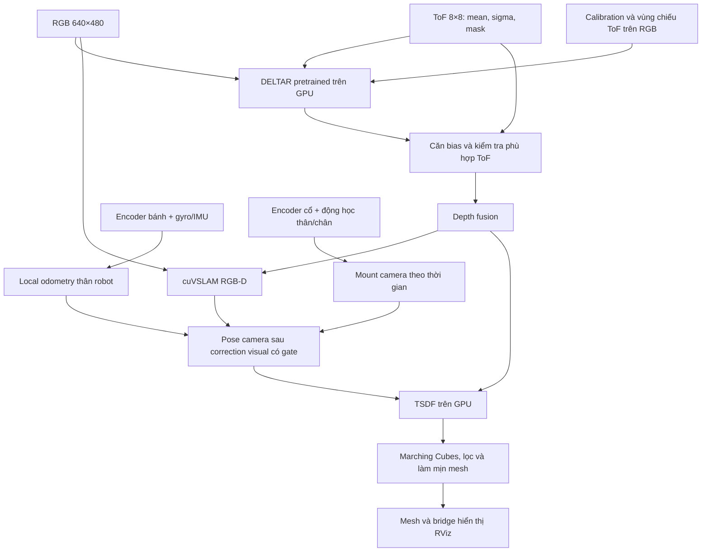

# Scan3D Fusion — Pipeline RGB–ToF SLAM của RB

Cập nhật: **12/11/2026**.

Bộ công cụ này giúp RB dùng **camera RGB và ToF 8×8** để ước lượng chuyển động,
quét môi trường và dựng bản đồ bề mặt 3D dạng “đất sét”. Hệ thống hiện chạy trong
MuJoCo trên PC có GPU NVIDIA; **điều khiển và core SLAM không dùng ROS**.
ROS/RViz chỉ phục vụ hiển thị.

Đây là prototype đang được kiểm chứng. Mesh nhìn liền mạch hoặc đẹp không tự
chứng minh độ chính xác của depth, pose hay khả năng navigation.

## Mục lục

- [1. Ba công nghệ chính làm gì?](#1-ba-công-nghệ-chính-làm-gì)
- [2. Sơ đồ toàn luồng](#2-sơ-đồ-toàn-luồng)
- [3. Các bước xử lý](#3-các-bước-xử-lý)
- [4. Chúng ta đã có VIO chưa?](#4-chúng-ta-đã-có-vio-chưa)
- [5. Dữ liệu nào được phép tạo bản đồ?](#5-dữ-liệu-nào-được-phép-tạo-bản-đồ)
- [6. Cấu hình và tuyến quét hiện tại](#6-cấu-hình-và-tuyến-quét-hiện-tại)
- [7. Cách chạy trên PC hiện tại](#7-cách-chạy-trên-pc-hiện-tại)
- [8. Dữ liệu đầu ra và cách kiểm tra](#8-dữ-liệu-đầu-ra-và-cách-kiểm-tra)
- [9. Kết quả mới nhất và các giới hạn](#9-kết-quả-mới-nhất-và-các-giới-hạn)
- [10. Bố cục mã nguồn](#10-bố-cục-mã-nguồn)
- [11. Kiểm tra và tài liệu chi tiết](#11-kiểm-tra-và-tài-liệu-chi-tiết)

## 1. Ba công nghệ chính làm gì?

Có ba câu hỏi phải giải quyết để dựng bản đồ:

| Câu hỏi | Khối trả lời | Đầu ra |
|---|---|---|
| Bề mặt trong ảnh cách camera bao xa? | **DELTAR + bộ kiểm tra ToF** | Ảnh depth dày, căn theo ảnh RGB |
| Camera đang ở đâu và nhìn hướng nào? | **cuVSLAM + wheel/IMU odometry + động học robot** | Pose camera theo thời gian |
| Ghép các góc nhìn thành bề mặt như thế nào? | **TSDF + Marching Cubes** | Mesh 3D |

### DELTAR: suy ra khoảng cách theo pixel

DELTAR nhận ảnh RGB, thống kê khoảng cách của 64 vùng ToF và thông tin vị trí
các vùng đó trên ảnh. Checkpoint pretrained NYU chạy trên GPU để dự đoán depth
dày; luồng hiện tại đưa kết quả về kích thước 640×480.

ToF chỉ có 64 vùng đo. Vì vậy, **640×480 pixel depth không phải 640×480 phép đo
ToF độc lập**: phần chi tiết được mạng suy luận từ RGB và ràng buộc ToF.
DELTAR không tự tìm vị trí camera và không tự ghép cả căn phòng.

### cuVSLAM: ước lượng chuyển động và vị trí

cuVSLAM hiện chạy ở **chế độ RGB-D**, nhận chuỗi ảnh RGB và depth fusion.
Nó theo dõi đặc trưng qua các frame để ước lượng pose camera và duy trì map
SLAM nội bộ. Adapter dùng release `17.0.1+cu12` trong môi trường riêng.

Có tích hợp chức năng SLAM/loop closure của thư viện không đồng nghĩa đã kiểm
chứng đóng vòng chính xác trên phòng hiện tại. Map database cuVSLAM cũng không
phải mesh “đất sét” được hiển thị.

### TSDF: tích lũy hình học thành bề mặt

TSDF chia không gian thành các ô thể tích gọi là **voxel**. Mỗi frame depth được
đưa vào thể tích theo pose camera; nhiều quan sát đóng góp vào cùng bề mặt.
Marching Cubes trích bề mặt thành các tam giác để xuất mesh.

Ví dụ: DELTAR cung cấp hình học ghế sofa nhìn từ từng góc, khối định vị xác định
chỗ đặt từng góc nhìn, TSDF ghép chúng thành bề mặt chung. Cả depth lẫn pose đều
phải đủ tốt để ghế không bị phồng, lệch hoặc có hai lớp.

## 2. Sơ đồ toàn luồng



Luồng trên là cập nhật live. **Finalize sau quét** bổ sung bước surface matching
để chỉnh pose rồi dựng lại TSDF; chi tiết ở bước 7 bên dưới.

## 3. Các bước xử lý

### Bước 1 — Thu nhận và đồng bộ

MuJoCo mô phỏng vật lý robot, render RGB và tạo số đo ToF theo từng vùng.
Encoder bánh, gyro/IMU và góc cổ được ghi cùng timestamp mô phỏng.

Worker ghép snapshot ảnh với packet odometry có sai lệch tối đa **20 ms**.
Chỉ dùng packet odometry hợp lệ khi robot đã cân bằng. Snapshot pose thật của
simulator phục vụ renderer cảm biến, không được dùng làm pose ghép map live.

### Bước 2 — Hiệu chuẩn quan hệ camera–ToF

Calibration xác định phép biến đổi giữa hệ trục camera và ToF, từ đó biết mỗi
vùng ToF tương ứng khu vực nào trên ảnh RGB. Cấu hình hiện tại nằm trong
[`config/sim_calibration.json`](config/sim_calibration.json).

Đây là calibration trong mô phỏng. Khi chuyển sang phần cứng, phải đo lại
intrinsic camera, extrinsic RGB–ToF, mount và đồng bộ cảm biến.

### Bước 3 — Tạo và kiểm tra depth fusion

DELTAR dự đoán depth từ RGB và ToF. Bộ xử lý dùng chung trong
[`reconstruction/depth_support.py`](reconstruction/depth_support.py) sau đó:

- Căn bias cục bộ theo số đo ToF.
- Chiếu depth về đúng vùng ToF để kiểm tra tính phù hợp, bỏ giá trị mâu thuẫn.
- Kiểm tra thêm phân bố depth liên tục ở vùng nhìn xiên để tránh bỏ quá nhiều
  pixel hợp lệ chỉ vì một ô ToF chứa nhiều khoảng cách.
- Giữ depth không hợp lệ ở trạng thái rỗng; không dựng mặt phẳng để thay thế.

Đầu ra là RGB và depth cùng hệ pixel. Buffer/keyframe lưu depth `uint16` theo
**milimét**; khi tích phân TSDF, depth được đổi sang **mét**.

### Bước 4 — Ước lượng pose visual bằng cuVSLAM

cuVSLAM xử lý RGB-D và xuất pose camera. Tracker nhận các frame fusion được
xử lý; hệ thống chỉ lưu một phần thành **keyframe**, tức những góc nhìn đại diện
để tích lũy map. Sau 3 frame khởi tạo, điều kiện giữ keyframe là chuyển động
camera ít nhất 5 cm hoặc xoay khoảng 4,6° so với keyframe trước.

Mất tracking thực sự sẽ dừng ghép và báo lỗi, không tự dùng pose thật MuJoCo
để đi tiếp. Khoảng trễ timestamp đơn lẻ không tự được xem là mất tracking.

### Bước 5 — Kết hợp odometry và động học camera

Encoder hai bánh và gyro tạo local odometry x/y/yaw với covariance, có kiểm tra
bất đồng/nghi trượt. IMU cung cấp thông tin nghiêng thân. Camera gắn trên đầu
quay nên cần mount thay đổi theo thời gian để quy đổi pose camera và thân.

`BodyLocalization` dùng pose visual để hiệu chỉnh hệ map so với odometry.
Correction qua gate để chặn bước nhảy lớn; đây là fusion **bên ngoài cuVSLAM**,
không đưa wheel/IMU factors vào bộ tối ưu nội bộ của thư viện.

**Giả thiết hiện tại:** live dùng `level_floor=True`. Cao độ dựa vào bán kính bánh
và động học trên nền ngang; roll/pitch theo IMU. Correction visual chỉ giữ X/Y/yaw
sau căn hệ ban đầu, không sửa Z/roll/pitch. Đây là ràng buộc pose, không phải ép
mesh sàn phẳng, nhưng chưa phù hợp định vị 6-DoF tổng quát trên dốc/bậc.

Nếu visual correction bị gate từ chối, pose map tiếp tục dựa trên odometry và
correction đã nhận trước đó. Tuy nhiên worker live hiện vẫn dừng khi cuVSLAM
báo mất tracking; không có chế độ tự tiếp tục quét qua mất tracking.

### Bước 6 — Cập nhật TSDF và mesh live

Mỗi keyframe cung cấp depth fusion và pose camera cho TSDF. Khi đủ bằng chứng
bề mặt, hệ thống trích mesh, lọc thành phần nhỏ và làm mịn Gaussian/Taubin.

- Live/finalize: voxel tối thiểu **4 cm**, tự tăng khi thể tích lớn; `min_views=3`.
- Mesh live được xem xét dựng lại mỗi ít nhất **5 giây** khi có keyframe mới;
  thời gian xử lý thực tế có thể dài hơn.
- Mỗi ô Marching Cubes phải đủ hỗ trợ ở cả 8 đỉnh. Vùng thiếu dữ liệu vẫn mở.
- Có phục hồi zero crossing TSDF thô gần ngang bị Gaussian xóa khi đủ quan sát;
  bước này không ép cao độ hoặc tạo depth mới.

Mesh được xuất qua bridge sang RViz. ROS không tham gia suy luận, tracking hay
TSDF. Các bộ lọc có thể dịch/làm mất chi tiết bề mặt; mesh không phải raw cloud.

### Bước 7 — Finalize sau quét

Luồng headless gọi finalize sau khi hoàn tất tuyến. Có thể gọi thủ công cho
phiên đã dừng, có `live_sequence.json` và đầy đủ keyframe:

```bash
env -u PYTHONPATH /home/dvt/.venvs/deltar/bin/python \
  technology/scan3d_fusion/live/workers.py finalize datasets/raw/PHIEN_CAN_XU_LY
```

Lệnh ghi lại các file kết quả cuối trong thư mục phiên; sao lưu chúng trước nếu
cần giữ bản cũ. Không finalize khi phiên còn đang ghi dữ liệu.

Finalize dùng **surface matching point-to-plane** trên các mặt gần đứng để
chỉnh X/Y/yaw theo từng frame. Correction có giới hạn; mặt tường đơn thiếu
ràng buộc thì không được dùng để sửa tùy ý. Bước này giữ nguyên cao độ/roll/pitch.

Sau đó TSDF được dựng lại theo pose đã chỉnh, xuất `final_mesh.stl` và
`final_mesh.ply`. Đây là tinh chỉnh tuần tự sau quét, **chưa phải pose graph toàn
cục, matching 6-DoF realtime hay tối ưu depth đa khung**.

## 4. Chúng ta đã có VIO chưa?

**Chưa có VIO tích hợp trong tracker.** cuVSLAM đang nhận RGB-D, không nhận chuỗi
mẫu gia tốc/gyro để cùng ước lượng trạng thái inertial bên trong tracker.

Hiện có hai nhánh: wheel/IMU odometry và pose visual, kết hợp ở bên ngoài.
Không nên gọi nhánh này là bộ VIO đầy đủ chỉ vì nó dùng cả camera và IMU.
Camera ở đầu quay còn IMU ở thân; khi cổ quay, extrinsic camera–IMU thay đổi.
Không thể coi chúng là một rig gắn cứng khi triển khai VIO thông thường.

## 5. Dữ liệu nào được phép tạo bản đồ?

| Nguồn | Được dùng vào việc gì trong luồng chính? |
|---|---|
| RGB + ToF và calibration | Tạo depth fusion, cung cấp hình học quan sát |
| Encoder, gyro/IMU, động học robot | Ước lượng pose và mount camera |
| Scene/pose thật MuJoCo | Render cảm biến; scene còn phục vụ lập tuyến thử và kiểm tra va chạm |
| Depth/pose chuẩn của simulator | Đánh giá ngoại tuyến; không cấp vào map live/fusion đang kiểm chứng |
| Mesh CAD tường/sàn/đồ vật | Không được chép vào map để vá phần thiếu |
| Mặt phẳng suy diễn hoặc floor completion | Không nằm trong pipeline chính |

Keyframe mới phải có `depth_source=deltar_tof_fusion`. Worker từ chối dữ liệu
thiếu nguồn hoặc mang dấu `floor_plane` hữu hạn của bước ép sàn cũ. H5 của
inference live dùng depth toàn zero làm placeholder cho loader DELTAR.

Một số ví dụ capture/handheld **cũ** dùng pose mô phỏng đã biết để kiểm tra riêng
reconstruction. Chúng không chứng minh SLAM tự định vị được; phải xem provenance
và `pose_source` của từng phiên. ToF-SLAM tham khảo không phải implementation
đầy đủ đang chạy ở đây: hiện tại dùng TSDF, chưa có tối ưu neural scene/pose
đa khung như hệ đó.

## 6. Cấu hình và tuyến quét hiện tại

| Hạng mục | Cấu hình |
|---|---|
| RGB | 640×480, camera ở đầu RB |
| ToF | 8×8 vùng, FoV cấu hình 45°, 15 Hz, tầm 0,02–4 m |
| Mount ToF | Bên trái camera, lệch ngang khoảng 2 cm, yaw −4°; tọa độ trong `config/tof.yaml` |
| Nhiễu ToF | `noise.sigma_fraction_of_bound: 0.0` — không thêm nhiễu ngẫu nhiên trong bài thử hiện tại |
| Calibration | Extrinsic mô phỏng trong `config/sim_calibration.json` |
| GPU phát triển | NVIDIA RTX 3060 |
| Profile phòng khách | Thời gian mô phỏng ×5, scene phòng khách độc lập |
| Tuyến cố định | 184 waypoint, 66 điểm lia, dài khoảng 96,3 m |
| Đồng bộ lia/fusion | `scan_step_deg: 8`, chờ góc frame đã xử lý trước khi đầu đi tiếp |
| Keyframe | Tối đa 4096/phiên |

Không thêm nhiễu ToF **không có nghĩa depth không sai**. Một vùng 8×8 vẫn chứa
nhiều khoảng cách khi nhìn xiên hoặc cắt qua sàn/tường; DELTAR vẫn có bias và
lỗi suy luận. Mô hình ToF hiện là thống kê vùng mean/std gần đúng, chưa mô phỏng
đầy đủ SPAD, photon histogram, vật liệu, ánh sáng mặt trời, multipath hoặc xtalk.

Tuyến thử đi chu vi và các dải trong phòng; robot dừng, lia đầu quét đủ vòng,
về hướng trước rồi đi tiếp. Bộ lập tuyến dùng scene đã biết để tránh vật cản.
Đây là **tuyến cố định**, chưa phải exploration/navigation từ bản đồ SLAM.

×5 tăng thời gian vật lý/controller/timestamp mô phỏng. GPU vẫn chạy theo năng
lực thật; buffer lấy frame mới nhất có thể bỏ frame. Không cam kết xử lý đủ
15 FPS hoặc hoàn tất toàn bộ tính toán nhanh gấp 5 lần.

## 7. Cách chạy trên PC hiện tại

Mọi lệnh bên dưới chạy từ **thư mục gốc repo**. Chỉ mở một phiên live/headless
cùng lúc; script dùng khóa để tránh hai phiên điều khiển trùng nhau.

### Môi trường

Các launcher đang dùng môi trường đã cài trên máy:

| Môi trường | Công việc |
|---|---|
| `/home/dvt/.venvs/deltar` | Python 3.8, DELTAR/PyTorch CUDA, render cảm biến và TSDF |
| `/home/dvt/.venvs/cuvslam` | Python 3.12, cuVSLAM 17.0.1+cu12; gọi qua `mapping/cuvslam/run_python.sh` |
| `/home/dvt/micromamba/envs/wheel-leg-ros` | Dashboard/launcher và ROS/RViz hiển thị |

Dependencies nằm trong [`environment/requirements-gpu.txt`](environment/requirements-gpu.txt)
và [`environment/requirements-cuvslam.txt`](environment/requirements-cuvslam.txt).
Checkpoint DELTAR đang dùng là `model/deltar/weights/nyu.pt`. File lớn được giữ
trên máy và loại khỏi Git; clone repo không tự bảo đảm có checkpoint hoặc dataset.

Muốn dựng lại môi trường, xem [hướng dẫn model](model/deltar/README.md),
[hướng dẫn cuVSLAM](mapping/cuvslam/README.md) và [README gốc repo](../../README.md)
cho build simulator. Các đường dẫn launcher hiện phụ thuộc máy phát triển.

### Mở phòng khách và quét live

```bash
technology/scan3d_fusion/live/run_living_room.sh
```

1. Chờ dashboard, MuJoCo và RViz khởi động.
2. Bấm **Đứng dậy (từ nằm)**, chờ cân bằng và hoàn tất chuyển chiều cao.
3. Chờ inference/tracking sẵn sàng, có ít nhất 3 keyframe hợp lệ.
4. Dùng **Quét map tự động** để đi theo tuyến hoặc điều khiển tay khi sẵn sàng.
5. Theo dõi trạng thái; Stop SIM giữ dữ liệu phiên. Mất tracking thì dừng,
   kiểm tra log và tạo phiên mới, không tự nối hai hệ tọa độ khác gốc.

Xem [live/README.md](live/README.md) cho thao tác điều khiển và xử lý phiên.
Mở nhà đầy đủ thay cho phòng khách: `./run_vision.sh`.

### Quét headless

```bash
/home/dvt/micromamba/envs/wheel-leg-ros/bin/python \
  technology/scan3d_fusion/live/headless.py
```

Lệnh chạy phòng khách ×5, tự đứng dậy, hạ về chiều cao giữa, đi theo tuyến rồi
finalize. Không mở cửa sổ; GPU vẫn render cảm biến qua EGL. Trong lượt này mesh
chỉ dựng sau quét để giảm tải tracking. Theo dõi đường dẫn được in ở dòng
`SESSION`; chỉ coi là thành công khi `headless_result.json` báo thành công.

### Mở kết quả hiện tại trong RViz

```bash
technology/scan3d_fusion/viewer/run_clay_rviz.sh \
  datasets/processed/scan3d_fusion/room-floor-preserved-20261112/final_mesh.stl
```

Đây là mở mesh đã lưu, không khởi chạy lượt SLAM mới.

### Phát lại dữ liệu đã ghi

```bash
env -u PYTHONPATH MUJOCO_GL=egl OMP_NUM_THREADS=2 MKL_NUM_THREADS=2 \
  /home/dvt/.venvs/deltar/bin/python evaluation/replay_fusion_only.py \
  datasets/raw/PHIEN_NGUON datasets/processed/scan3d_fusion/PHIEN_MOI
```

Thư mục đầu ra phải chưa tồn tại. Script giữ pose **ước lượng** đã lưu để đánh
giá lại fusion/mesh, không chạy lại cuVSLAM từ đầu. Nếu nguồn đã có `inputs/`
và `prediction/`, nó dùng lại dữ liệu đó để so bộ lọc; nếu nguồn là log simulator,
nó render lại RGB/ToF và chạy DELTAR. Một số output liên kết về nguồn bằng symlink.

Muốn chạy lại riêng tracking RGB-D và xuất trajectory cho TSDF, xem
[`mapping/cuvslam/README.md`](mapping/cuvslam/README.md); không nhầm việc này
với replay giữ nguyên pose.

## 8. Dữ liệu đầu ra và cách kiểm tra

Phiên mới nằm ở `datasets/raw/tof-YYYYMMDD-HHMMSS-.../`:

| File/thư mục | Ý nghĩa |
|---|---|
| `sensors.log`, `odometry.jsonl` | Số đo và odometry bánh/IMU |
| `live_capture.jsonl` | Snapshot cảm biến để ghép đúng timestamp |
| `rgbd.npz` | Buffer RGB/depth fusion mới nhất |
| `keyframes/` | Depth keyframe, nguồn depth và thống kê ToF |
| `live_sequence.json` | Pose camera ước lượng dùng cho map live |
| `cloud.npz` | Cloud hiển thị gom voxel 3 cm và trajectory; không thay depth đầy đủ của TSDF |
| `mesh-*.stl`, `mesh.json` | Các revision mesh live và chỉ dẫn file hiện hành |
| `cuvslam_map/` | Database SLAM, lưu khi tracker đóng theo luồng xử lý |
| `route_state.json` | Trạng thái hiện tại của tuyến, không phải lịch sử đầy đủ |
| `infer.log`, `slam.log`, `mesh.log`, `*_status.json` | Log và trạng thái từng worker |
| `surface_sequence.json`, `surface_matching.json` | Pose và thống kê matching sau finalize |
| `final_mesh.stl`, `final_mesh.ply`, `final_mesh.json` | Mesh cuối và metadata sau finalize |
| `headless_result.json`, `result.png` | Kết quả tuyến và ảnh preview của lượt headless |

File cuối không có nếu chưa finalize hoặc phiên thất bại trước bước đó. Runner
offline `reconstruction/reconstruct.py` còn xuất OBJ; không mặc định mọi phiên
live đều có OBJ. Giữ file nguồn nếu output dùng symlink.

Khi xem bản đồ, kiểm tra **đồng thời hình học, pose và độ phủ**, không chỉ ảnh mesh:

| Hiện tượng | Các thành phần cần kiểm tra |
|---|---|
| Sàn phẳng thật nhưng map gợn/phồng | Bias depth, ToF mixed zone, sai tilt/pose, tích phân và smoothing |
| Tường kép, đồ vật bị kéo dài | Pose lệch, đồng bộ, mount khi cổ quay, correction/tracking |
| Lỗ thủng hoặc bề mặt rời rạc | Thiếu góc nhìn, depth bị loại, min_views, zero crossing TSDF bị mất |
| Đầu chờ lâu khi lia | Fusion chưa theo kịp, feedback cũ hoặc worker bị lỗi |
| Map phẳng đẹp bất thường | Kiểm tra provenance: có ép phẳng, completion hay geometry chuẩn không |

Các triệu chứng có thể có nhiều nguyên nhân. Cần đo đối chứng trước khi kết luận
là do DELTAR, cuVSLAM hoặc TSDF.

## 9. Kết quả mới nhất và các giới hạn

Bản đối chiếu đang dùng là
`datasets/processed/scan3d_fusion/room-floor-preserved-20261112/`:

- **3.198 frame fusion**, voxel 4 cm, không ép phẳng hoặc floor completion.
- Bổ sung góc từ snapshot đã ghi; pose bổ sung truyền từ anchor map ước lượng
  bằng delta wheel/IMU và động học cổ. **Không phải lượt tracking mới độc lập
  trên toàn bộ 3.198 frame.**
- Cải thiện kiểm tra vùng xiên và khôi phục bề mặt TSDF bị Gaussian xóa khi đủ
  hỗ trợ. Không tạo thêm depth, không lấy sàn CAD để vá.
- Sàn vẫn có lồi lõm, mesh còn lỗ và vật thể chưa đầy đủ. Kiểm tra 32 frame đã
  tham gia map cho vùng bên phải: RMS cao độ do depth khoảng 2,60 cm, phần do
  pose khoảng 0,17 cm. Đây không phải test set độc lập hoặc kết quả phần cứng.

**Thí nghiệm ép phẳng đã rút khỏi hiển thị chính:**
`room-estimated-plane-preview-20261112` fit mặt phẳng từ mesh rồi dịch 25.524
vertex về đó, tối đa 5,98 cm. Sàn phẳng của bản này là do giả thiết hình học,
không chứng minh fusion chính xác. Nó không được tích hợp vào live/finalize.
Các helper `floor_support.py`, `complete_floor.py` cũ cũng không được gọi trong
pipeline chính; giữ lại để đối chiếu thí nghiệm.

Những việc chưa được chứng minh hoặc chưa có:

- Tracking/loop closure ổn định toàn tuyến live ×5 với cấu hình quét dày mới.
- VIO tích hợp, fusion chặt wheel/IMU/visual, định vị tổng quát trên dốc/bậc.
- Tối ưu neural scene/pose và local/global BA như hệ ToF-SLAM tham khảo.
- Depth chính xác tại mọi pixel, mesh kín toàn bộ bề mặt hoặc sạch vật cản ảo.
- Calibration và độ tin cậy trên phần cứng thật, navigation tự động an toàn.

Báo cáo có điều kiện đo và giới hạn:
[toàn phòng](../../evaluation/room_dense_results.md),
[lỗ sát tường](../../evaluation/remaining_holes_results.md),
[lồi lõm sàn](../../evaluation/uneven_floor_diagnosis.md).
[CURRENT_STATUS.md](CURRENT_STATUS.md) giữ snapshot tổng hợp cùng ngày.

## 10. Bố cục mã nguồn

```text
technology/scan3d_fusion/
├── README.md                  Hướng dẫn pipeline hiện tại
├── CURRENT_STATUS.md          Snapshot trạng thái và kết quả
├── config/                    Camera, ToF, calibration, DELTAR config
├── environment/               Dependency cho các môi trường GPU
├── calibration/               Calibration mô phỏng và công cụ đặt ToF
├── capture/                   Capture RGB/ToF và ví dụ reconstruction
├── sensor/                    Preview cảm biến
├── model/deltar/               Mã model, checkpoint tại chỗ, license
├── inference/                 Runner DELTAR offline
├── mapping/
│   ├── odometry/              Wheel/IMU và correction từ visual
│   ├── cuvslam/               Adapter RGB-D SLAM, replay và đánh giá pose
│   ├── tof_only/              Mapper occupancy ToF-only riêng
│   ├── native/                Tích hợp native, route JSON và bridge
│   └── fixed_scan_route.py    Thực thi tuyến quét cố định
├── reconstruction/
│   ├── depth_support.py       Hiệu chỉnh/kiểm tra depth bằng ToF
│   ├── reconstruct.py         TSDF và xuất mesh dùng chung
│   ├── surface_matching.py    Matching pose sau quét
│   └── render_mesh.py         Render mesh đã xuất thành ảnh
├── live/                      Session, inference/tracking/mesh, headless
└── viewer/                    Hiển thị mesh đã lưu trong RViz
```

Scene, CAD và controller vẫn ở workspace chung. `datasets/raw/` giữ log;
`datasets/processed/` giữ kết quả; `evaluation/` giữ script và báo cáo đối chứng.

**Nhánh ToF-only** dùng occupancy mapper C++ và wheel/IMU odometry, chưa có scan
matching/loop closure riêng. Nó khác nhánh RGB–ToF/DELTAR/TSDF mô tả trong README
này; xem [mapping/tof_only/README.md](mapping/tof_only/README.md).

## 11. Kiểm tra và tài liệu chi tiết

Kiểm tra reconstruction trên môi trường hiện tại:

```bash
env -u PYTHONPATH OMP_NUM_THREADS=2 MKL_NUM_THREADS=2 \
  /home/dvt/.venvs/deltar/bin/python -m unittest discover \
  -s technology/scan3d_fusion/reconstruction -p 'test_*.py'
```

Các test gồm projection, pose rigid, kiểm tra depth, TSDF, surface matching và
fixture của helper thí nghiệm cũ. Test helper cũ pass không có nghĩa helper đó
đang được dùng. Unit test không thay cho benchmark toàn tuyến hoặc robot thật.

| Tài liệu | Nội dung |
|---|---|
| [Live](live/README.md) | Điều khiển, worker, tuyến, headless và chẩn đoán |
| [Calibration](calibration/README.md) | Phương pháp và kết quả calibration mô phỏng |
| [Odometry](mapping/odometry/README.md) | Encoder/IMU, covariance, gate và mount |
| [cuVSLAM adapter](mapping/cuvslam/README.md) | Release, cài đặt, replay, trajectory và kiểm thử pose |
| [DELTAR](model/deltar/README.md) | Bộ model/checkpoint và cách chạy |
| [DELTAR upstream](model/deltar/UPSTREAM_README.md) | Tài liệu tác giả trong snapshot tham chiếu |
| [cuVSLAM tham chiếu](../../prj_reference/cuVSLAM/README.md) | Repo tham chiếu, phân biệt với adapter của RB |

Một số hướng dẫn con còn mô tả các lượt thử trước. Dùng README này cho kiến trúc
hiện tại, đọc ngày và provenance trong báo cáo khi so sánh số liệu. Lần cập nhật
tài liệu này không khởi chạy lại benchmark hoặc thay đổi thuật toán runtime.
