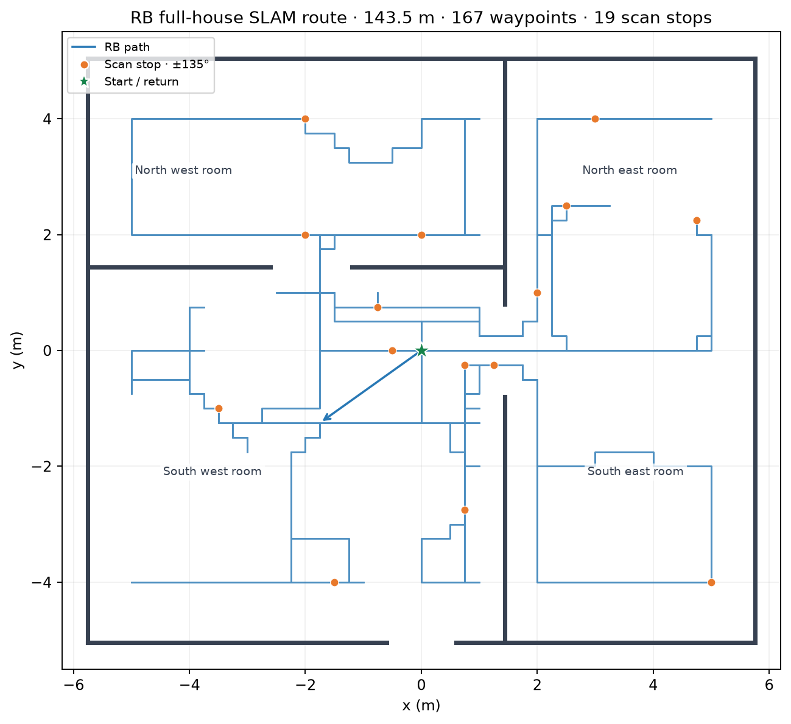

# Native ToF occupancy mapping

C++17 mapper with no ROS, MuJoCo or firmware runtime dependency. The mapper and MuJoCo sensor adapter source are collected in [tof_only](../tof_only/README.md); this folder keeps its CMake integration, RViz bridge/configuration and fixed route. The mapper receives measured radial ToF distances and sensor-derived kinematics; integrates signed wheel travel and gyro heading, then accumulates a bounded 3D voxel grid and projects it to a grayscale map. This is odometry mapping, without scan matching or loop closure.

Build independently from the workspace root:

```bash
cmake -S technology/scan3d_fusion/mapping/tof_only -B build/tof_only -DCMAKE_BUILD_TYPE=Release
cmake --build build/tof_only -j2
python technology/scan3d_fusion/mapping/tof_only/test_mapper.py build/tof_only/rb_tof_mapper
build/tof_only/rb_tof_mapper /tmp/replayed-map < datasets/raw/tof-SESSION/sensors.log
```

The normal `rb1_sim` build also builds `rb_tof_mapper` beside the simulator binary. The dashboard opens a map window automatically, records sensor-only logs under `datasets/raw/tof-TIMESTAMP/`, and updates `map.pgm`, `state.json`, and `trajectory.csv`. Calibration comes from `technology/scan3d_fusion/config/tof.yaml`; rebuild after editing it. Python + PyYAML are build-time requirements; Tk/Pillow are used only by the viewer.

The dashboard's **Quét map tự động** button follows the collision-checked full-house route in `fixed_scan_route.json`. It starts at `(0, 0)` facing `+X`, covers all four room regions, then returns to `(0, 0)` to revisit the opening area. The current path is 143.5 m with 167 waypoints and 19 selected scan stops. At each scan stop it sweeps the articulated head from `−135°` to `+135°` at up to 20°/s, returns it to `0°`, and then drives on. Translation through the route continues collecting views between scan stops. This is fixed path following from MuJoCo pose feedback, not online SLAM navigation or obstacle replanning; the SLAM workers still estimate poses from sensor data.



The route detours around the current sofa, coffee table and stairs. Full-house
segments are capped at 0.05 m/s, slowing near waypoints and when heading error
grows; the 19 scan stops advance at most 8 degrees per processed RGB-D image.
In a 12-waypoint probe, 90.0% of tracking steps were accepted and aligned ATE
was 1.75 cm over 10.7 m; the 19 cm endpoint error shows remaining drift.
Intermediate points do not send STOP; large turns use separate entry/exit
thresholds to prevent stop/go chatter. Lack of progress for 12 simulation
seconds, or a failed live inference/tracking worker, stops the route with a reason.
The live RGB-D worker saves a mapping keyframe after 5 cm translation or about
4.6° rotation, as in the successful living-room baseline. Hybrid mapping uses
wheel/IMU camera motion for this decision and rejects inconsistent visual
corrections. The 8,192-view limit remains enforced; reaching it stops the scan
with a reason. Actual saved-view count depends on processing throughput.

After moving furniture, check the route against the physical collision geometry
using a Python environment with MuJoCo installed:

```bash
python technology/scan3d_fusion/mapping/repair_scan_route.py
# Reconnect the fixed route around changed obstacles and respace scan stops:
python technology/scan3d_fusion/mapping/repair_scan_route.py --write
# Run a separate native simulation through the entire route (no GUI or SLAM workers):
python technology/scan3d_fusion/mapping/check_route_physics.py /tmp/route-check.json
```

The offline clearance check uses a cylinder of radius 0.40 m, spanning heights
0.01–0.45 m, sampled every 0.05 m along each segment. It includes room for the
robot to turn and balance; it does not guarantee collision avoidance after future
scene changes or prove sensor coverage behind every object. The physics check
also exercises stand-up, middle height, settling and head sweeps.

## RViz display bridge

SLAM and robot control remain native. For RViz visualization only, the optional ROS 2 bridge reads the mapper's saved `map.pgm`, `map.ply`, `state.json`, and the runner's read-only `VIEW` state; it publishes `/map`, `/tof/occupied_voxels`, static `/environment`, and the RB's CAD meshes on `/robot`. It registers the static MuJoCo scene to the local odometry map frame and places the robot marker from the same map pose, so the overlay does not mix world and odometry coordinates. The robot uses the same CAD assembly and joint positions as the MuJoCo viewer and updates at 30 Hz. The house footprint is 11.52 × 10.08 m; the mapper grid is 12.8 × 12.8 m. Robot visualization does not feed pose or joint data back to control or SLAM; the occupancy map continues to use encoder/gyro odometry. With the local `wheel-leg-ros` environment installed, run `technology/scan3d_fusion/mapping/native/run_tof_rviz.sh` to open RViz on the latest session.

To inspect the original house geometry without the scanned occupancy map, pass the saved session and `--house-only`. The session is used to align the house with the mapper's local frame; this profile shows the static environment and hides the map, point cloud and robot:

```bash
technology/scan3d_fusion/mapping/native/run_tof_rviz.sh datasets/raw/tof-SESSION --house-only
```

To open a second, point-cloud-only view beside the full map, run `rviz2 -d technology/scan3d_fusion/mapping/native/rviz_pointcloud.rviz` in the same ROS environment. It subscribes to the live `/tof/occupied_voxels` topic.

## Record contract

One ASCII newline-terminated record, version 1:

```
TOFMAP t supported left_m right_m gyro_yaw_rad pitch_rad roll_rad axle_body_x axle_body_z wheel_radius track range0 ... range63
MAPRESET
```

`t` is simulation/sensor time, not GUI wall time. Wheel positions are cumulative signed encoder-derived distances, compensated for pitch and leg-chain rotation. Gyro heading is integrated at the source IMU rate after quiet bias estimation. Axle coordinates come from measured joint angles and calibrated forward kinematics. They are not world coordinates. No ground-truth pose is accepted. Zero range means invalid, never maximum-range free space. Frames have exactly 64 row-major radial ranges; columns run image-left to right, rows top to bottom. The fixed optical mounting is compiled from the same vision YAML as the simulator.

On the supported planar floor, yaw increments use variance-weighted wheel/gyro fusion with slow residual gyro-rate compensation from nonslipping wheel measurements. See [odometry](../odometry/README.md) for the estimator and its limits. XY uses the midpoint heading. Pose is initialized locally at the first supported frame. During unsupported/large-tilt frames, map accumulation pauses. The GUI sensor pipe applies backpressure instead of dropping packets when the mapper is slow. Gaps over 0.5 sensor seconds still reseed counters and exclude that motion. Reset starts a fresh map; trajectory logs contain a reset marker.

## Map semantics and limits

- Fixed 12.8 × 12.8 m XY extent, 2.5 cm voxels, heights 2.5–80 cm above the support floor. Mapping pauses near the XY boundary.
- Signed occupancy evidence: +3 at measured endpoints, −1 along observed rays, bounded to [−12,24], occupied threshold 6. A frame updates a voxel at most once; endpoints take precedence over free evidence.
- Projection: occupied if any height layer is occupied; white if at least one layer was observed free and none is occupied; otherwise unknown gray. White is observed free space at sampled heights, **not full robot clearance**.
- No whole-FoV clearing. Invalid frames do not erase prior obstacles. Floor hits do not become obstacles. A ray above an obstacle cannot erase its lower voxel.
- Range uncertainty leaves a gap before an endpoint. The simulated ToF is a noisy center ray per zone, not a physical area/histogram sensor model.
- Forward kinematics assumes both wheels supported on a flat floor; pitch/roll gates pause unsuitable frames. MPU6500 heading has no absolute north reference, so map drift remains possible.
- The 2.5 cm grid is storage resolution, not guaranteed sensor accuracy. Sparse 8×8 ToF can miss thin obstacles; repeated views from different positions add surface detail. No navigation control is connected to this map.

Original implementation informed by ArduBot's radial projection and occupancy projection pipeline. No ROS source/node or virtual-FoV free-space clearing was copied into the mapper.

Ground rejection fits a near-horizontal support plane from at least 12 consistent lower-zone returns, tolerating IMU tilt bias. Objects within the plane tolerance (2.5 cm plus 1% range) can be suppressed; this preview is not a low-obstacle safety detector.
