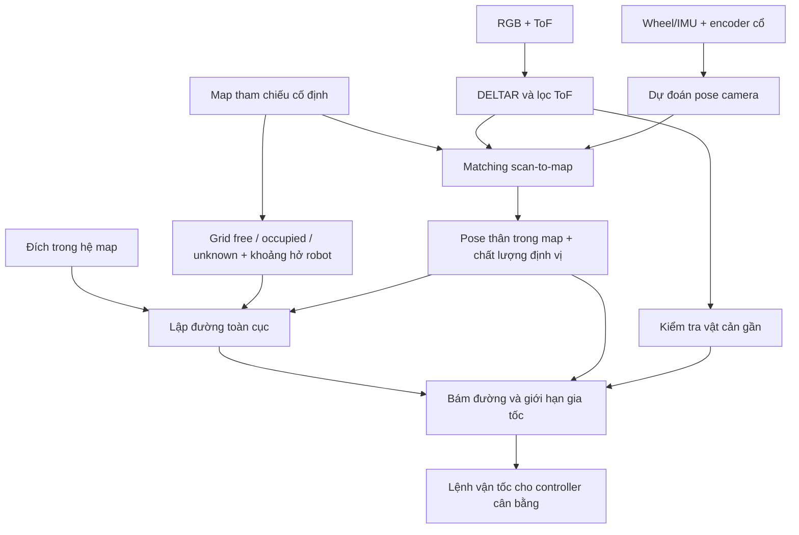

# Localization và navigation trên bản đồ đã quét

Trạng thái 14/11/2026: đã có bộ định vị trên map cố định, grid/A*, bộ bám đường
và cửa sổ **bấm chọn đích trên bản đồ 2D**. Demo động học đi tới đích; **chưa đạt
navigation end-to-end trên bản đồ quét**. Giữ core không ROS, giao diện dùng Tk.

## Chạy navigation

### Tách sàn sau fusion

Luồng live tự lưu `ground_labels` cùng depth trong `rgbd.npz` và keyframe:
`0 = uncertain`, `1 = ground`, `2 = obstacle`. `ground_plane_camera`,
`ground_confirmations`, `ground_source` ghi điều kiện phân loại. `cloud.npz`
có `labels` tương ứng với `xyz`; các lớp khác nhau trong cùng voxel vẫn được
giữ riêng. Depth và mesh đầy đủ tiếp tục giữ cả sàn.

Bộ phân loại dùng pose wheel/IMU đồng bộ và mount camera hiện tại, RANSAC gần
trọng lực, ba lần xác nhận liên tiếp, pháp tuyến và độ liên tục cục bộ. Với
giả thiết robot chạy trên sàn phẳng đã hiệu chuẩn tại odom Z=0, điểm sàn còn
phải nằm trong ±1,2 cm theo độ cao IMU. Mặt phẳng fit không được dịch gốc quá
1 cm. Điểm cao từ 2,5 cm được giữ là vật cản; vùng giữa hai ngưỡng và điểm
không đủ tin cậy giữ nhãn uncertain. Những ngưỡng này chưa hiệu chuẩn cho RB thật.

Xử lý lại bản quét cũ, dùng **thư mục đầu ra mới nằm ngoài bản nguồn**:

```bash
env -u PYTHONPATH OPENBLAS_NUM_THREADS=1 /home/dvt/micromamba/envs/wheel-leg-ros/bin/python \
  technology/scan3d_fusion/reconstruction/segment_scan.py \
  datasets/processed/scan3d_fusion/room-floor-preserved-20261112 \
  /tmp/rb-ground-scan-new
env -u PYTHONPATH OPENBLAS_NUM_THREADS=1 /home/dvt/micromamba/envs/wheel-leg-ros/bin/python \
  technology/scan3d_fusion/navigation/grid.py /tmp/rb-ground-scan-new /tmp/rb-ground-grid-new.npz
```

Replay giữ nguyên depth, ToF và pose đã lưu; xác nhận checksum toàn bộ depth.
`ground_layers.npz` chứa ba đám điểm `ground`, `obstacle`, `uncertain` trong
frame map, giảm mẫu voxel 3 cm; đây là các điểm đo đã phân loại, không phải
mesh được ép phẳng hay thể tích đã chứng minh đi được. `ground_report.json`
ghi nguồn và kết quả. Không lấy hình học hay pose ground truth của simulator.

Grid nhận nhãn tự động, tách ground khỏi lớp vật cản; uncertain trong khoảng
cao robot và điểm thấp dưới sàn chặn việc gán free. Vật cản luôn thắng. Một ô
chỉ được free khi có ít nhất hai frame hỗ trợ sàn và đủ bằng chứng tia đo tại
mọi dải độ cao 2,5–40 cm. Depth gốc vẫn dùng để kiểm tra tia, không xóa depth
của pixel sàn. Thiếu depth không được coi là khoảng trống. Các frame của một
scan phải cùng định dạng phân loại; bản cũ chưa có nhãn vẫn chạy chế độ cũ.

Đây là kiểm tra theo nhiều frame, **chưa bảo đảm các góc nhìn độc lập**. Chưa hỗ
trợ địa hình nghiêng, bậc thang hay chứng nhận va chạm. Guard live vẫn kiểm tra
depth gốc một cách bảo thủ. Xem [đối chiếu trên bản quét](../../../evaluation/ground_segmentation_results.md).

### Bản thử ép phẳng sàn và chiếu 2D

```bash
technology/scan3d_fusion/navigation/run_flat_rviz.sh
```

Mở RViz ở góc nhìn TopDownOrtho, ẩn mesh 3D, bật bản đồ 2D và costmap. Các công
cụ pose/goal/stop vẫn dùng như bên dưới. Trắng là free, tím đậm là occupied,
xanh nhạt là khoảng đệm bị chặn và xám là unknown. Tắt Global costmap để chỉ xem
map trắng/đen/xám. Bản thử dùng mặt sàn RANSAC trong preview đã tạo từ cùng scan,
không ghi đè mesh gốc. Vật thể vẫn được chiếu xuống grid; không dồn mọi vertex
3D về Z=0. Lỗ hở/thiếu dữ liệu không được tự lấp.

Artifact trên máy: `datasets/processed/scan3d_fusion/navigation-flat-2d-20261114/`
chứa `grid.npz`, `map.pgm`, `map.yaml`, `map.png`, `report.json`. Sau khoảng đệm
25 cm có 8.128 ô đi được trong một vùng liên thông; bản mesh chưa ép phẳng trước
đó có 2.655 ô đi được. Đây là giả thiết sàn phẳng: vật thấp bị gộp vào mặt sàn
có thể mất nhãn vật cản. Chỉ dùng đối chiếu/demo, chưa kiểm chứng bằng cảm biến.

Xem [ảnh và kết quả bản 2D](../../../evaluation/navigation_flat_2d_results.md).

### RViz: thả pose/goal, xem quỹ đạo và costmap

```bash
technology/scan3d_fusion/navigation/run_rviz_navigation.sh
```

Launcher mở RViz với đúng mesh phòng khách đã quét, các lớp bản đồ/đường đi và
các công cụ chuẩn. Mất khoảng 8 giây để chiếu grid từ mesh khi khởi động.

1. **2D Pose Estimate**: bấm và kéo trên sàn để đặt X/Y và hướng robot demo.
   Thao tác này hủy chuyến cũ, xóa quỹ đạo cũ; ô bị chặn hoặc unknown bị từ chối.
2. **2D Goal Pose** (tên nút trên RViz2 đang cài): bấm và kéo chọn đích/hướng
   cuối. Planner lập đường và robot mô phỏng bắt đầu bám đường ngay.
3. **Publish Point** rồi bấm bản đồ: dừng/hủy chuyến; cần chọn goal mới để chạy lại.
4. Trong **Displays**, bật/tắt **Global costmap**, **Local window**, **Global plan**
   và **Executed trajectory**. Đường dự kiến màu cam; quỹ đạo đã đi màu xanh lục lam.
5. Dùng **Move Camera** để xoay/zoom; chọn **TopDownOrtho** trong bảng **Views**
   nếu muốn thả pose/goal từ trên xuống. Pose khởi đầu mặc định `(0,7; −1,6; 0°)`.

Trên costmap, `0` là vùng có thể lập đường trong demo, `99` là khoảng đệm bị
chặn, `100` là vật cản, `−1` là chưa biết. Global costmap dùng toàn bộ grid;
local window là cửa sổ khoảng 3 × 3 m của **cùng map tĩnh**, không phải quan sát
cảm biến mới. Bộ planner/controller giữ nguyên A* và bám đường P đã có.

**Đây là navigation demo tương tác trong RViz**, dùng pose động học chính xác.
Thả pose hiện đặt lại robot demo, chưa chạy AMCL/scan matcher. Adapter không
phát `/cmd_vel`, không khởi động native controller và không dùng Nav2. ROS chỉ
nhận thao tác/hiển thị; đóng RViz dừng adapter do launcher tạo.

| Topic | Kiểu / mục đích |
|---|---|
| `/rb_navigation/initialpose` | `PoseWithCovarianceStamped`, thả pose trong frame `map` |
| `/rb_navigation/goal_pose` | `PoseStamped`, goal X/Y/yaw trong `map` |
| `/rb_navigation/stop` | `PointStamped`, bất kỳ click Publish Point đều dừng |
| `/rb_navigation/mesh` | `Marker`, mesh nguồn riêng của phiên navigation |
| `/rb_navigation/map` | `OccupancyGrid`, hỗ trợ sàn mesh |
| `/rb_navigation/global_costmap` | `OccupancyGrid`, vật cản và khoảng đệm 25 cm |
| `/rb_navigation/local_costmap` | `OccupancyGrid`, cửa sổ tĩnh quanh robot |
| `/rb_navigation/plan` | `Path`, đường A* |
| `/rb_navigation/trajectory` | `Path`, quỹ đạo demo đã đi |
| `/rb_navigation/pose`, `/tf` | Pose thân và phép biến đổi `map → base_link` |
| `/rb_navigation/status` | JSON trạng thái/lý do dừng, ghi rõ demo và map tĩnh |

Có thể đổi mesh/pose khởi đầu bằng `--mesh <file.stl> --initial-pose X Y YAW_DEG`.
Chỉ một launcher navigation được chạy cùng lúc; không tác động các phiên ROS khác.
Cấu hình dùng các [công cụ chuẩn của RViz](https://github.com/ros2/rviz/blob/rolling/rviz2/doc/index.rst#tools).
Xem [ảnh RViz và kết quả kiểm tra](../../../evaluation/rviz_navigation_results.md).

### Xem RB đi trên bản quét 3D

Dùng đúng `room-floor-preserved-20261112/final_mesh.stl`, giữ nguyên mesh và lỗ
hở; mô hình CAD RB chạy theo quỹ đạo của A* + bộ bám đường. Đây là **trình diễn
động học trên mesh**, chưa mô phỏng cân bằng/va chạm vật lý hay định vị cảm biến.

```bash
env -u PYTHONPATH MUJOCO_GL=glfw /home/dvt/micromamba/envs/wheel-leg-ros/bin/python \
  technology/scan3d_fusion/navigation/mesh_demo.py \
  --output datasets/processed/scan3d_fusion/navigation-3d-my-demo
```

Output phải là thư mục mới. Mặc định đi từ `(0,7; -1,6)` tới `(0,8; 0,8)` m;
đổi bằng `--start X Y --goal X Y`. Sau khi tạo GIF và log, cửa sổ 3D mở và phát
lượt chạy ở tốc độ 1×. Dùng chuột xoay/zoom, **Space** phát lại, đóng cửa sổ để
thoát. Thêm `--headless` và đặt `MUJOCO_GL=egl` để chỉ xuất ảnh/GIF.

Grid trình diễn chiếu từ chính mesh đã tích hợp nhiều góc nhìn: chỉ nhận mặt
sàn trong ±2,5 cm quanh Z=0, nghiêng không quá 15°, yêu cầu phủ các mẫu cách
5 mm trong ô 5 cm. Mọi tam giác cắt dải cao 2,5–40 cm đều chặn, kể cả vách đứng
và vật nhô; vùng thiếu sàn giữ unknown. Giữ khoảng đệm 25 cm. Không làm phẳng,
vá sàn hoặc đưa hình học phòng MuJoCo vào mesh.

Grid này còn 2.655 ô đi được, nhưng **không thay thế grid native từ depth**:
mesh có thể bỏ vật mảnh khi tích hợp và chưa chứng minh khoảng trống toàn thể
tích. Cờ `demo_only` được lưu cùng NPZ và giao diện từ chối dùng grid này để
khởi động native. Xem [kết quả và ảnh động 3D](../../../evaluation/navigation_mesh_3d_results.md).

### Cửa sổ bản đồ 2D

Từ thư mục gốc repo, mở demo để thử chọn đích, xem đường và di chuyển:

```bash
technology/scan3d_fusion/navigation/run_navigation.sh --example
```

Bấm vùng trắng ngà để chọn đích → xem đường màu cam → bấm **Đi tới đích**.
**Esc** hoặc **Dừng / Hủy chuyến đi** dừng và hủy. Chọn vị trí ban đầu cho phép
đặt lại điểm xuất phát. Demo dùng bản đồ minh họa và pose động học chính xác,
không điều khiển RB, không chứng minh chất lượng SLAM hoặc vật lý cân bằng.

Mở grid dựng từ bản scan phòng khách hiện tại:

```bash
technology/scan3d_fusion/navigation/run_navigation.sh
```

Grid 5 cm từ 3.198 frame có 58 ô free, 20.616 occupied, 7.018 unknown.
Sau khoảng đệm 25 cm có **0 ô đi được**. Giao diện báo không thể lập đường;
đây là kết quả kiểm tra bản scan hiện tại, không phải một tuyến đã chạy thành công.
Không coi lỗ mesh là free hoặc lấy hình học scene để mở đường.

Khi có grid phù hợp, chế độ native yêu cầu pose thân ban đầu trong hệ map:

```bash
technology/scan3d_fusion/navigation/run_navigation.sh \
  --mode native --grid /duong/dan/grid.npz --initial-pose X Y YAW_DEG
```

Thay đường dẫn và X/Y/yaw bằng giá trị đã đối chiếu. Bấm **Khởi động RB trong
MuJoCo**, đợi đứng dậy/cân bằng rồi chọn đích. Không dùng tọa độ ví dụ cho phiên
khác. `--example` chỉ cho demo; native từ chối khởi động nếu initial pose bị chặn.
Launcher dùng môi trường `wheel-leg-ros` có Tk/Pillow/NumPy/SciPy trên máy này;
native cần môi trường DELTAR và native runner sẵn có.

Native dùng wheel/IMU neo vào initial pose, **không nối scan matcher chưa đạt**
và không đọc pose thật simulator để bám đường. Giới hạn thử 2 m tổng quãng đường
hoặc 60 giây sensor-time sau khi neo; sai số 5 cm là giả thiết thử nghiệm chưa
hiệu chuẩn. Tốc độ tối đa 0,1 m/s và 0,4 rad/s. Pose quá 0,3 s, depth quá 0,5 s,
mất telemetry hoặc watchdog đều chặn chuyển động. Tuổi depth tính từ lúc capture,
không lấy thời điểm inference hoàn thành làm dữ liệu mới. Sau lỗi phải chọn đích
lại; đóng cửa sổ dừng phiên do nó tạo.

Grid cần sàn gần Z=0, bằng chứng sàn từ ít nhất hai view, ray trống ở 16 mức
cao 2,5–40 cm và hợp nhất endpoint vật cản thấp/nhô cao. Đây là kiểm tra thể tích
rời rạc trên depth ước lượng, chưa bảo đảm đầy đủ hình học liên tục. A* chặn cả
unknown, rìa bản đồ và đường cắt góc. Guard depth kiểm tra hành lang phía trước;
vùng mù sát thân/phía sau vẫn phụ thuộc map cố định, nên chỉ dành cho thử nghiệm
phòng tĩnh. Gặp vật cản thì dừng; chưa tự replan theo vật cản động.

Tạo grid mới (output phải chưa tồn tại và nằm ngoài input):

```bash
env -u PYTHONPATH /home/dvt/micromamba/envs/wheel-leg-ros/bin/python \
  technology/scan3d_fusion/navigation/grid.py \
  datasets/processed/scan3d_fusion/room-floor-preserved-20261112 \
  datasets/processed/scan3d_fusion/navigation-grid-new.npz
```

Xem [kiểm thử, ảnh giao diện và giới hạn](../../../evaluation/navigation_results.md).

## Định vị đã triển khai

**Kết quả kiểm chứng hiện chưa đạt:** XY RMSE 27,2/54,2 cm trên hai đoạn thử,
tệ hơn wheel/IMU. Chưa dùng đầu ra này để điều khiển tự hành. `usable` chỉ phản
ánh gate matching, không chứng nhận độ chính xác. Chi tiết ở báo cáo bên dưới.

`fixed_map.py` dựng reference voxel 4 cm từ depth fusion/pháp tuyến và pose đã lưu
(ưu tiên `surface_sequence.json`, nếu thiếu dùng `live_sequence.json`). Reference
không nhận thêm điểm trong lúc định vị. Bộ ước lượng chỉ nhận odometry, mount
camera theo thời gian, intrinsics và depth mm; không nhận pose mô phỏng.

`run_localization.py` có hai cách chạy, đều yêu cầu **pose thân ban đầu trong hệ
map**: X/Y bằng mét, yaw CLI bằng độ. Python API dùng radian. Cao độ và roll/pitch
lấy từ wheel/IMU với giả thiết nền ngang. Chưa tự tìm vị trí toàn cục.

Replay kiểm tra đã chuẩn bị trên máy này:

```bash
env -u PYTHONPATH /home/dvt/.venvs/cuvslam/bin/python \
  technology/scan3d_fusion/navigation/run_localization.py \
  --map datasets/processed/scan3d_fusion/room-floor-preserved-20261112 \
  --replay datasets/processed/scan3d_fusion/localization-heldout-20261114 \
  --initial-pose 0.15 0 0 \
  --output datasets/processed/scan3d_fusion/localization-my-replay
```

Pose ví dụ `(0.15, 0, 0°)` được chọn gần vị trí bắt đầu đoạn replay này; không
áp dụng tự động cho phiên khác. Thư mục output phải mới, nằm ngoài map và input.

Để quan sát một phiên đang chạy, thay `--replay ...` bằng `--live <thư-mục-phiên>`.
Phiên đó phải đang có worker inference ghi `rgbd.npz` đồng bộ. Chạy localizer ở
terminal riêng; nó không thay controller/GUI hay dùng pose của worker SLAM.
Ctrl+C hoặc file `STOP` của phiên sẽ dừng observer, không ra lệnh cho robot.

Đầu ra:

- `poses.jsonl`: mỗi frame có pose thân/camera, correction, overlap, residual,
  ràng buộc hình học, lý do chấp nhận/từ chối và thời gian xử lý.
- `status.json`: trạng thái mới nhất cùng `usable`, timestamp và thời hạn wall-clock.
- `run.json`: map/input/pose khởi tạo và giới hạn của lượt chạy.
- `summary.json`: tỷ lệ frame dùng được, lý do từ chối, p50/p95 độ trễ matching.

Bộ khớp dùng tối đa 16 view trong 3 giây, lưu trong hệ odom chưa correction;
pose chung phải vượt gate ở từng view. Cần hai giả thuyết liên tiếp nhất quán
(trong 5 cm/0,04 rad) để commit correction và xác nhận `tracking`. Frame bị từ chối làm trạng
thái chuyển `degraded` và `usable=false`; quá 1 giây sensor-time không khớp
được thì `lost`. Khoảng cách frame trên 0,5 giây cũng yêu cầu xác nhận lại.
Live mất cập nhật quá 2 giây wall-clock báo `lost`; kết thúc báo `stopped`.
Consumer phải kiểm tra **cả `usable` và `valid_until_wall_time`**, vì tiến trình
bị kill không thể tự sửa file trạng thái cũ. Giá trị pose ở trạng thái mất định
vị chỉ phục vụ chẩn đoán; không được dùng để phát lệnh điều khiển.

Gate ban đầu: ≥100 correspondence, overlap ≥35%, point-to-plane RMSE ≤4 cm,
eigenvalue nhỏ nhất của ma trận hình học XY/yaw ≥0,005; correction tối đa 20 cm
và 0,12 rad mỗi frame. Đây là ngưỡng prototype, không phải covariance đã hiệu
chuẩn. Một bức tường riêng lẻ không đủ ràng buộc toàn bộ pose. FoV hẹp và depth
suy luận có thể làm mất định vị khi lia đầu hoặc nhìn vào vùng ít cấu trúc.

Xem [kết quả và lệnh kiểm chứng](../../../evaluation/fixed_map_localization_results.md).

## Bản đồ tham chiếu cố định

Dùng `datasets/processed/scan3d_fusion/room-floor-preserved-20261112/`:

- `final_mesh.stl`: bề mặt để hiển thị và đối chiếu.
- `live_sequence.json`: 3.198 pose camera ước lượng, đã có chỉnh surface matching.
- `keyframes/`: depth fusion và thống kê ToF; có symlink về dữ liệu nguồn.
- `inputs/`, `prediction/`, `source.json`: nguồn cảm biến/prediction và provenance.

Thư mục này **không có `cuvslam_map/` tương ứng**. Không lấy database bất kỳ từ
phiên khác rồi giả định pose nằm đúng hệ tọa độ mesh cuối. Các pose từng được
chỉnh sau quét; nếu dùng database cuVSLAM phải kiểm chứng phép nối hai hệ và
sai số còn lại, không chỉ đổi tên frame thành `map`.

Không sửa bản đồ tham chiếu trong khi localization; lưu kết quả thử nghiệm ở
phiên riêng. Tuyến quét cũ dùng `backend.view` (pose mô phỏng) và planner cũ dùng
va chạm scene. Chúng là công cụ thu thập dữ liệu, **không phải navigation bằng
pose ước lượng trên map đã quét**.

## Pipeline đích



## Mốc 1 — Localization trên map cố định

Phiên bản đầu có pose ban đầu gần đúng do người vận hành cung cấp trong hệ map;
**chưa đặt mục tiêu tự nhận vị trí từ mọi điểm bất kỳ**. Không dùng pose thật
simulator để tự cấp initial pose.

1. Dựng reference point cloud/pháp tuyến từ keyframe fusion và pose đã lưu.
2. Wheel/IMU dự đoán chuyển động; động học cổ/thân đổi camera pose sang body pose.
3. Matching scan hiện tại với reference cố định để hiệu chỉnh X/Y/yaw.
   Tái sử dụng các phép chiếu/pháp tuyến trong
   `reconstruction/surface_matching.py`, nhưng không gọi nguyên `refine_sequence`
   để biến bài toán thành dựng thêm map tuần tự.
4. Chấp nhận correction khi đủ overlap, residual tốt, đủ ràng buộc hình học và
   không nhảy quá lớn; lưu số liệu từng lần, không chỉ cờ thành công.
5. Báo `initializing`, `tracking`, `degraded`, `lost`; pose stale/lost không được
   dùng tiếp để phát lệnh navigation. Khôi phục có thể cần dừng và lia đầu.

Point-to-plane trên mặt gần đứng hiện có bỏ điểm thấp dưới 15 cm để matching.
**Không tái sử dụng mask đó cho vật cản navigation**: bóng/vật thấp vẫn phải
được xét va chạm. Giả thiết nền ngang của odometry vẫn phải được công khai.

Kiểm tra trước khi nối điều khiển: replay một phiên chuyển động mới với pose
khởi đầu cung cấp rõ; đo sai số thân theo thời gian, drift, thời gian mất định vị,
tỷ lệ correction bị loại và ảnh hưởng khi chỉ quay đầu. Dùng ground truth chỉ
ở evaluator, không ở estimator. Replay các frame đã tạo map chỉ là smoke test,
không đủ xác nhận khả năng localization trong phiên mới.

## Mốc 2 — Chuẩn bị map cho robot chạy trên sàn

Giữ mesh 3D để xem, tạo thêm grid 2D/2.5D để lập đường:

- Phân biệt `free`, `occupied`, `unknown` bằng bằng chứng quan sát/ray từ depth
  và pose đã lưu; không coi chỗ mesh thủng là đường trống.
- Xét vật cản theo thể tích robot quét qua, gồm vật thấp và vật nhô ở cao độ thân.
- Phân biệt nền có thể đi được với vật cản; không coi mọi điểm mesh là occupied.
- Nới vùng cấm theo footprint RB và khoảng dự phòng cho cân bằng/sai số pose.
- Chưa đủ bằng chứng ở đâu thì chặn lập đường ở đó trong phiên bản đầu.

Planner không đọc CAD/scene collision để biết đường trống. Mô phỏng va chạm chỉ
dùng để chấm kết quả sau đó. Cần kiểm tra các hành lang có đủ bằng chứng cho
đường đi trước khi kết luận bản scan hiện tại đủ dùng cho navigation.

## Mốc 3 — Đi tới đích

1. Nhận đích X/Y/yaw trong đúng hệ map.
2. A* trên grid đã nới vật cản; kiểm tra cả đoạn nối/làm gọn đường, không cắt góc.
3. Controller bám đường dùng pose localization, xuất vận tốc tiến và quay;
   giữ controller cân bằng hiện tại, giới hạn thay đổi vận tốc để tránh dừng giật.
4. Cảm biến hiện tại kiểm tra vật cản gần, dừng/replan khi cần. Camera/ToF nhìn
   hẹp nên không mặc định vùng ngoài FoV là an toàn để lùi hoặc quay.
5. Đến đích hoặc mất định vị phải có trạng thái rõ; lệnh dừng vận hành có ramp,
   dừng khẩn cấp vẫn theo cơ chế controller.

## Tiêu chí hoàn thành giai đoạn đầu

- Khởi động phiên mới, cung cấp initial pose và giữ định vị trong hệ map cũ.
- Đầu quay không làm pose thân quay sai theo camera.
- Chọn đích trong vùng đã biết, lập đường tránh vật cản từ dữ liệu scan.
- RB bám đường bằng pose ước lượng, không lấy `backend.view.x/y/quaternion`.
- Pose stale/lost, đích bị chặn hoặc không có đường phải dừng có lý do.
- Đo riêng độ chính xác localization, tỷ lệ đến đích, khoảng hở/va chạm và độ trễ;
  không dùng chất lượng hiển thị mesh để thay các phép đo này.

Chưa đặt con số sai số/tỷ lệ đạt trước khi có baseline của phiên mới. Chưa dùng
cuVSLAM relocalization database hoặc ROS navigation trong thiết kế đầu này.
